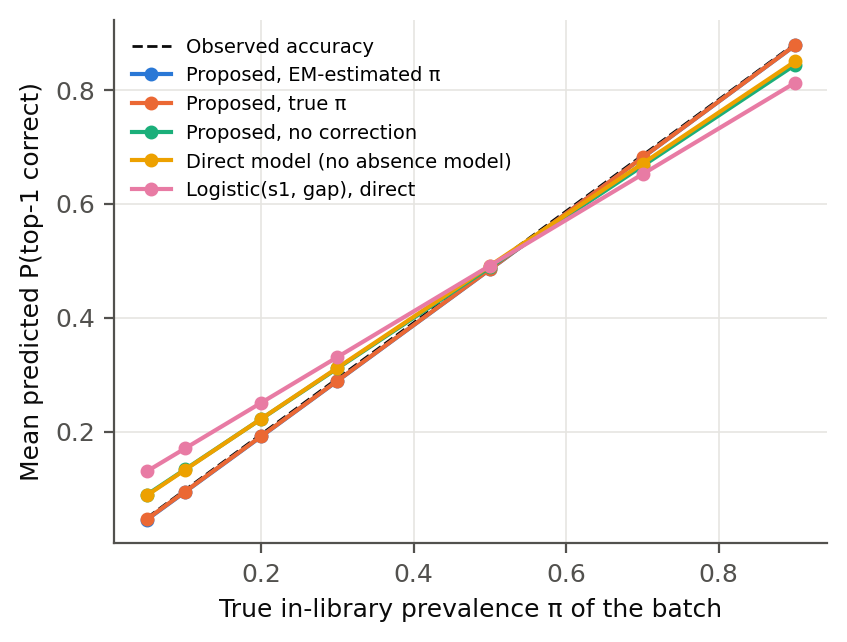
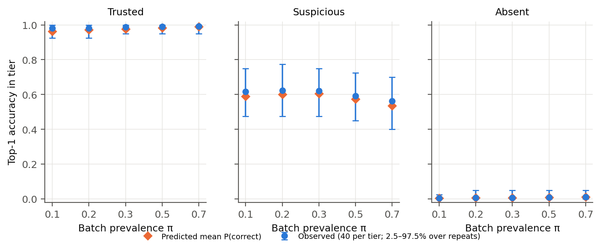

# Calibrated trust tiers for MS/MS library-search annotations

*Crowding, library absence and prevalence shift under structure-disjoint evaluation (MassSpecGym v1.5, CPU only).*

Every number in this report is produced by the code in this repository and inserted from `results/*.json` by `scripts/14_render_report.py`. The chronological record of decisions and abandoned variants is in `LOG.md`; the pre-registration for the wet-lab check is in `WETLAB_PREREG.md`.

## 1. Summary

**Task.** A query MS/MS spectrum is annotated by an engine (here, spectral-library search with entropy similarity). The system returns a calibrated probability that the engine's top-1 is correct (identity = first block of the InChIKey, i.e. 2-D skeleton) and sorts each query into one of three tiers: **trusted** (p_correct ≥ 0.9), **likely absent from library** (P(in library) ≤ 0.2), or **suspicious** (everything else).

**Method (primary system, selected on validation).** p_correct(x; π) = P(in | x; π) · P(correct | x, in). Two gradient-boosted models provide the two factors. P(in) is moved to the batch's in-library prevalence π by Bayes prior shift, and π is estimated on the unlabeled batch by EM. Features are observable only: metadata, similarity scores, analogue hits, and **query-level crowding**. Query-level crowding means near-ties among candidates, structural neighbours of the top-1 in the library and in the precursor window, and the spectral neighbourhood density of the query and of the top-1. Family-level features did not add validation value and are not in the primary system.

**Main results on the structure-disjoint test fold** (2,490 molecules; 14706 query spectra, each evaluated with its truth in the library (a) and removed (b)). π is the batch's in-library prevalence, estimated by EM unless stated.

1. **Risk–coverage (claim 1): better than every baseline.** At π = 0.2: e-AURC 0.0041 for the proposed system vs 0.0314 for logistic(s1, gap) and 0.0324 for a tuned score threshold. ΔAURC vs logistic(s1, gap), decomposed = -0.0273, 95% CI [-0.0335, -0.0204]. Coverage at ≤ 5% risk: 18.5% vs 0.5% (the oracle maximum at π = 0.2 is ≈ 20%). The two additional baselines added after the main test do not change this; see §6.9–6.10.
2. **Calibration per family and per crowding group (claim 2): holds where it can be tested.** In every top-1 ClassyFire class with enough data (20 of 212 classes at π = 0.2, covering 75.2% of queries), the predicted accuracy lies inside the 95% CI of the observed accuracy (100.0% of groups). The same holds for superclass, subclass and every crowding quartile. The logistic(s1, gap) baseline without an absence model reaches only 40.0% for classes, and 0% for every crowding grouping. The 192 small classes are not claimed.
3. **Crowding adds information beyond similarity (claim 3): yes at the query level, no at the family level.**
   - Within similarity-score strata, top-1 errors are more likely when the top-1 has structural neighbours in the library (Mantel–Haenszel OR 2.15, 95% CI [1.60, 2.88]) and when the top-2 candidate is structurally similar (OR 6.4).
   - Adding the crowding features to a rich no-crowding model improves the log loss of p_correct significantly: Δ = -0.0028, CI [-0.0052, -0.0004]. Ranking does not improve (ΔAURC CI [-0.0006, 0.0002]).
   - Added to similarity scores alone, crowding improves both ranking and log loss (§6.3).
   - The collaborator's **family-level** version of the prior is **not** supported under the strict split. The correlation between family spectral crowding (train library) and family error rate (test) is Spearman ρ = 0.19, CI [-0.20, 0.53].
4. **Shifts (claim 4): holds for prevalence; partial for instrument; fails for a new data source.**
   - **Prevalence: holds.** With EM-estimated π the proposed system stays calibrated from π = 0.05 to 0.9. The same model without the correction over-states trusted-tier accuracy at π = 0.1: 98.2% predicted vs 90.0% observed.
   - **Instrument: partial** (§6.6). A model trained on Orbitrap and tested on QTOF stays roughly calibrated (ECE 0.013). Trained on QTOF, where there is much less training data, and tested on Orbitrap, it is not: predicted accuracy 0.123 vs observed 0.196 at π = 0.2.
   - **Library measured on another instrument type** (scenario a_x, §6.1): overall calibration holds (predicted 0.190 vs observed 0.190 at π = 0.2). The trusted tier, however, is over-confident: 94.4% observed vs 98.0% predicted.
   - **New data source (MassBank 2026.03, §6.7): fails.** Even after tautomer and duplicate de-duplication (v3), the trusted tier is badly over-confident at π = 0.2: 51.8% observed vs 95.5% predicted. Most confident errors are indistinguishable isomers (100.0% share the truth's formula).
   - **On this external source a baseline ranks better than the proposed system.** The direct logistic(s1, gap) has a lower e-AURC (Δ proposed − baseline = +0.0420, CI [0.0093, 0.0569]), although its log loss is worse. This is reported as a negative result; the method was not changed.
5. **Wet-lab simulation (the final form).** At π = 0.2, in each tier (40 queries sampled per tier, 1,000 repeats), the predicted mean accuracy falls inside the observed 95% Wilson interval in 99.5% (trusted), 96.6% (suspicious) and 92.7% (absent) of repeats.

**A construction shortcut, found and removed.** A family-level library-count feature let the model detect that the truth had been deleted from the training library: per-family counts are one short in the paired absent version. This inflated training fit and destroyed out-of-sample absence detection (§6.8). It is reported as a formal result.

**Scope.** Positive-ion mode, [M+H]+ / [M+Na]+, Orbitrap and QTOF, spectral-library search. Identity is 2-D only; stereoisomers are never distinguished. "Absent from library" is **absent-from-library detection**, not discovery of new metabolites.

## 2. Setting and definitions

- **Data.** MassSpecGym v1.5 (Hugging Face `roman-bushuiev/MassSpecGym`), official MCES-based folds, unchanged.
  - 231104 spectra; 28921 molecules after RDKit standardization (Cleanup → largest fragment → uncharge).
  - 0 standardized molecules span folds.
  - Positive mode only; adducts {'[M+H]+': 195237, '[M+Na]+': 35867}.
- **Spectrum processing** (identical for queries and library, fixed in `config.yaml`): drop peaks above precursor − 1.6 Da; drop peaks < 1% of the base peak; merge peaks closer than 0.05 Da; sum-normalize; ≥ 3 peaks. This drops 11.8% of spectra everywhere.
- **Engine.** Flash entropy search.
  - Precursor tolerance 20.0 ppm, chosen on the train fold: ≥ 99% coverage of same-molecule, same-adduct pairs.
  - Candidates are aggregated to molecules (maximum score per molecule). The top-1 is the highest-scoring molecule; ties are broken deterministically without labels.
  - A second engine (greedy cosine on the same processed peaks) is used for an engine-swap check.
- **Correct.** Top-1 InChIKey first block = truth first block (fixed, §4 of the task). Supplementary "near-correct": top-1 Tanimoto to truth ≥ 0.8, fixed before testing.
- **Family.** ClassyFire class of the observable top-1 (superclass and subclass as sensitivity levels).
  - Existing ClassyFire results were looked up by InChIKey: 28666 / 28921 molecules found.
  - New classification requests for the remaining 255 failed (server error). These molecules form `unclassified` (0.9%).
- **Study population.** Queries with ≥ 1 library candidate in the precursor window. In scenario (b), 18.3% of test queries have none; they are counted but not tiered.

## 3. Evaluation design (built before any model)

- **Nested reference libraries.** Train queries search the train fold only; validation queries search train + val; test queries search all three folds. No test spectrum is ever a library entry, a candidate or a neighbour for any training query. The query spectrum itself is never in its own library (audited in `results/checks.json`).
- **Scenarios.**
  - (a) Leave-one-spectrum-out: the truth remains through its other spectra.
  - (b) All spectra of the truth removed.
  - (c) Additionally remove library molecules with Tanimoto ≥ 0.7 to the truth ("new scaffold").
  - **(a_x)** The truth is present **only** through spectra measured on the other instrument type. In MassSpecGym, (a) usually leaves same-instrument spectra of the truth at other collision energies. a_x is the closer analogue of a lab querying a public library. It is reported next to (a) in the main results.
- **Paired pool (against pool-construction leakage).** Only query spectra for which (a) is possible are used, and each is used in both (a) and (b). The query spectrum and its metadata are therefore identical across the two labels (audited). Train: ≤ 5 spectra per molecule. Everywhere: weights 1/n per molecule.
- **Prevalence** π (fraction of in-library queries among tiered queries) is a sweep variable: [0.05, 0.1, 0.2, 0.3, 0.5, 0.7, 0.9]. Metrics at a given π use importance weights on the full (a) + (b) test set. Wet-lab batches are sampled with exactly that π, one spectrum per molecule, each molecule either in or absent.
- **Wet-lab simulation.** Frozen thresholds. Each tier: 40 random queries per batch, 1000 batches. Report the observed accuracy and its Wilson 95% CI, compare with the mean predicted p_correct, and report the fraction of batches in which the prediction falls inside the CI.
- **Uncertainty.** Molecule-cluster bootstrap (1000 draws) for differences between systems.
- **Splits for fitting.** Hyperparameters were chosen on val-A. The calibrator family was chosen by val-A ↔ val-B cross-fitting and then fitted on the whole validation fold. val-A and val-B are structure clusters (Tanimoto ≥ 0.4 components). The test fold was used once for the final evaluation (`LOG.md`).

## 4. Method

**Feature groups** (`src/msconf/features.py`; every column is computable at deployment, and truth-derived columns carry the prefix `ana_` and are blocked by an assertion):

| group | content |
|---|---|
| meta | precursor m/z, adduct, instrument, collision energy, peak count, spectral entropy, # library spectra / molecules in the window |
| sim | s1, s2, s3, s1−s2, s1−s3 |
| sim_extra | matched peaks of top-1, mean score over the top-1's library spectra, # top-1 spectra in the window |
| analog | best similarity outside the precursor window, minus s1 |
| crowd_spec | # molecules with open-search similarity ≥ 0.5 / ≥ 0.7 to the query; near-ties (≥ s1 − 0.1); # candidates ≥ 0.5; spectral neighbourhood size of the top-1 in the library |
| crowd_struct | Tanimoto(top-1, top-2); mean Tanimoto to ranks 2–5; # library molecules with Tanimoto ≥ 0.7 to the top-1; the same inside the window |
| crowd_family | family entropy of the top-5; same-family counts and fractions (window, open neighbourhood); family-level spectral / structural crowding tables computed on the train library |

**Models.** LightGBM for P(correct | x, in) on scenario-(a) rows and for P(in | x) on (a) + (b) rows. Each gets a 16-configuration random search selected on val-A; every tunable baseline gets the same budget. Calibration: isotonic or Platt, chosen by cross-fit. **Label shift:** P(in | x; π) = Bayes prior shift from π_cal = 0.539. π̂ comes from EM (Saerens et al., 2002) on the unlabeled batch.

**Primary configuration** (validation rule, `results/selection.json`): lowest val-A log loss of p_correct at π = 0.5 among {full, full without window counts, full without family features, no crowding}.

| candidate | val-A log loss, π = 0.5 |
|---|---|
| **full without family features (selected)** | 0.0691 |
| full | 0.0706 |
| no crowding | 0.0780 |

Per-family calibration offsets were **not** adopted: the cross-fitted per-family gap did not drop by ≥ 10%.

**Tiers** (frozen): trusted iff p_correct ≥ 0.9; absent iff P(in) ≤ 0.2; otherwise suspicious.

**Baselines and floors** (same data, calibration rule and tuning budget):
- **Score baselines.** Raw score threshold (s1); top-1 − top-2 gap; logistic(s1, gap). Each is used both "direct" (a single calibrated P(correct), as practitioners use it) and "decomposed" (our absence model and label shift wrapped around the same inputs).
- **Floors.** Metadata-only and similarity-only.
- **Added after the main test.** MS2Query-style neighbourhood consistency and target–decoy FDR (§6.9–6.10).
- **COSMIC (SIRIUS 6 CSI:FingerID + COSMIC).** It runs on the project owner's machine under an academic licence (`cosmic/README.md`): 300 test molecules stratified by membership in the published CSI:FingerID training structures, plus 200 validation molecules for calibration. **Status: pending** — the SIRIUS run on the owner's Mac has not been imported yet; no COSMIC number appears in this report until `scripts/cosmic/ingest_cosmic.py` has produced `results/eval_cosmic_subset.json`.

## 5. Population and engine

- Test fold: 2490 molecules; (b) rows without any candidate: 18.3%; (c): 20.4%.
- Engine top-1 accuracy with the truth in the library (weighted by molecule):
  - (a): entropy 97.9%, cosine 96.9%.
  - (a_x): 95.1%, vs 98.3% for the same queries under (a).
- In-library errors are rare in (a). 59.2% of them stay in the truth's ClassyFire class, and 40.2% have Tanimoto ≥ 0.7 to the truth (near-isomer confusions).
- When the truth is absent (b), the top-1 is usually unrelated: median Tanimoto 0.13. Its score is low (median s1 0.07, vs 0.92 in (a)).

## 6. Results

### 6.1 Main table: (a) and (a_x) side by side

Test fold, EM-estimated prevalence. **(a)** is the MassSpecGym leave-one-spectrum-out condition. **(a_x)** is the expected behaviour when a lab queries a public library whose entry for the compound was measured on a different instrument type; it is evaluated on the 4312 test queries (420 molecules) for which it is possible, paired with their (b) versions. The a_x rows use exactly the same frozen models.

**π = 0.2, all systems, scenario (a):**

| System | AURC ↓ | e-AURC ↓ | Cov@risk≤5% | Cov@risk≤10% | AUROC(correct) | AUROC(in-lib) | Log loss ↓ | ECE ↓ | Mean pred / obs |
|---|---|---|---|---|---|---|---|---|---|
| **Proposed** (full − family features) | 0.489 | 0.0041 | 18.5% | 20.9% | 0.995 | 0.994 | 0.071 | 0.004 | 0.192 / 0.196 |
| Full features (decomposed) | 0.489 | 0.0041 | 18.5% | 20.9% | 0.995 | 0.994 | 0.070 | 0.004 | 0.192 / 0.196 |
| No crowding (base) | 0.489 | 0.0043 | 18.1% | 20.8% | 0.995 | 0.993 | 0.074 | 0.006 | 0.190 / 0.196 |
| Candidate-list-only (engine-agnostic) | 0.498 | 0.0131 | 5.2% | 19.5% | 0.987 | 0.986 | 0.109 | 0.007 | 0.192 / 0.196 |
| Full features, direct P(correct) | 0.489 | 0.0043 | 18.5% | 21.0% | 0.995 | 0.992 | 0.089 | 0.027 | 0.223 / 0.196 |
| Full features, logistic | 0.516 | 0.0311 | 0.0% | 1.2% | 0.977 | 0.975 | 0.141 | 0.013 | 0.193 / 0.196 |
| Logistic(s1, gap), decomposed | 0.516 | 0.0314 | 0.1% | 0.1% | 0.975 | 0.972 | 0.147 | 0.012 | 0.191 / 0.196 |
| Logistic(s1, gap) | 0.512 | 0.0272 | 0.5% | 8.0% | 0.975 | 0.973 | 0.185 | 0.055 | 0.251 / 0.196 |
| Score threshold s1 | 0.517 | 0.0324 | 0.2% | 9.0% | 0.970 | 0.969 | 0.204 | 0.062 | 0.258 / 0.196 |
| Gap s1−s2 | 0.513 | 0.0283 | 0.5% | 8.6% | 0.970 | 0.963 | 0.204 | 0.065 | 0.260 / 0.196 |
| s1, decomposed | 0.523 | 0.0377 | 0.2% | 2.8% | 0.969 | 0.969 | 0.162 | 0.011 | 0.194 / 0.196 |
| gap, decomposed | 0.519 | 0.0338 | 0.1% | 0.2% | 0.970 | 0.963 | 0.161 | 0.011 | 0.190 / 0.196 |
| Floor: similarity only | 0.509 | 0.0242 | 1.1% | 10.6% | 0.977 | 0.975 | 0.145 | 0.008 | 0.190 / 0.196 |
| Floor: metadata only | 0.758 | 0.2727 | 0.0% | 0.1% | 0.578 | 0.581 | 0.547 | 0.111 | 0.085 / 0.196 |

**π = 0.5, all systems, scenario (a):**

| System | AURC ↓ | e-AURC ↓ | Cov@risk≤5% | Cov@risk≤10% | AUROC(correct) | AUROC(in-lib) | Log loss ↓ | ECE ↓ | Mean pred / obs |
|---|---|---|---|---|---|---|---|---|---|
| **Proposed** (full − family features) | 0.164 | 0.0028 | 50.6% | 54.2% | 0.995 | 0.994 | 0.087 | 0.005 | 0.485 / 0.490 |
| Full features (decomposed) | 0.164 | 0.0028 | 50.6% | 54.2% | 0.995 | 0.994 | 0.085 | 0.004 | 0.486 / 0.490 |
| No crowding (base) | 0.164 | 0.0030 | 50.4% | 54.2% | 0.995 | 0.993 | 0.092 | 0.007 | 0.483 / 0.490 |
| Candidate-list-only (engine-agnostic) | 0.170 | 0.0088 | 49.4% | 53.5% | 0.987 | 0.986 | 0.131 | 0.007 | 0.487 / 0.490 |
| Full features, direct P(correct) | 0.164 | 0.0029 | 50.8% | 54.2% | 0.995 | 0.992 | 0.085 | 0.003 | 0.491 / 0.490 |
| Full features, logistic | 0.182 | 0.0215 | 47.6% | 53.4% | 0.976 | 0.975 | 0.166 | 0.012 | 0.485 / 0.490 |
| Logistic(s1, gap), decomposed | 0.183 | 0.0219 | 45.9% | 53.2% | 0.974 | 0.972 | 0.177 | 0.012 | 0.483 / 0.490 |
| Logistic(s1, gap) | 0.180 | 0.0192 | 44.9% | 53.1% | 0.974 | 0.973 | 0.180 | 0.010 | 0.492 / 0.490 |
| Score threshold s1 | 0.189 | 0.0279 | 25.4% | 52.7% | 0.964 | 0.969 | 0.201 | 0.007 | 0.494 / 0.490 |
| Gap s1−s2 | 0.181 | 0.0202 | 46.1% | 52.2% | 0.970 | 0.963 | 0.200 | 0.011 | 0.492 / 0.490 |
| s1, decomposed | 0.193 | 0.0324 | 6.7% | 52.8% | 0.964 | 0.969 | 0.202 | 0.012 | 0.487 / 0.490 |
| gap, decomposed | 0.185 | 0.0238 | 46.0% | 52.2% | 0.969 | 0.963 | 0.200 | 0.013 | 0.482 / 0.490 |
| Floor: similarity only | 0.178 | 0.0170 | 46.5% | 53.0% | 0.977 | 0.975 | 0.174 | 0.013 | 0.482 / 0.490 |
| Floor: metadata only | 0.444 | 0.2829 | 0.2% | 0.4% | 0.576 | 0.581 | 0.707 | 0.113 | 0.377 / 0.490 |

**(a) vs (a_x), same queries, π = 0.2:**

| System | In-library scenario | Prevalence | AURC | ECE | Pred/obs acc | Trusted acc (share) |
|---|---|---|---|---|---|---|
| **Proposed** (full − family features) | a_same_queries | oracle | 0.499 | 0.013 | 0.209 / 0.197 | 95.1% (12.9%) |
| **Proposed** (full − family features) | a_same_queries | em | 0.499 | 0.017 | 0.214 / 0.197 | 94.9% (13.3%) |
| **Proposed** (full − family features) | a_x | oracle | 0.520 | 0.030 | 0.190 / 0.190 | 94.4% (11.3%) |
| **Proposed** (full − family features) | a_x | em | 0.520 | 0.030 | 0.190 / 0.190 | 94.4% (11.3%) |
| Full features (decomposed) | a_same_queries | oracle | 0.499 | 0.024 | 0.216 / 0.197 | 92.6% (13.3%) |
| Full features (decomposed) | a_same_queries | em | 0.499 | 0.030 | 0.224 / 0.197 | 92.2% (13.8%) |
| Full features (decomposed) | a_x | oracle | 0.520 | 0.031 | 0.198 / 0.190 | 91.6% (11.7%) |
| Full features (decomposed) | a_x | em | 0.520 | 0.031 | 0.201 / 0.190 | 91.6% (11.8%) |
| No crowding (base) | a_same_queries | oracle | 0.500 | 0.017 | 0.212 / 0.197 | 96.0% (12.8%) |
| No crowding (base) | a_same_queries | em | 0.500 | 0.022 | 0.218 / 0.197 | 96.0% (13.2%) |
| No crowding (base) | a_x | oracle | 0.522 | 0.037 | 0.192 / 0.190 | 95.4% (11.1%) |
| No crowding (base) | a_x | em | 0.522 | 0.037 | 0.193 / 0.190 | 95.5% (11.2%) |
| Logistic(s1, gap), decomposed | a_same_queries | oracle | 0.517 | 0.068 | 0.265 / 0.197 | 81.5% (16.6%) |
| Logistic(s1, gap), decomposed | a_same_queries | em | 0.518 | 0.095 | 0.292 / 0.197 | 77.5% (20.1%) |
| Logistic(s1, gap), decomposed | a_x | oracle | 0.548 | 0.064 | 0.248 / 0.190 | 75.8% (12.7%) |
| Logistic(s1, gap), decomposed | a_x | em | 0.548 | 0.085 | 0.273 / 0.190 | 72.6% (16.6%) |
| Logistic(s1, gap) | a_same_queries | oracle | 0.506 | 0.141 | 0.337 / 0.197 | 71.6% (23.1%) |
| Logistic(s1, gap) | a_same_queries | em | 0.506 | 0.141 | 0.337 / 0.197 | 71.6% (23.1%) |
| Logistic(s1, gap) | a_x | oracle | 0.536 | 0.136 | 0.325 / 0.190 | 67.9% (20.5%) |
| Logistic(s1, gap) | a_x | em | 0.536 | 0.136 | 0.325 / 0.190 | 67.9% (20.5%) |

**(a) vs (a_x), π = 0.5:**

| System | In-library scenario | Prevalence | AURC | ECE | Pred/obs acc | Trusted acc (share) |
|---|---|---|---|---|---|---|
| **Proposed** (full − family features) | a_same_queries | oracle | 0.171 | 0.012 | 0.496 / 0.492 | 96.8% (39.7%) |
| **Proposed** (full − family features) | a_same_queries | em | 0.171 | 0.012 | 0.499 / 0.492 | 96.8% (40.1%) |
| **Proposed** (full − family features) | a_x | oracle | 0.191 | 0.038 | 0.456 / 0.475 | 96.2% (34.2%) |
| **Proposed** (full − family features) | a_x | em | 0.191 | 0.041 | 0.451 / 0.475 | 96.9% (33.3%) |
| Full features (decomposed) | a_same_queries | oracle | 0.170 | 0.017 | 0.504 / 0.492 | 97.0% (40.0%) |
| Full features (decomposed) | a_same_queries | em | 0.170 | 0.018 | 0.509 / 0.492 | 96.8% (41.0%) |
| Full features (decomposed) | a_x | oracle | 0.191 | 0.033 | 0.466 / 0.475 | 96.4% (34.3%) |
| Full features (decomposed) | a_x | em | 0.191 | 0.033 | 0.464 / 0.475 | 96.5% (33.9%) |
| No crowding (base) | a_same_queries | oracle | 0.171 | 0.016 | 0.498 / 0.492 | 96.4% (39.1%) |
| No crowding (base) | a_same_queries | em | 0.171 | 0.016 | 0.502 / 0.492 | 96.4% (39.6%) |
| No crowding (base) | a_x | oracle | 0.193 | 0.044 | 0.455 / 0.475 | 95.7% (34.1%) |
| No crowding (base) | a_x | em | 0.193 | 0.046 | 0.450 / 0.475 | 95.8% (33.3%) |
| Logistic(s1, gap), decomposed | a_same_queries | oracle | 0.184 | 0.058 | 0.545 / 0.492 | 91.0% (45.7%) |
| Logistic(s1, gap), decomposed | a_same_queries | em | 0.184 | 0.069 | 0.558 / 0.492 | 88.8% (47.7%) |
| Logistic(s1, gap), decomposed | a_x | oracle | 0.212 | 0.060 | 0.514 / 0.475 | 89.3% (39.5%) |
| Logistic(s1, gap), decomposed | a_x | em | 0.212 | 0.065 | 0.523 / 0.475 | 87.9% (41.5%) |
| Logistic(s1, gap) | a_same_queries | oracle | 0.176 | 0.073 | 0.561 / 0.492 | 91.0% (45.5%) |
| Logistic(s1, gap) | a_same_queries | em | 0.176 | 0.073 | 0.561 / 0.492 | 91.0% (45.5%) |
| Logistic(s1, gap) | a_x | oracle | 0.204 | 0.068 | 0.530 / 0.475 | 89.3% (39.0%) |
| Logistic(s1, gap) | a_x | em | 0.204 | 0.068 | 0.530 / 0.475 | 89.3% (39.0%) |

What a_x means for the lab:
- The engine's in-library accuracy falls from 98.3% to 95.1%. The proposed P(correct | in) follows this on average: mean prediction 0.948, observed 0.951.
- The trusted tier is, however, over-confident under a_x: at π = 0.2 its accuracy is 94.4% against a predicted 98.0%.
- **This, not the (a) figure, is the planning value for the wet-lab trusted tier.**

**Paired bootstrap differences (proposed − other), π = 0.2:**

| Comparison | ΔAURC | 95% CI | ΔLog loss | 95% CI  |
|---|---|---|---|---|
| **Proposed** (full − family features) − Score threshold s1 | -0.0283 | [-0.0395, -0.0246] | -0.1331 | [-0.1498, -0.1152] |
| **Proposed** (full − family features) − Gap s1−s2 | -0.0242 | [-0.0350, -0.0212] | -0.1336 | [-0.1516, -0.1152] |
| **Proposed** (full − family features) − Logistic(s1, gap) | -0.0231 | [-0.0328, -0.0191] | -0.1145 | [-0.1319, -0.0967] |
| **Proposed** (full − family features) − s1, decomposed | -0.0336 | [-0.0412, -0.0253] | -0.0913 | [-0.1012, -0.0808] |
| **Proposed** (full − family features) − gap, decomposed | -0.0297 | [-0.0362, -0.0225] | -0.0901 | [-0.1022, -0.0785] |
| **Proposed** (full − family features) − Logistic(s1, gap), decomposed | -0.0273 | [-0.0335, -0.0204] | -0.0767 | [-0.0867, -0.0661] |
| **Proposed** (full − family features) − Floor: metadata only | -0.2686 | [-0.2752, -0.2612] | -0.4157 | [-0.4237, -0.4067] |
| **Proposed** (full − family features) − Floor: similarity only | -0.0200 | [-0.0255, -0.0149] | -0.0743 | [-0.0842, -0.0642] |
| **Proposed** (full − family features) − No crowding (base) | -0.0002 | [-0.0006, 0.0002] | -0.0028 | [-0.0052, -0.0004] |
| **Proposed** (full − family features) − Full features (decomposed) | +0.0000 | [-0.0005, 0.0005] | +0.0006 | [-0.0021, 0.0033] |
| **Proposed** (full − family features) − Full without window counts | -0.0010 | [-0.0019, -0.0001] | -0.0028 | [-0.0060, 0.0005] |
| **Proposed** (full − family features) − Similarity + crowding | -0.0145 | [-0.0191, -0.0102] | -0.0590 | [-0.0688, -0.0491] |
| **Proposed** (full − family features) − Full − spectral crowding | -0.0008 | [-0.0015, -0.0001] | -0.0037 | [-0.0067, -0.0007] |
| **Proposed** (full − family features) − Full − structural crowding | -0.0003 | [-0.0009, 0.0002] | -0.0010 | [-0.0039, 0.0016] |
| **Proposed** (full − family features) − Candidate-list-only (engine-agnostic) | -0.0089 | [-0.0120, -0.0061] | -0.0382 | [-0.0456, -0.0309] |
| **Proposed** (full − family features) − Full features, direct P(correct) | -0.0002 | [-0.0007, 0.0003] | -0.0184 | [-0.0263, -0.0105] |
| **Proposed** (full − family features) − Full features, logistic | -0.0270 | [-0.0354, -0.0204] | -0.0705 | [-0.0811, -0.0598] |
| Full features (decomposed) − No crowding (base) | -0.0002 | [-0.0008, 0.0003] | -0.0034 | [-0.0064, -0.0002] |
| Similarity + crowding − Floor: similarity only | -0.0055 | [-0.0096, -0.0018] | -0.0153 | [-0.0208, -0.0094] |
| Full + fam_lib_size (shortcut demo) − **Proposed** (full − family features) | +0.0016 | [0.0006, 0.0027] | +0.0147 | [0.0101, 0.0196] |

### 6.2 Calibration by family and by crowding group (claim 2)

Groups need ≥ 100 effective rows and ≥ 20 molecules; smaller groups are reported as insufficient and never claimed. Grouping by the **observable** top-1 family is the method's guarantee; grouping by the true family (`ana_true_class`) is analysis only.

π = 0.2:

| System | Grouping | Groups (sufficient/all) | Rows in sufficient groups | Pred ∈ 95% CI | Mean \|obs−pred\| | Max \|obs−pred\| |
|---|---|---|---|---|---|---|
| **Proposed** (full − family features) | top1_class | 20/212 | 75.2% | 100.0% | 0.011 | 0.026 |
| **Proposed** (full − family features) | top1_superclass | 10/14 | 98.9% | 100.0% | 0.016 | 0.047 |
| **Proposed** (full − family features) | top1_subclass | 17/469 | 46.6% | 100.0% | 0.014 | 0.031 |
| **Proposed** (full − family features) | bin_top1_struct_nbrs | 3/3 | 100.0% | 100.0% | 0.004 | 0.007 |
| **Proposed** (full − family features) | bin_fam_spec_crowd_train | 4/4 | 100.0% | 100.0% | 0.006 | 0.010 |
| **Proposed** (full − family features) | bin_n_open_hi | 3/3 | 100.0% | 100.0% | 0.006 | 0.010 |
| **Proposed** (full − family features) | bin_top1_specdens | 3/3 | 100.0% | 100.0% | 0.006 | 0.011 |
| **Proposed** (full − family features) | ana_true_class | 18/148 | 75.9% | 100.0% | 0.009 | 0.028 |
| No crowding (base) | top1_class | 20/212 | 75.2% | 100.0% | 0.013 | 0.032 |
| No crowding (base) | top1_superclass | 10/14 | 98.9% | 100.0% | 0.016 | 0.034 |
| No crowding (base) | top1_subclass | 17/469 | 46.6% | 100.0% | 0.016 | 0.032 |
| No crowding (base) | bin_top1_struct_nbrs | 3/3 | 100.0% | 66.7% | 0.011 | 0.014 |
| No crowding (base) | bin_fam_spec_crowd_train | 4/4 | 100.0% | 100.0% | 0.006 | 0.010 |
| No crowding (base) | bin_n_open_hi | 3/3 | 100.0% | 100.0% | 0.009 | 0.015 |
| No crowding (base) | bin_top1_specdens | 3/3 | 100.0% | 100.0% | 0.003 | 0.007 |
| No crowding (base) | ana_true_class | 18/148 | 75.9% | 100.0% | 0.010 | 0.030 |
| Logistic(s1, gap), decomposed | top1_class | 20/212 | 75.2% | 85.0% | 0.032 | 0.071 |
| Logistic(s1, gap), decomposed | top1_superclass | 10/14 | 98.9% | 50.0% | 0.036 | 0.082 |
| Logistic(s1, gap), decomposed | top1_subclass | 17/469 | 46.6% | 94.1% | 0.037 | 0.071 |
| Logistic(s1, gap), decomposed | bin_top1_struct_nbrs | 3/3 | 100.0% | 0.0% | 0.031 | 0.038 |
| Logistic(s1, gap), decomposed | bin_fam_spec_crowd_train | 4/4 | 100.0% | 75.0% | 0.010 | 0.015 |
| Logistic(s1, gap), decomposed | bin_n_open_hi | 3/3 | 100.0% | 33.3% | 0.019 | 0.035 |
| Logistic(s1, gap), decomposed | bin_top1_specdens | 3/3 | 100.0% | 0.0% | 0.023 | 0.027 |
| Logistic(s1, gap), decomposed | ana_true_class | 18/148 | 75.9% | 77.8% | 0.026 | 0.089 |
| Logistic(s1, gap) | top1_class | 20/212 | 75.2% | 40.0% | 0.055 | 0.164 |
| Logistic(s1, gap) | top1_superclass | 10/14 | 98.9% | 20.0% | 0.063 | 0.134 |
| Logistic(s1, gap) | top1_subclass | 17/469 | 46.6% | 52.9% | 0.052 | 0.138 |
| Logistic(s1, gap) | bin_top1_struct_nbrs | 3/3 | 100.0% | 0.0% | 0.073 | 0.100 |
| Logistic(s1, gap) | bin_fam_spec_crowd_train | 4/4 | 100.0% | 0.0% | 0.055 | 0.070 |
| Logistic(s1, gap) | bin_n_open_hi | 3/3 | 100.0% | 0.0% | 0.075 | 0.125 |
| Logistic(s1, gap) | bin_top1_specdens | 3/3 | 100.0% | 0.0% | 0.067 | 0.081 |
| Logistic(s1, gap) | ana_true_class | 18/148 | 75.9% | 55.6% | 0.059 | 0.231 |
| Full features, direct P(correct) | top1_class | 20/212 | 75.2% | 85.0% | 0.024 | 0.064 |
| Full features, direct P(correct) | top1_superclass | 10/14 | 98.9% | 40.0% | 0.032 | 0.095 |
| Full features, direct P(correct) | top1_subclass | 17/469 | 46.6% | 76.5% | 0.028 | 0.081 |
| Full features, direct P(correct) | bin_top1_struct_nbrs | 3/3 | 100.0% | 0.0% | 0.033 | 0.041 |
| Full features, direct P(correct) | bin_fam_spec_crowd_train | 4/4 | 100.0% | 25.0% | 0.026 | 0.041 |
| Full features, direct P(correct) | bin_n_open_hi | 3/3 | 100.0% | 0.0% | 0.038 | 0.056 |
| Full features, direct P(correct) | bin_top1_specdens | 3/3 | 100.0% | 33.3% | 0.023 | 0.030 |
| Full features, direct P(correct) | ana_true_class | 18/148 | 75.9% | 88.9% | 0.025 | 0.069 |

π = 0.5:

| System | Grouping | Groups (sufficient/all) | Rows in sufficient groups | Pred ∈ 95% CI | Mean \|obs−pred\| | Max \|obs−pred\| |
|---|---|---|---|---|---|---|
| **Proposed** (full − family features) | top1_class | 27/212 | 80.2% | 100.0% | 0.014 | 0.040 |
| **Proposed** (full − family features) | top1_superclass | 11/14 | 99.4% | 100.0% | 0.016 | 0.046 |
| **Proposed** (full − family features) | top1_subclass | 30/469 | 56.2% | 100.0% | 0.017 | 0.048 |
| **Proposed** (full − family features) | bin_top1_struct_nbrs | 3/3 | 100.0% | 100.0% | 0.004 | 0.005 |
| **Proposed** (full − family features) | bin_fam_spec_crowd_train | 4/4 | 100.0% | 100.0% | 0.006 | 0.011 |
| **Proposed** (full − family features) | bin_n_open_hi | 3/3 | 100.0% | 100.0% | 0.005 | 0.009 |
| **Proposed** (full − family features) | bin_top1_specdens | 3/3 | 100.0% | 100.0% | 0.008 | 0.017 |
| **Proposed** (full − family features) | ana_true_class | 26/148 | 81.7% | 100.0% | 0.014 | 0.043 |
| No crowding (base) | top1_class | 27/212 | 80.2% | 100.0% | 0.014 | 0.051 |
| No crowding (base) | top1_superclass | 11/14 | 99.4% | 100.0% | 0.019 | 0.044 |
| No crowding (base) | top1_subclass | 30/469 | 56.2% | 100.0% | 0.019 | 0.057 |
| No crowding (base) | bin_top1_struct_nbrs | 3/3 | 100.0% | 66.7% | 0.012 | 0.017 |
| No crowding (base) | bin_fam_spec_crowd_train | 4/4 | 100.0% | 100.0% | 0.006 | 0.010 |
| No crowding (base) | bin_n_open_hi | 3/3 | 100.0% | 100.0% | 0.008 | 0.012 |
| No crowding (base) | bin_top1_specdens | 3/3 | 100.0% | 100.0% | 0.003 | 0.008 |
| No crowding (base) | ana_true_class | 26/148 | 81.7% | 100.0% | 0.013 | 0.048 |
| Logistic(s1, gap), decomposed | top1_class | 27/212 | 80.2% | 88.9% | 0.032 | 0.101 |
| Logistic(s1, gap), decomposed | top1_superclass | 11/14 | 99.4% | 45.5% | 0.039 | 0.101 |
| Logistic(s1, gap), decomposed | top1_subclass | 30/469 | 56.2% | 93.3% | 0.035 | 0.101 |
| Logistic(s1, gap), decomposed | bin_top1_struct_nbrs | 3/3 | 100.0% | 0.0% | 0.031 | 0.036 |
| Logistic(s1, gap), decomposed | bin_fam_spec_crowd_train | 4/4 | 100.0% | 75.0% | 0.011 | 0.016 |
| Logistic(s1, gap), decomposed | bin_n_open_hi | 3/3 | 100.0% | 33.3% | 0.013 | 0.021 |
| Logistic(s1, gap), decomposed | bin_top1_specdens | 3/3 | 100.0% | 0.0% | 0.033 | 0.045 |
| Logistic(s1, gap), decomposed | ana_true_class | 26/148 | 81.7% | 92.3% | 0.024 | 0.090 |
| Logistic(s1, gap) | top1_class | 27/212 | 80.2% | 81.5% | 0.035 | 0.097 |
| Logistic(s1, gap) | top1_superclass | 11/14 | 99.4% | 63.6% | 0.044 | 0.107 |
| Logistic(s1, gap) | top1_subclass | 30/469 | 56.2% | 86.7% | 0.038 | 0.105 |
| Logistic(s1, gap) | bin_top1_struct_nbrs | 3/3 | 100.0% | 0.0% | 0.041 | 0.060 |
| Logistic(s1, gap) | bin_fam_spec_crowd_train | 4/4 | 100.0% | 75.0% | 0.008 | 0.022 |
| Logistic(s1, gap) | bin_n_open_hi | 3/3 | 100.0% | 66.7% | 0.019 | 0.047 |
| Logistic(s1, gap) | bin_top1_specdens | 3/3 | 100.0% | 0.0% | 0.037 | 0.053 |
| Logistic(s1, gap) | ana_true_class | 26/148 | 81.7% | 88.5% | 0.026 | 0.110 |
| Full features, direct P(correct) | top1_class | 27/212 | 80.2% | 100.0% | 0.012 | 0.038 |
| Full features, direct P(correct) | top1_superclass | 11/14 | 99.4% | 100.0% | 0.013 | 0.058 |
| Full features, direct P(correct) | top1_subclass | 30/469 | 56.2% | 100.0% | 0.014 | 0.050 |
| Full features, direct P(correct) | bin_top1_struct_nbrs | 3/3 | 100.0% | 100.0% | 0.007 | 0.010 |
| Full features, direct P(correct) | bin_fam_spec_crowd_train | 4/4 | 100.0% | 100.0% | 0.006 | 0.014 |
| Full features, direct P(correct) | bin_n_open_hi | 3/3 | 100.0% | 100.0% | 0.004 | 0.008 |
| Full features, direct P(correct) | bin_top1_specdens | 3/3 | 100.0% | 100.0% | 0.005 | 0.009 |
| Full features, direct P(correct) | ana_true_class | 26/148 | 81.7% | 100.0% | 0.012 | 0.035 |

Component level for the proposed system (P(correct | in) on (a) rows is prevalence-free):

| Component | Grouping | Groups (sufficient/all) | Pred ∈ 95% CI | Mean \|obs−pred\| | Max \|obs−pred\| |
|---|---|---|---|---|---|
| P(correct \| in) | top1_class | 14/148 | 92.9% | 0.004 | 0.011 |
| P(correct \| in) | top1_superclass | 8/14 | 100.0% | 0.004 | 0.014 |
| P(correct \| in) | top1_subclass | 15/328 | 93.3% | 0.005 | 0.014 |
| P(correct \| in) | bin_fam_spec_crowd_train | 4/4 | 100.0% | 0.002 | 0.006 |
| P(correct \| in) | bin_top1_struct_nbrs | 3/3 | 100.0% | 0.006 | 0.009 |
| P(in), π=0.5 | top1_class | 27/212 | 100.0% | 0.014 | 0.033 |
| P(in), π=0.5 | top1_superclass | 11/14 | 100.0% | 0.020 | 0.075 |
| P(in), π=0.5 | top1_subclass | 30/469 | 100.0% | 0.015 | 0.044 |

Per-family tables: `reports/tables/groups_top1_class_pi0.2.csv`, `…_pi0.5.csv`; figure `figures/fig4_family_calibration.png`.

### 6.3 Does crowding add information beyond the similarity score? (claim 3)

**Nested model comparisons** (component log loss / AUROC on test; Δ CIs from a molecule bootstrap):

| Comparison | P(correct\|in) log loss | Δ 95% CI | P(correct\|in) AUROC | ΔAUROC 95% CI | P(in) log loss | Δ 95% CI  | P(in) AUROC |
|---|---|---|---|---|---|---|---|
| **Proposed** (full − family features) vs No crowding (base) | 0.0266 vs 0.0285 | [-0.0041, 0.0006] | 0.994 vs 0.992 | [-0.001, 0.004] | 0.0975 vs 0.1011 | [-0.0061, -0.0007] | 0.994 vs 0.993 |
| Full features (decomposed) vs No crowding (base) | 0.0254 vs 0.0285 | [-0.0056, -0.0009] | 0.994 vs 0.992 | [0.000, 0.005] | 0.0966 vs 0.1011 | [-0.0078, -0.0010] | 0.994 vs 0.993 |
| Full features (decomposed) vs **Proposed** (full − family features) | 0.0254 vs 0.0266 | [-0.0026, 0.0001] | 0.994 vs 0.994 | [-0.000, 0.002] | 0.0966 vs 0.0975 | [-0.0038, 0.0020] | 0.994 vs 0.994 |
| Similarity + crowding vs Floor: similarity only | 0.0388 vs 0.0504 | [-0.0161, -0.0077] | 0.987 vs 0.969 | [0.011, 0.026] | 0.1654 vs 0.1776 | [-0.0176, -0.0071] | 0.979 vs 0.975 |

**Stratified test.** Top-1 error odds for queries above vs below the validation median of each crowding measure, within deciles of the similarity score s1 (edges from validation), scenario (a):

| Crowding measure (> val median) | MH odds ratio of error | 95% CI |
|---|---|---|
| top1_struct_nbrs | 2.147 | [1.60, 2.88] |
| fam_spec_crowd_train | 0.932 | [0.68, 1.28] |
| n_open_hi | 5.549 | [3.94, 7.81] |
| top1_specdens | 1.244 | [0.92, 1.67] |
| n_near_tie | 82.680 | [56.56, 120.86] |
| fam_ent_topk | 1.798 | [1.27, 2.54] |
| tani12 | 6.387 | [4.44, 9.20] |

Reading:
- Crowding measured **around the individual candidate** carries information that s1 does not. This holds for near-ties, Tanimoto(top-1, top-2), the top-1's structural neighbours and the query's spectral neighbourhood.
- Most of the advantage over the baselines, however, comes from the non-crowding features (score structure, analogue hits, metadata). Over that rich base, crowding improves probability quality (log loss) but not ranking.
- Crowding measured as a **family attribute** does not predict errors once s1 is controlled for: the MH odds ratio for family spectral crowding is 0.93, CI [0.68, 1.28].
- At the family level, the correlation between train-library family crowding and test family error is ρ = 0.19 for the top-1 family (33 families, CI [-0.20, 0.53]) and ρ = -0.05 for the true family.
- **The collaborator's prior therefore holds in a narrower form than stated.** Crowding predicts errors at the level of each annotation's own candidate neighbourhood, not as a transferable property of a chemical family.

Hardest top-1 families (scenario a, ≥ 50 queries and ≥ 10 molecules):

| Top-1 family (class) | Queries | Molecules | error (95% CI) |
|---|---|---|---|
| Naphthopyrans | 53 | 14 | 9.4% (4.1%–20.3%) |
| Cinnamic acids and derivatives | 162 | 21 | 7.4% (4.3%–12.5%) |
| Steroids and steroid derivatives | 163 | 24 | 6.1% (3.4%–10.9%) |
| Benzopyrans | 118 | 29 | 5.9% (2.9%–11.7%) |
| Tetrahydroisoquinolines | 96 | 12 | 4.2% (1.6%–10.2%) |
| Diazines | 183 | 55 | 3.3% (1.5%–7.0%) |
| Naphthalenes | 125 | 27 | 2.4% (0.8%–6.8%) |
| Imidazopyrimidines | 131 | 28 | 2.3% (0.8%–6.5%) |
| Isoindoles and derivatives | 50 | 14 | 2.0% (0.4%–10.5%) |
| Diazinanes | 287 | 81 | 1.7% (0.7%–4.0%) |

### 6.4 Prevalence shift (claim 4, part 1)

Proposed system at each true π; the last column is the direct full-feature model without an absence model:

| π | obs. acc | pred (true π) | pred (EM π̂) | π̂ (EM) | pred (no corr.) | ECE true/EM/none | Direct model pred |
|---|---|---|---|---|---|---|---|
| 0.05 | 0.049 | 0.047 | 0.046 | 0.047 | 0.089 | 0.003 / 0.003 / 0.040 | 0.088 |
| 0.1 | 0.098 | 0.095 | 0.094 | 0.097 | 0.134 | 0.003 / 0.004 / 0.036 | 0.133 |
| 0.2 | 0.196 | 0.192 | 0.192 | 0.197 | 0.223 | 0.004 / 0.004 / 0.027 | 0.223 |
| 0.3 | 0.294 | 0.290 | 0.289 | 0.297 | 0.311 | 0.004 / 0.005 / 0.018 | 0.312 |
| 0.5 | 0.490 | 0.485 | 0.485 | 0.497 | 0.489 | 0.005 / 0.005 / 0.003 | 0.491 |
| 0.7 | 0.685 | 0.681 | 0.681 | 0.698 | 0.666 | 0.004 / 0.004 / 0.019 | 0.671 |
| 0.9 | 0.881 | 0.878 | 0.878 | 0.899 | 0.844 | 0.003 / 0.003 / 0.037 | 0.850 |

### 6.5 Wet-lab simulation (the final-form evaluation)

Proposed system with EM-estimated π, test fold, 40 per tier, 1000 batches.

π = 0.1:

| Tier | Mean tier size / batch | Obs. acc (mean, 2.5–97.5%) | Pred. acc | P(pred ∈ 95% CI) | Obs. in-lib | Pred. in-lib | P(pred in-lib ∈ CI) |
|---|---|---|---|---|---|---|---|
| trusted | 71 | 98.2% (92.5%–100.0%) | 96.3% | 99.9% | 98.2% | 96.3% | 99.9% |
| suspicious | 74 | 61.7% (47.5%–75.0%) | 59.0% | 97.9% | 63.5% | 61.6% | 97.7% |
| absent | 1086 | 0.4% (0.0%–2.5%) | 0.4% | 93.7% | 0.6% | 0.6% | 93.6% |

π = 0.2:

| Tier | Mean tier size / batch | Obs. acc (mean, 2.5–97.5%) | Pred. acc | P(pred ∈ 95% CI) | Obs. in-lib | Pred. in-lib | P(pred in-lib ∈ CI) |
|---|---|---|---|---|---|---|---|
| trusted | 200 | 98.1% (92.5%–100.0%) | 97.1% | 99.5% | 98.1% | 97.2% | 99.3% |
| suspicious | 110 | 62.2% (47.5%–77.5%) | 60.1% | 96.6% | 65.2% | 64.2% | 97.3% |
| absent | 1075 | 0.6% (0.0%–5.0%) | 0.6% | 92.7% | 0.8% | 0.8% | 94.1% |

π = 0.5:

| Tier | Mean tier size / batch | Obs. acc (mean, 2.5–97.5%) | Pred. acc | P(pred ∈ 95% CI) | Obs. in-lib | Pred. in-lib | P(pred in-lib ∈ CI) |
|---|---|---|---|---|---|---|---|
| trusted | 965 | 99.0% (95.0%–100.0%) | 98.4% | 98.6% | 99.0% | 98.5% | 98.3% |
| suspicious | 204 | 59.2% (45.0%–72.5%) | 57.4% | 97.8% | 67.3% | 66.9% | 96.5% |
| absent | 1047 | 0.9% (0.0%–5.0%) | 0.9% | 95.9% | 1.4% | 1.5% | 96.0% |

The same simulation without the prevalence correction, at π = 0.1:

| Tier | Mean tier size / batch | Obs. acc (mean, 2.5–97.5%) | Pred. acc | P(pred ∈ 95% CI) | Obs. in-lib | Pred. in-lib | P(pred in-lib ∈ CI) |
|---|---|---|---|---|---|---|---|
| trusted | 120 | 90.0% (80.0%–97.5%) | 98.2% | 17.8% | 90.0% | 98.3% | 16.6% |
| suspicious | 85 | 14.0% (5.0%–25.0%) | 46.0% | 0.1% | 16.2% | 54.6% | 0.0% |
| absent | 1027 | 0.1% (0.0%–2.5%) | 0.9% | 99.9% | 0.2% | 1.6% | 100.0% |

The direct full-feature model (no absence model), at π = 0.1:

| Tier | Mean tier size / batch | Obs. acc (mean, 2.5–97.5%) | Pred. acc | P(pred ∈ 95% CI) | Obs. in-lib | Pred. in-lib | P(pred in-lib ∈ CI) |
|---|---|---|---|---|---|---|---|
| trusted | 122 | 88.7% (77.5%–97.5%) | 98.4% | 11.2% | 88.7% | 98.4% | 11.3% |
| suspicious | 65 | 16.8% (5.0%–27.5%) | 54.9% | 0.0% | 18.4% | 54.9% | 0.0% |
| absent | 1044 | 0.1% (0.0%–0.0%) | 0.8% | 99.8% | 0.2% | 0.8% | 99.4% |

### 6.6 Leave-one-instrument-type (claim 4, part 2)

Model trained and calibrated on one instrument type and tested on the other ("cross"), vs the frozen all-instrument model on the same test rows ("ref"). The reference library is unchanged. π = 0.2, EM:

| Test instrument | System | AURC cross / ref | ECE cross / ref | Pred/obs acc (cross) | Trusted-tier acc (cross) |
|---|---|---|---|---|---|
| Orbitrap | **Proposed** (full − family features) | 0.508 / 0.489 | 0.073 / 0.006 | 0.123 / 0.196 | 83.3% |
| Orbitrap | No crowding (base) | 0.509 / 0.489 | 0.086 / 0.009 | 0.110 / 0.196 | 80.2% |
| Orbitrap | Logistic(s1, gap), decomposed | 0.516 / 0.513 | 0.116 / 0.021 | 0.080 / 0.196 | – |
| QTOF | **Proposed** (full − family features) | 0.510 / 0.494 | 0.013 / 0.010 | 0.209 / 0.196 | 93.3% |
| QTOF | No crowding (base) | 0.507 / 0.495 | 0.018 / 0.011 | 0.209 / 0.196 | 92.0% |
| QTOF | Logistic(s1, gap), decomposed | 0.521 / 0.520 | 0.101 / 0.093 | 0.296 / 0.196 | 79.2% |

π = 0.5:

| Test instrument | System | AURC cross / ref | ECE cross / ref | Pred/obs acc (cross) | Trusted-tier acc (cross) |
|---|---|---|---|---|---|
| Orbitrap | **Proposed** (full − family features) | 0.179 / 0.164 | 0.092 / 0.006 | 0.398 / 0.489 | 97.7% |
| Orbitrap | No crowding (base) | 0.180 / 0.164 | 0.112 / 0.009 | 0.377 / 0.489 | 97.4% |
| Orbitrap | Logistic(s1, gap), decomposed | 0.184 / 0.181 | 0.140 / 0.021 | 0.350 / 0.489 | 95.4% |
| QTOF | **Proposed** (full − family features) | 0.179 / 0.167 | 0.019 / 0.005 | 0.489 / 0.489 | 95.8% |
| QTOF | No crowding (base) | 0.176 / 0.168 | 0.026 / 0.008 | 0.487 / 0.489 | 95.9% |
| QTOF | Logistic(s1, gap), decomposed | 0.188 / 0.186 | 0.061 / 0.066 | 0.550 / 0.489 | 88.3% |

### 6.7 External data source: MassBank 2026.03 (claim 4, part 3)

Construction (`scripts/11_external_massbank.py`):
- Positive-mode MS2 records ([M+H]+/[M+Na]+) from QTOF and Orbitrap instruments.
- Molecules already in MassSpecGym are removed by InChIKey first block.
- Only molecules with Tanimoto < 0.7 to every train molecule are kept. This is a proxy for MCES distance, which was not computed for this set.
- The external spectra are added to the library as a new source.

The frozen models were applied without change. **v1** is the set as first constructed. Reading its failure (below) showed that tautomeric duplicates had escaped the InChIKey-based cross-library de-duplication (§5.11 of the task). **v2** additionally removes external molecules whose RDKit canonical-tautomer key equals a MassSpecGym molecule or another external molecule. **v3** additionally removes external molecules having an (almost) identical spectrum (entropy ≥ 0.99) of a different MassSpecGym molecule. All three are reported; none involved any change to the method.

| set | molecules | engine top-1 acc (a) | system | AUROC(in-lib) | AURC | ECE | pred/obs acc | π̂ | trusted: obs (pred), share |
|---|---|---|---|---|---|---|---|---|---|
| v1 | 348 | 88.7% | **Proposed** (full − family features) | 0.862 | 0.688 | 0.120 | 0.284 / 0.177 | 0.295 | 39.7% (96.2%), 16.6% |
| v1 | 348 | 88.7% | No crowding (base) | 0.859 | 0.688 | 0.117 | 0.286 / 0.177 | 0.298 | 37.4% (96.1%), 16.3% |
| v1 | 348 | 88.7% | Logistic(s1, gap), decomposed | 0.874 | 0.657 | 0.204 | 0.376 / 0.177 | 0.398 | 54.9% (95.8%), 24.5% |
| v1 | 348 | 88.7% | Logistic(s1, gap) | 0.876 | 0.633 | 0.239 | 0.412 / 0.177 | – | 54.6% (96.9%), 27.0% |
| v1 | 348 | 88.7% | Score threshold s1 | 0.842 | 0.731 | 0.254 | 0.426 / 0.177 | – | 48.0% (95.0%), 33.6% |
| v2 | 327 | 93.4% | **Proposed** (full − family features) | 0.912 | 0.626 | 0.075 | 0.222 / 0.187 | 0.228 | 49.4% (95.6%), 10.9% |
| v2 | 327 | 93.4% | No crowding (base) | 0.909 | 0.625 | 0.070 | 0.223 / 0.187 | 0.230 | 48.4% (95.6%), 10.5% |
| v2 | 327 | 93.4% | Logistic(s1, gap), decomposed | 0.911 | 0.618 | 0.136 | 0.317 / 0.187 | 0.332 | 68.1% (94.7%), 20.8% |
| v2 | 327 | 93.4% | Logistic(s1, gap) | 0.911 | 0.588 | 0.183 | 0.366 / 0.187 | – | 66.6% (96.9%), 23.5% |
| v2 | 327 | 93.4% | Score threshold s1 | 0.897 | 0.656 | 0.196 | 0.378 / 0.187 | – | 61.2% (94.8%), 27.7% |
| v3 | 319 | 94.7% | **Proposed** (full − family features) | 0.928 | 0.599 | 0.069 | 0.200 / 0.189 | 0.204 | 51.8% (95.5%), 9.0% |
| v3 | 319 | 94.7% | No crowding (base) | 0.925 | 0.598 | 0.067 | 0.200 / 0.189 | 0.205 | 51.1% (95.3%), 8.8% |
| v3 | 319 | 94.7% | Logistic(s1, gap), decomposed | 0.927 | 0.595 | 0.109 | 0.293 / 0.189 | 0.306 | 74.3% (94.1%), 19.3% |
| v3 | 319 | 94.7% | Logistic(s1, gap) | 0.928 | 0.558 | 0.163 | 0.347 / 0.189 | – | 72.8% (96.9%), 21.9% |
| v3 | 319 | 94.7% | Score threshold s1 | 0.914 | 0.628 | 0.175 | 0.360 / 0.189 | – | 67.3% (94.7%), 25.6% |

π = 0.5:

| set | molecules | engine top-1 acc (a) | system | AUROC(in-lib) | AURC | ECE | pred/obs acc | π̂ | trusted: obs (pred), share |
|---|---|---|---|---|---|---|---|---|---|
| v1 | 348 | 88.7% | **Proposed** (full − family features) | 0.862 | 0.361 | 0.098 | 0.510 / 0.443 | 0.533 | 75.3% (96.4%), 36.8% |
| v1 | 348 | 88.7% | No crowding (base) | 0.859 | 0.361 | 0.095 | 0.513 / 0.443 | 0.536 | 74.9% (96.4%), 35.4% |
| v1 | 348 | 88.7% | Logistic(s1, gap), decomposed | 0.874 | 0.321 | 0.169 | 0.599 / 0.443 | 0.635 | 80.2% (97.4%), 49.2% |
| v1 | 348 | 88.7% | Logistic(s1, gap) | 0.876 | 0.294 | 0.165 | 0.593 / 0.443 | – | 82.1% (96.9%), 44.9% |
| v1 | 348 | 88.7% | Score threshold s1 | 0.842 | 0.476 | 0.178 | 0.605 / 0.443 | – | 73.4% (95.0%), 54.9% |
| v2 | 327 | 93.4% | **Proposed** (full − family features) | 0.912 | 0.287 | 0.069 | 0.473 / 0.467 | 0.488 | 84.2% (96.1%), 32.5% |
| v2 | 327 | 93.4% | No crowding (base) | 0.909 | 0.285 | 0.059 | 0.475 / 0.467 | 0.491 | 84.9% (96.2%), 30.6% |
| v2 | 327 | 93.4% | Logistic(s1, gap), decomposed | 0.911 | 0.278 | 0.118 | 0.571 / 0.467 | 0.598 | 86.7% (97.2%), 47.7% |
| v2 | 327 | 93.4% | Logistic(s1, gap) | 0.911 | 0.247 | 0.114 | 0.566 / 0.467 | – | 88.8% (96.9%), 44.1% |
| v2 | 327 | 93.4% | Score threshold s1 | 0.897 | 0.360 | 0.122 | 0.575 / 0.467 | – | 83.2% (94.9%), 51.1% |
| v3 | 319 | 94.7% | **Proposed** (full − family features) | 0.928 | 0.256 | 0.067 | 0.459 / 0.473 | 0.471 | 87.8% (96.0%), 31.1% |
| v3 | 319 | 94.7% | No crowding (base) | 0.925 | 0.254 | 0.061 | 0.460 / 0.473 | 0.474 | 88.6% (96.0%), 29.3% |
| v3 | 319 | 94.7% | Logistic(s1, gap), decomposed | 0.927 | 0.254 | 0.101 | 0.559 / 0.473 | 0.583 | 90.4% (97.2%), 46.0% |
| v3 | 319 | 94.7% | Logistic(s1, gap) | 0.928 | 0.220 | 0.097 | 0.555 / 0.473 | – | 91.3% (96.9%), 43.7% |
| v3 | 319 | 94.7% | Score threshold s1 | 0.914 | 0.321 | 0.107 | 0.563 / 0.473 | – | 86.7% (94.8%), 49.6% |

Per MassBank contributor (leave-one-source view), v3, π = 0.5:

| source (MassBank contributor) | molecules | AUROC(in-lib) | AURC | ECE | pred/obs acc | trusted obs (pred) |
|---|---|---|---|---|---|---|
| Eawag | 193 | 0.924 | 0.274 | 0.055 | 0.506 / 0.479 | 85.7% (96.2%) |
| other | 128 | 0.933 | 0.230 | 0.084 | 0.405 / 0.464 | 92.0% (96.2%) |

Paired molecule bootstrap on v3 (proposed − other; negative favours the proposed system):

| π | comparison | Δ e-AURC [95% CI] | Δ log loss [95% CI] |
|---|---|---|---|
| 0.2 | **Proposed** (full − family features) − No crowding (base) | +0.0009 [-0.0085, 0.0092] | -0.0015 [-0.0186, 0.0152] |
| 0.2 | **Proposed** (full − family features) − Logistic(s1, gap), decomposed | +0.0047 [-0.0150, 0.0187] | +0.0271 [-0.0128, 0.0727] |
| 0.2 | **Proposed** (full − family features) − Logistic(s1, gap) | +0.0420 [0.0093, 0.0569] | -0.1363 [-0.1909, -0.0882] |
| 0.2 | **Proposed** (full − family features) − Score threshold s1 | -0.0282 [-0.0381, -0.0127] | -0.1649 [-0.2281, -0.1054] |
| 0.2 | **Proposed** (full − family features) − Floor: similarity only | -0.0161 [-0.0276, -0.0055] | -0.0174 [-0.0449, 0.0098] |
| 0.5 | **Proposed** (full − family features) − No crowding (base) | +0.0015 [-0.0065, 0.0094] | -0.0056 [-0.0191, 0.0083] |
| 0.5 | **Proposed** (full − family features) − Logistic(s1, gap), decomposed | +0.0010 [-0.0209, 0.0141] | -0.0153 [-0.0549, 0.0307] |
| 0.5 | **Proposed** (full − family features) − Logistic(s1, gap) | +0.0357 [0.0058, 0.0526] | -0.0370 [-0.0738, 0.0028] |
| 0.5 | **Proposed** (full − family features) − Score threshold s1 | -0.0655 [-0.0867, -0.0360] | -0.0777 [-0.1228, -0.0358] |
| 0.5 | **Proposed** (full − family features) − Floor: similarity only | -0.0213 [-0.0355, -0.0067] | -0.0455 [-0.0771, -0.0119] |

Anatomy of the confident errors (wrong top-1 with p_correct ≥ 0.9 at π = 0.5, v3):
- 188 query rows from 17 molecules; 76.6% are absent-truth rows.
- 100.0% have the truth's molecular formula, and 86.2% have s1 ≥ 0.95. The median Tanimoto of the top-1 to the truth is 0.79.
- 93.1% of these top-1 hits are other molecules from the same external source; by contributor: {'Eawag': 175, 'mFam': 9, 'Athens_Univ': 4}.

Reading:
- **v1 shows how structure-representation mismatches alone destroy calibration.** Tautomers and duplicate deposits produce many "wrong" top-1 hits with a perfect spectral score to the same compound stored differently.
- **After de-duplication (v2, v3), the remaining failure is concentrated in a few families of constitutional isomers with practically identical spectra**, mostly from one contributor. When the truth is absent and such an isomer is present, the spectrum carries no information that separates them. The model, trained on MassSpecGym where this situation is rare (§5: 7.0% of absent-truth top-1 hits have Tanimoto ≥ 0.7 to the truth), calls them trusted.
- The simpler score-based baseline ranks this source better, but its probabilities are worse calibrated. The richer model has learned MassSpecGym-specific regularities that do not carry over.
- **Implications for the lab:**
  - Isomer-equivalent annotations are the main risk.
  - The trusted tier should be read as "this structure or an MS/MS-indistinguishable isomer".
  - The pre-registration re-calibrates on the laboratory's own verified features before any claim about their data (WETLAB_PREREG §7).

### 6.8 Formal result: a pool-construction shortcut in a family-count feature

The feature `fam_lib_size` counts the library molecules sharing the top-1's family.
- The family-level tables identify the family. In the training library the count is a fixed N_c when the truth is present, and N_c − 1 in the paired absent version whenever the top-1 shares the truth's family.
- The model memorizes N_c per family and learns "one short ⇒ absent". This is the collaborator's earlier failure mode (pool construction leaks the answer) in a new guise. It is invisible under a random split of the training data.

Controlled experiment on validation (fixed hyperparameters; `results/dev_feature_variants.json`):

| feature set | P(in) train log loss | P(in) val-A log loss |
|---|---|---|
| base | 0.0838 | 0.0828 |
| base + fam_lib_size only | 0.0333 | 0.1705 |
| base + all family features | 0.0292 | 0.1531 |
| base + family features without fam_lib_size | 0.0698 | 0.0813 |
| base + spectral + structural crowding | 0.0665 | 0.0753 |

On the test fold the shortcut model (`M_full_with_libsize`, kept only as a demonstration) is significantly worse than the primary system at π = 0.2: ΔAURC +0.0016 [0.0006, 0.0027], Δ log loss +0.0147 [0.0101, 0.0196]. Two general lessons:
- In paired present/absent designs, any library count that can be compared against a memorizable reference encodes the deletion.
- Only an out-of-distribution validation split reveals it.

### 6.9 Baseline added after the main test: MS2Query-style neighbourhood consistency, and how it differs from ours

These baselines were **added after the main test evaluation** at the project owner's request; the proposed method was not changed (LOG, 22:20).

**Fair reproduction.** MS2Query's official Spec2Vec / MS2Deepscore / random-forest models were trained on public libraries that overlap the MassSpecGym test molecules, so using them would leak. We therefore re-implemented its mechanism on our retrieval engine (`scripts/17_ms2query_features.py`):
- the same 5 features, with entropy similarity in place of the learned embeddings;
- a random forest with MS2Query's settings (250 trees, depth 5, regression on Tanimoto(candidate, truth)), trained on 500000 train-fold pairs;
- candidates = precursor-window molecules + 10 analogues;
- the 10 structural neighbours are taken from the scenario library only;
- calibration with the shared validation rule.

The official pre-trained MS2Query was not run.

**How the neighbourhood is used — the difference.**
- MS2Query asks a *consistency* question: do the candidate's structural neighbours in the library also match the query? Similar molecules should give similar spectra, so a hit is more credible when its neighbourhood agrees. Its score is a regression on structural similarity to the truth, and it has no model of the truth being absent or of prevalence.
- The proposed system asks a *competition* question: how many plausible alternatives crowd around this annotation? That means near-tied candidates, structurally similar runner-ups, structural neighbours of the top-1 in the library and window, and the density of the query's spectral neighbourhood. It separately models absence P(in) and corrects for prevalence.

Test results (π = 0.2, EM):

| system | e-AURC | Cov@risk≤5% | AUROC(correct) | Log loss | ECE | pred/obs acc | trusted obs (pred), share | ΔAURC proposed − this [95% CI] | ΔLog loss [95% CI] |
|---|---|---|---|---|---|---|---|---|---|
| **Proposed** (full − family features) | 0.0041 | 18.5% | 0.995 | 0.071 | 0.004 | 0.192 / 0.196 | 98.2% (97.2%), 14.4% | — | — |
| MS2Query-style score of our top-1 | 0.0181 | 8.1% | 0.980 | 0.170 | 0.055 | 0.251 / 0.196 | 89.3% (95.9%), 18.5% | -0.0140 [-0.0199, -0.0107] | -0.0999 [-0.1155, -0.0845] |
| Target−decoy margin (s1 − d1) | 0.0325 | 0.4% | 0.970 | 0.202 | 0.061 | 0.256 / 0.196 | 83.8% (94.9%), 17.3% | -0.0283 [-0.0413, -0.0260] | -0.1317 [-0.1483, -0.1141] |
| MS2Query-style, own top-1 | 0.0217 | 8.3% | 0.970 | 0.181 | 0.062 | 0.251 / 0.189 | 87.9% (95.4%), 18.9% | -0.0290 [-0.0355, -0.0257] | -0.1108 [-0.1250, -0.0965] |
| MS2Query features in our decomposed framework | 0.0204 | 6.7% | 0.980 | 0.141 | 0.010 | 0.190 / 0.196 | 93.8% (95.2%), 9.9% | -0.0162 [-0.0218, -0.0116] | -0.0704 [-0.0807, -0.0604] |

π = 0.5:

| system | e-AURC | Cov@risk≤5% | AUROC(correct) | Log loss | ECE | pred/obs acc | trusted obs (pred), share | ΔAURC proposed − this [95% CI] | ΔLog loss [95% CI] |
|---|---|---|---|---|---|---|---|---|---|
| **Proposed** (full − family features) | 0.0028 | 50.6% | 0.995 | 0.087 | 0.005 | 0.485 / 0.490 | 99.0% (98.4%), 43.5% | — | — |
| MS2Query-style score of our top-1 | 0.0146 | 46.2% | 0.978 | 0.175 | 0.009 | 0.491 / 0.490 | 96.5% (96.0%), 42.8% | -0.0117 [-0.0164, -0.0089] | -0.0881 [-0.1017, -0.0752] |
| Target−decoy margin (s1 − d1) | 0.0274 | 35.3% | 0.965 | 0.201 | 0.010 | 0.493 / 0.490 | 94.5% (94.9%), 38.3% | -0.0246 [-0.0352, -0.0212] | -0.1136 [-0.1276, -0.1018] |
| MS2Query-style, own top-1 | 0.0186 | 45.8% | 0.967 | 0.206 | 0.010 | 0.474 / 0.472 | 95.9% (95.6%), 43.2% | -0.0284 [-0.0337, -0.0252] | -0.1189 [-0.1314, -0.1050] |
| MS2Query features in our decomposed framework | 0.0158 | 43.7% | 0.978 | 0.179 | 0.012 | 0.484 / 0.490 | 96.8% (96.9%), 35.1% | -0.0129 [-0.0179, -0.0091] | -0.0917 [-0.1040, -0.0801] |

**Like-for-like test of the neighbourhood mechanism** (`results/eval_neighbourhood_comparison.json`). All systems here are inside the same decomposed / label-shift framework, with the same budget and calibration; lower is better, so a negative Δ favours the first system:

| comparison (π = 0.2) | Δ e-AURC [95% CI] | Δ log loss [95% CI] |
|---|---|---|
| similarity + **our crowding** − similarity + **MS2Query consistency** | -0.0017 [-0.0058, 0.0022] | -0.0113 [-0.0187, -0.0039] |
| similarity + MS2Query consistency − similarity only | -0.0038 [-0.0079, 0.0002] | -0.0039 [-0.0122, 0.0036] |
| similarity + our crowding − similarity only | -0.0055 [-0.0096, -0.0018] | -0.0153 [-0.0208, -0.0094] |
| proposed − similarity + MS2Query consistency | -0.0162 [-0.0218, -0.0116] | -0.0704 [-0.0807, -0.0604] |

| comparison (π = 0.5) | Δ e-AURC [95% CI] | Δ log loss [95% CI] |
|---|---|---|
| similarity + our crowding − similarity + MS2Query consistency | -0.0031 [-0.0069, -0.0002] | -0.0245 [-0.0335, -0.0162] |
| similarity + MS2Query consistency − similarity only | -0.0012 [-0.0043, 0.0021] | +0.0044 [-0.0043, 0.0135] |

Reading:
- MS2Query's own top-1 is an analogue for 35.1% of queries. That is by design (it is an analogue-search tool), but it lowers exact-match accuracy.
- In the like-for-like comparison, adding our competition-type crowding to the similarity scores improves both ranking and log loss (row 3). Adding MS2Query's consistency features does not significantly improve on similarity alone at either prevalence (row 2).
- Head-to-head (row 1), competition crowding gives a lower log loss at both prevalences, and a lower e-AURC at π = 0.5; at π = 0.2 the e-AURC difference is not significant.
- So, for deciding whether an exact top-1 is right, knowing how many plausible alternatives compete with it is more informative than knowing whether its structural neighbourhood agrees with the spectrum.
- The larger remaining gap between the proposed system and every MS2Query variant comes from the explicit absence model and the non-neighbourhood features (score structure, analogue hits, metadata).

### 6.10 Baseline added after the main test: target–decoy FDR

Also **added after the main test evaluation**; the method was not changed.
- **Decoys** (fixed a priori, `scripts/18_target_decoy.py`): one per library spectrum. Each decoy has the same precursor, peak count and intensities as its target. Its fragment m/z values are drawn from real fragments of other molecules within ±5 Da.
- **Two uses.** (i) A per-query margin s1 − d1, calibrated like every other system (in the table in §6.9). (ii) A set-level FDR in each simulated batch: concatenated target–decoy competition with (decoys + 1)/targets q-values, accepting q ≤ 0.10.

TDA certifies a set, not individual annotations. The fair comparison is therefore against the proposed **trusted tier**, whose nominal error is also ≤ 10%, on identical batches: realized error, coverage, and estimated vs realized error.

| π | TDA q≤0.10: coverage | TDA realized error | TDA est. FDR | P(TDA error > 10%) | Proposed trusted: coverage | Proposed realized error | Proposed predicted error | P(proposed error > 10%) | AURC TDA / proposed |
|---|---|---|---|---|---|---|---|---|---|
| 0.1 | 17.7% | 46.1% | 9.6% | 100.0% | 5.7% | 1.8% | 3.7% | 0.0% | 0.685 / 0.679 |
| 0.2 | 28.2% | 32.0% | 9.7% | 100.0% | 14.4% | 1.8% | 2.8% | 0.0% | 0.497 / 0.489 |
| 0.3 | 38.8% | 25.5% | 9.8% | 100.0% | 23.7% | 1.3% | 2.3% | 0.0% | 0.359 / 0.350 |
| 0.5 | 59.6% | 18.6% | 9.9% | 100.0% | 43.5% | 1.1% | 1.6% | 0.0% | 0.174 / 0.164 |
| 0.7 | 79.1% | 13.7% | 9.9% | 100.0% | 63.9% | 0.9% | 1.1% | 0.0% | 0.070 / 0.058 |

The target–decoy estimate stays at its nominal level while the realized error is several times higher at every prevalence. Decoys model random matches. They do not model the two dominant failure modes here: wrong but real library compounds scoring high (near-isomers), and absent compounds whose close analogues are in the library. The proposed trusted tier's realized error stays below its predicted error at every prevalence (conservative), with lower coverage.

### 6.11 COSMIC (SIRIUS 6: CSI:FingerID + COSMIC)

**Pending.** The SIRIUS/COSMIC run on the project owner's Mac has not been imported; this section is empty on purpose.

### 6.12 Other checks

- **Scenario (c), new scaffold.** Truth and its Tanimoto ≥ 0.7 neighbours are removed. Proposed system: AUROC(in-library) 0.9957; at π = 0.2 (EM) predicted 0.184 vs observed 0.196, ECE 0.012.
- **Engine swap** (greedy cosine, same pipeline; π = 0.2, EM). The ordering of systems is unchanged:

| System (cosine engine) | AURC | AUROC(in-lib) | Log loss | ECE |
|---|---|---|---|---|
| Full features (decomposed) | 0.492 | 0.993 | 0.070 | 0.004 |
| **Proposed** (full − family features) | 0.492 | 0.992 | 0.071 | 0.004 |
| No crowding (base) | 0.493 | 0.991 | 0.076 | 0.006 |
| Floor: similarity only | 0.526 | 0.961 | 0.184 | 0.008 |
| Logistic(s1, gap), decomposed | 0.529 | 0.959 | 0.190 | 0.007 |
| Logistic(s1, gap) | 0.529 | 0.959 | 0.247 | 0.082 |
| gap, decomposed | 0.532 | 0.948 | 0.202 | 0.009 |
| Gap s1−s2 | 0.532 | 0.948 | 0.267 | 0.092 |
| Score threshold s1 | 0.535 | 0.955 | 0.263 | 0.088 |
| s1, decomposed | 0.539 | 0.955 | 0.202 | 0.013 |
| Floor: metadata only | 0.759 | 0.581 | 0.543 | 0.110 |

- **Near-correct** (Tanimoto ≥ 0.8), π = 0.2: AURC proposed 0.4652 vs logistic(s1, gap) decomposed 0.4834.
- **Tautomer audit** (`results/tautomer_audit.json`). 0 groups of tautomer-equivalent MassSpecGym molecules span folds, so there is no fold contamination. 56 molecules sit in such groups within folds.
- **Integrity audits** (`scripts/15_checks.py`):

| Check | Result | Detail |
|---|---|---|
| query_molecules_single_fold | PASS | 0 |
| candidates_respect_nested_libraries | PASS | 0 |
| query_spectrum_excluded_from_own_library | PASS | 0 violations in 2000 sampled queries |
| truth_absent_in_b_c | PASS |  |
| truth_present_in_a | PASS |  |
| no_truth_columns_in_feature_sets | PASS | [] |
| train_script_drops_test_fold | PASS |  |
| data_lab_is_git_ignored | PASS |  |
| no_lab_files_tracked | PASS |  |
| no_ai_coauthor_in_git_history | PASS |  |
| paired_a_b_rows_share_query_metadata | PASS | 78572 paired queries |
| info_metadata_only_floor_auroc_in_library_pi0.5 | info | 0.581 |
| info_metadata_only_floor_auroc_correct_pi0.5 | info | 0.576 |

## 7. Negative results and surprises

- **Family-level crowding does not transfer.** The family-level version of the prior is not supported (§6.3), and family features did not help on validation once the shortcut was removed. They were therefore left out of the primary system; they are neutral on test.
- **In-library errors are rare under the benchmark's (a) condition** (2.1%). So "untrustworthy" is dominated by library absence in any realistic batch, and the crowding effect, although significant, acts on a small slice.
- **Library crowding differs between folds.** The engine's in-library accuracy on the train fold (train-only library) was 93.5% vs 98.6% on validation. Structure-disjoint folds make held-out molecules less crowded by near-isomers from other clusters. Calibration therefore had to come from validation, not from the training data.
- **The middle of P(in) is heterogeneous across structurally disjoint sets.** Cross-fitting the calibrator between the two structure-cluster halves of validation moved the mid-range (0.2–0.9) calibration of P(in) by −0.11 and +0.10 depending on direction (`results/dev_calibrators.json`). On test, the suspicious tier was nonetheless consistent (§6.5). For a new sample set the suspicious-tier accuracy should be treated as uncertain by about ±0.1 **in addition to** sampling error. This is carried into the pre-registration.
- **A new data source breaks the trusted tier.** First through structure-representation mismatches (tautomers, duplicates), then through MS/MS-indistinguishable isomers. There, a simple score baseline ranks better than the proposed system (§6.7).
- Two reporting bugs (e-AURC oracle ordering; a boolean-dtype average in the wet-lab summary) were found after the first test pass and fixed. The frozen evaluation was re-run unchanged (`LOG.md`).

## 8. Scope and limitations

- **Applies to:** positive-ion ESI MS/MS, [M+H]+ and [M+Na]+ precursors, Orbitrap and QTOF instruments, spectral-library search with the processing in `config.yaml`, 2-D identity.
- **Not claimed:** negative mode; other adducts; untested instruments; stereo-isomer resolution; discovery of new metabolites. The "absent" tier is only a pointer for follow-up.
- The absent scenario is simulated by deleting molecules from a public library. A real sample's absent compounds may differ from MassSpecGym molecules that happen to have several spectra (the paired design uses only such molecules).
- External-source calibration failed (§6.7). The method needs the lab's own library and annotation conventions — tautomer and stereo handling — to match the ones calibrated here. Otherwise it must be re-calibrated on a small labelled set from the lab (pre-registration §7).
- MCES was not computed for the external set (Tanimoto proxy). COSMIC was not run (licence). The official MS2Query models were not run (they leak).

## 9. Reproducibility

`make all` runs download → preparation → ClassyFire lookup → search → features → training → calibration → evaluation → shifts → external set → figures → report → checks. All settings are in `config.yaml`. Every JSON under `results/` records the script, config hash, seed, commit and time. The lab-data directory `data/lab/` is git-ignored, and no lab file may be sent to any web service (`src/msconf/interfaces.py`).

---
Rendered by scripts/14_render_report.py from results/*.json; config eecc176f8476, commit c9407e9880 (dirty).
