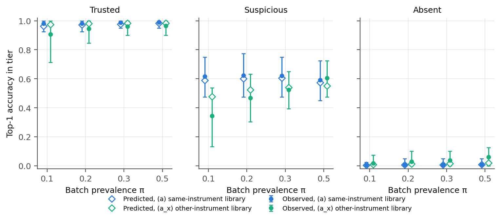

# Calibrated trust tiers for MS/MS library-search annotations

*Crowding, library absence and prevalence shift under structure-disjoint evaluation (MassSpecGym v1.5, CPU only).*

Every number in this report is produced by the code in this repository and inserted from `results/*.json` by `scripts/14_render_report.py`. The chronological record of decisions and abandoned variants is in `LOG.md`; the pre-registration for the wet-lab check is in `WETLAB_PREREG.md`.

## 1. Summary

**Task.** A query MS/MS spectrum is annotated by an engine (here, spectral-library search with entropy similarity). The system returns a calibrated probability that the engine's top-1 is correct (identity = first block of the InChIKey, i.e. 2-D skeleton) and sorts each query into one of three tiers: **trusted** (p_correct ≥ 0.9), **likely absent from library** (P(in library) ≤ 0.2), or **suspicious** (everything else).

**Method (primary system, selected on validation).** p_correct(x; π) = P(in | x; π) · P(correct | x, in). Two gradient-boosted models provide the two factors. P(in) is moved to the batch's in-library prevalence π by Bayes prior shift, and π is estimated on the unlabeled batch by EM. Features are observable only: metadata, similarity scores, the top-1's support in the library (matched peaks, its other library spectra), analogue hits, and **query-level crowding**. Query-level crowding means near-ties among candidates, structural neighbours of the top-1 in the library and in the precursor window, and the spectral neighbourhood density of the query and of the top-1. Family-level features did not add validation value and are not in the primary system.

**Main results on the structure-disjoint test fold** (2,490 molecules; 14706 query spectra, each evaluated with its truth in the library (a) and removed (b)). π is the batch's in-library prevalence, estimated by EM unless stated.

1. **Risk–coverage on the test fold (claim 1): better than every baseline.** At π = 0.2: e-AURC 0.0041 for the proposed system vs 0.0272 for logistic(s1, gap), 0.0314 for the same logistic model inside our decomposed framework, and 0.0324 for a tuned score threshold. ΔAURC vs logistic(s1, gap), decomposed = -0.0273, 95% CI [-0.0335, -0.0204]. Coverage at ≤ 5% risk: 18.5% vs 0.5% (the oracle maximum at π = 0.2 equals the fraction of correct top-1 annotations, 19.6%). The two additional baselines added after the main test do not change this; see §6.9–6.10.
   - **Every baseline also under the same EM prior correction** (§6.1, added after the main test). The correction is applied to each direct baseline's P(correct). It is monotone, so ranking (e-AURC) is unchanged; calibration improves.
     - Logistic(s1, gap): log loss 0.185 → 0.150 at π = 0.2, still far above the proposed system's 0.071.
     - **The direct model with the full feature set, once EM-corrected, is as good as the proposed system.** At π = 0.2 its e-AURC is 0.0043 vs 0.0041, log loss 0.0701 vs 0.0706, and ECE 0.0029 vs 0.0043. It is also calibrated in every sufficient family and crowding group.
     - **So the lead over the score baselines comes from the features, and prevalence robustness comes from the EM prior correction.** The decomposition into P(in) · P(correct | in) is not what produces either on this benchmark. What the decomposition adds is an explicit P(in) for the "absent" tier (§6.1, §7).
   - **Which features carry the lead** (post hoc, §6.3). Features are added one group at a time, starting from logistic(s1, gap) in the decomposed framework, and the AURC lead at π = 0.2 is split across the steps:
     - a non-linear model of the similarity scores: 27%;
     - **support of the top-1 in the library** (matched peaks, mean score over the top-1's library spectra, number of its spectra in the window): **52%**;
     - analogue hits: 2% (not significant);
     - metadata including window counts: 19%;
     - query-level crowding: 1% (not significant).

     For log loss the shares are 55% (top-1 support), 38% (metadata) and 4% (crowding; significant, Δ -0.0028 [-0.0054, -0.0004]).
   - **COSMIC.** On the same candidate set, the proposed pipeline (spectral-library search + confidence model) gives better confidence ranking and calibration than CSI:FingerID + COSMIC. Setting: SIRIUS restricted to our library's molecules; 150 molecules outside CSI:FingerID's published training set; (a) and (b) mixed at π = 0.2. e-AURC is 0.0015 vs 0.0577 (Δ -0.0563 [-0.0802, -0.0326]). ECE is 0.015 vs 0.063. The engines differ, so this cannot be attributed to the confidence estimation alone. In scenario (a) alone the proposed system makes only 3 errors, so its (a)-only metrics are marked unstable and not compared (§6.11). When our library holds each compound only as measured on another instrument type (a_x; 66 eligible queries, mostly inside CSI:FingerID's training set), the ranking advantage shrinks: Δe-AURC -0.0173 [-0.0425, 0.0012], not significant.
2. **Calibration per family and per crowding group (claim 2): holds where it can be tested.** In every top-1 ClassyFire class with enough data (20 of 212 classes at π = 0.2, covering 75.2% of queries), the predicted accuracy lies inside the 95% CI of the observed accuracy (100.0% of groups). The same holds for superclass, subclass and every crowding quartile.
   - **Size of the group calibration errors** (|observed − predicted accuracy| in the sufficient groups, π = 0.2): classes mean 0.011, max 0.026; superclasses mean 0.016, max 0.047; subclasses max 0.031; crowding groups max 0.019. At π = 0.5 the largest class gap is 0.040.
   - **The score baselines are not calibrated per group.** Without prevalence correction, the logistic(s1, gap) baseline is consistent for only 40.0% of classes (mean gap 0.055, max 0.164) and for 0% of crowding groups (max gap 0.125). With the same EM prior correction it is consistent for 80.0% of classes (max gap 0.083) and on average 25.0% of crowding groups (max gap 0.035); §6.2. The direct full-feature model with the same EM correction is consistent in 100.0% of classes and 100.0% of crowding groups. Per-group calibration therefore comes with the feature set, not with the decomposition.
   - The 192 small classes are not claimed.
3. **Crowding adds information beyond similarity (claim 3): supported in a narrower form than the prior.** Crowding measured around each annotation's own candidates is supported; crowding measured as a property of a chemical family is not.
   - **Query-level crowding adds to the similarity scores in both ranking and probability quality.** The added crowding terms are near-ties, similar runner-ups, structural neighbours of the top-1, and spectral neighbourhood density. Similarity + crowding vs similarity alone: ΔAURC -0.0055 [-0.0096, -0.0018], Δ log loss -0.0153 [-0.0208, -0.0094] (π = 0.2).
   - **Within similarity-score strata, errors are more likely under crowding.** Top-1 errors rise when the top-1 has structural neighbours in the library (Mantel–Haenszel OR 2.15, 95% CI [1.60, 2.88]) and when the top-2 candidate is structurally similar (OR 6.4).
   - **Over the full no-crowding model only log loss improves, not ranking.** That model also contains analogue hits, score structure and metadata. Adding crowding gives Δ log loss -0.0028, CI [-0.0052, -0.0004]. The ranking change is not significant (ΔAURC CI [-0.0006, 0.0002]). Crowding accounts for 1% of the AURC lead and 4% of the log-loss lead over logistic(s1, gap) (§6.3). The rest comes from the top-1's library support, metadata and a non-linear score model.
   - **The family-level form of the prior is not supported under the strict split.** This is the collaborator's version: the correlation between family spectral crowding (train library) and family error rate (test) is Spearman ρ = 0.19, CI [-0.20, 0.53]. Within similarity strata, the family crowding odds ratio is 0.93, CI [0.68, 1.28].
4. **Shifts (claim 4): holds for prevalence; partial for instrument; fails for a new data source.**
   - **Prevalence: holds.** With EM-estimated π the proposed system stays calibrated from π = 0.05 to 0.9. The same model without the correction over-states trusted-tier accuracy at π = 0.1: 98.2% predicted vs 90.0% observed. A direct model with the same features stays calibrated too, once the same EM correction is applied to its P(correct) (§6.1). The robustness comes from the EM prior correction.
   - **Instrument: partial** (§6.6). A model trained on Orbitrap and tested on QTOF stays roughly calibrated (ECE 0.013). Trained on QTOF, where there is much less training data, and tested on Orbitrap, it is not: predicted accuracy 0.123 vs observed 0.196 at π = 0.2.
   - **Library measured on another instrument type** (scenario a_x, §6.1): overall calibration holds (predicted 0.190 vs observed 0.190 at π = 0.2). The trusted tier, however, is over-confident: 94.4% observed vs 98.0% predicted. In the simulated 40-per-tier wet-lab check under a_x, the prediction falls inside the trusted tier's 95% interval in only 65.4% of batches (π = 0.2; §6.5). This is the planning value for the lab and is pre-stated as a deviation in the pre-registration.
   - **New data source (MassBank 2026.03, §6.7): fails.** The tautomer audit found 25 of the 748 external molecules to be tautomers of MassSpecGym molecules and 4 to be tautomers of other external molecules; inside MassSpecGym, no tautomer group spans folds. Even after tautomer and duplicate de-duplication (v3), the trusted tier is badly over-confident at π = 0.2: 51.8% observed vs 95.5% predicted. Most confident errors are indistinguishable isomers (100.0% share the truth's formula).
   - **On this external source a baseline ranks better than the proposed system.** The direct logistic(s1, gap) has a lower e-AURC (Δ proposed − baseline = +0.0420, CI [0.0093, 0.0569]), although its log loss is worse. This is reported as a negative result; the method was not changed.
5. **Wet-lab simulation (the final form).** At π = 0.2, in each tier (40 queries sampled per tier, 1,000 repeats), the predicted mean accuracy falls inside the observed 95% Wilson interval in 99.5% (trusted), 96.6% (suspicious) and 92.7% (absent) of repeats.

**A construction shortcut, found and removed.** A family-level library-count feature let the model detect that the truth had been deleted from the training library: per-family counts are one short in the paired absent version. This inflated training fit and destroyed out-of-sample absence detection (§6.8). It is reported as a formal result.

**Scope.** Positive-ion mode, [M+H]+ / [M+Na]+, Orbitrap and QTOF, spectral-library search. Identity is 2-D only; stereoisomers are never distinguished. "Absent from library" is **absent-from-library detection**, not discovery of new metabolites.

## 2. Setting and definitions

- **Data.** MassSpecGym v1.5 (Hugging Face `roman-bushuiev/MassSpecGym`), official MCES-based folds, unchanged.
  - 231104 spectra; 28921 molecules after RDKit standardization (Cleanup → largest fragment → uncharge).
  - 0 standardized molecules span folds.
  - Positive mode only; adducts {'[M+H]+': 195237, '[M+Na]+': 35867}.
- **Spectrum processing** (identical for queries and library, fixed in `config.yaml`): drop peaks above precursor − 1.6 Da; drop peaks < 1% of the base peak; merge peaks closer than 0.05 Da; sum-normalize; ≥ 3 peaks. This drops 11.8% of spectra everywhere.
- **Engine.** Flash entropy search.
  - Precursor tolerance 20.0 ppm. It was set on the train fold by the rule "smallest of 5/10/15/20/30 ppm covering ≥ 99% of m/z differences between spectra of the same molecule and adduct".
  - **Traceability gap.** The computation behind that decision (LOG 2026-09-26 19:58) was ad hoc, and its code was not kept. The saved re-computation (`scripts/dev/diag_precursor_tolerance.py`) covers 98.8% of all same-molecule pairs at 20 ppm; under that definition the rule would give 30 ppm. For each spectrum's nearest same-molecule spectrum, which is what retrieval in scenario (a) needs, coverage is 99.9%. The tolerance was not changed after the fact.
  - Candidates are aggregated to molecules (maximum score per molecule). The top-1 is the highest-scoring molecule; ties are broken deterministically without labels.
  - A second engine (greedy cosine on the same processed peaks) is used for an engine-swap check.
- **Correct.** Top-1 InChIKey first block = truth first block (fixed, §4 of the task). Supplementary "near-correct": top-1 Tanimoto to truth ≥ 0.8, fixed before testing.
- **Family.** ClassyFire class of the observable top-1 (superclass and subclass as sensitivity levels).
  - Existing ClassyFire results were looked up by InChIKey: 28666 / 28921 molecules found.
  - New classification requests for the remaining 255 failed (server error). These molecules form `unclassified` (0.9%).
- **Study population.** Queries with ≥ 1 library candidate in the precursor window. In scenario (b), 18.3% of test queries have none; they are counted but not tiered.

## 3. Evaluation design (built before any model)

- **Nested reference libraries.** Train queries search the train fold only; validation queries search train + val; test queries search all three folds. No test spectrum is ever a library entry, a candidate or a neighbour for any training query. The query spectrum itself is never in its own library (audited in `results/checks.json`).
- **Scenarios.**
  - (a) Leave-one-spectrum-out: the truth remains through its other spectra.
  - (b) All spectra of the truth removed.
  - (c) Additionally remove library molecules with Tanimoto ≥ 0.7 to the truth ("new scaffold").
  - **(a_x)** The truth is present **only** through spectra measured on the other instrument type. In MassSpecGym, (a) usually leaves same-instrument spectra of the truth at other collision energies. a_x is the closer analogue of a lab querying a public library. It is reported next to (a) in the main results.
- **Paired pool (against pool-construction leakage).** Only query spectra for which (a) is possible are used, and each is used in both (a) and (b). The query spectrum and its metadata are therefore identical across the two labels (audited). Train: ≤ 5 spectra per molecule. Everywhere: weights 1/n per molecule.
- **Prevalence** π (fraction of in-library queries among tiered queries) is a sweep variable: [0.05, 0.1, 0.2, 0.3, 0.5, 0.7, 0.9]. Metrics at a given π use importance weights on the full (a) + (b) test set. Wet-lab batches are sampled with exactly that π, one spectrum per molecule, each molecule either in or absent.
- **Wet-lab simulation.** Frozen thresholds. Each tier: 40 random queries per batch, 1000 batches. Report the observed accuracy and its Wilson 95% CI, compare with the mean predicted p_correct, and report the fraction of batches in which the prediction falls inside the CI.
- **Uncertainty.** Molecule-cluster bootstrap (1000 draws) for differences between systems.
- **Splits for fitting.** Hyperparameters were chosen on val-A. The calibrator family was chosen by val-A ↔ val-B cross-fitting and then fitted on the whole validation fold. val-A and val-B are structure clusters (Tanimoto ≥ 0.4 components). The test fold was used once for the final evaluation (`LOG.md`).

## 4. Method

**Feature groups** (`src/msconf/features.py`; every column is computable at deployment, and truth-derived columns carry the prefix `ana_` and are blocked by an assertion):

| group | content |
|---|---|
| meta | precursor m/z, adduct, instrument, collision energy, peak count, spectral entropy, # library spectra / molecules in the window |
| sim | s1, s2, s3, s1−s2, s1−s3 |
| sim_extra | matched peaks of top-1, mean score over the top-1's library spectra, # top-1 spectra in the window |
| analog | best similarity outside the precursor window, minus s1 |
| crowd_spec | # molecules with open-search similarity ≥ 0.5 / ≥ 0.7 to the query; near-ties (≥ s1 − 0.1); # candidates ≥ 0.5; spectral neighbourhood size of the top-1 in the library |
| crowd_struct | Tanimoto(top-1, top-2); mean Tanimoto to ranks 2–5; # library molecules with Tanimoto ≥ 0.7 to the top-1; the same inside the window |
| crowd_family | family entropy of the top-5; same-family counts and fractions (window, open neighbourhood); family-level spectral / structural crowding tables computed on the train library |

**Models.** LightGBM for P(correct | x, in) on scenario-(a) rows and for P(in | x) on (a) + (b) rows. Each gets a 16-configuration random search selected on val-A; every tunable baseline gets the same budget. Calibration: isotonic or Platt, chosen by cross-fit. **Label shift:** P(in | x; π) = Bayes prior shift from π_cal = 0.539. π̂ comes from EM (Saerens et al., 2002) on the unlabeled batch.

**Primary configuration** (validation rule, `results/selection.json`): lowest val-A log loss of p_correct at π = 0.5 among {full, full without window counts, full without family features, no crowding}.

| candidate | val-A log loss, π = 0.5 |
|---|---|
| **full without family features (selected)** | 0.0691 |
| full | 0.0706 |
| no crowding | 0.0780 |

Per-family calibration offsets were **not** adopted: the cross-fitted per-family gap did not drop by ≥ 10%.

**Tiers** (frozen): trusted iff p_correct ≥ 0.9; absent iff P(in) ≤ 0.2; otherwise suspicious.

**Baselines and floors** (same data, calibration rule and tuning budget):
- **Score baselines.** Raw score threshold (s1); top-1 − top-2 gap; logistic(s1, gap). Each is used both "direct" (a single calibrated P(correct), as practitioners use it) and "decomposed" (our absence model and label shift wrapped around the same inputs).
- **Floors.** Metadata-only and similarity-only.
- **Added after the main test.** MS2Query-style neighbourhood consistency and target–decoy FDR (§6.9–6.10).
- **COSMIC (SIRIUS 6 CSI:FingerID + COSMIC).** It runs on the project owner's machine under an academic licence (`cosmic/README.md`): 300 test molecules stratified by membership in the published CSI:FingerID training structures, plus 200 validation molecules for calibration. Results: §6.11. The main comparison restricts SIRIUS to our library's molecules (same candidate set, (a) and (b)); a first run against PubChem is kept as background.

## 5. Population and engine

- Test fold: 2490 molecules; (b) rows without any candidate: 18.3%; (c): 20.4%.
- Engine top-1 accuracy with the truth in the library (weighted by molecule):
  - (a): entropy 97.9%, cosine 96.9%.
  - (a_x): 95.1%, vs 98.3% for the same queries under (a).
- In-library errors are rare in (a). 59.2% of them stay in the truth's ClassyFire class, and 40.2% have Tanimoto ≥ 0.7 to the truth (near-isomer confusions).
- When the truth is absent (b), the top-1 is usually unrelated: median Tanimoto 0.13. Its score is low (median s1 0.07, vs 0.92 in (a)).

## 6. Results

### 6.1 Main table: (a) and (a_x) side by side

Test fold, EM-estimated prevalence. **(a)** is the MassSpecGym leave-one-spectrum-out condition. **(a_x)** is the expected behaviour when a lab queries a public library whose entry for the compound was measured on a different instrument type; it is evaluated on the 4312 test queries (420 molecules) for which it is possible, paired with their (b) versions. The a_x rows use exactly the same frozen models.

In these two tables, decomposed systems use EM-estimated π. Direct systems (one calibrated P(correct), no absence model) are shown without any prevalence correction, which is how they are normally used. The same table with the EM correction applied to every direct baseline follows the bootstrap table below.

**π = 0.2, all systems, scenario (a):**

| System | AURC ↓ | e-AURC ↓ | Cov@risk≤5% | Cov@risk≤10% | AUROC(correct) | AUROC(in-lib) | Log loss ↓ | ECE ↓ | Mean pred / obs |
|---|---|---|---|---|---|---|---|---|---|
| **Proposed** (full − family features) | 0.489 | 0.0041 | 18.5% | 20.9% | 0.995 | 0.994 | 0.071 | 0.004 | 0.192 / 0.196 |
| Full features (decomposed) | 0.489 | 0.0041 | 18.5% | 20.9% | 0.995 | 0.994 | 0.070 | 0.004 | 0.192 / 0.196 |
| No crowding (base) | 0.489 | 0.0043 | 18.1% | 20.8% | 0.995 | 0.993 | 0.074 | 0.006 | 0.190 / 0.196 |
| Candidate-list-only (engine-agnostic) | 0.498 | 0.0131 | 5.2% | 19.5% | 0.987 | 0.986 | 0.109 | 0.007 | 0.192 / 0.196 |
| Full features, direct P(correct) | 0.489 | 0.0043 | 18.5% | 21.0% | 0.995 | 0.992 | 0.089 | 0.027 | 0.223 / 0.196 |
| Full features, logistic | 0.516 | 0.0311 | 0.0% | 1.2% | 0.977 | 0.975 | 0.141 | 0.013 | 0.193 / 0.196 |
| Logistic(s1, gap), decomposed | 0.516 | 0.0314 | 0.1% | 0.1% | 0.975 | 0.972 | 0.147 | 0.012 | 0.191 / 0.196 |
| Logistic(s1, gap) | 0.512 | 0.0272 | 0.5% | 8.0% | 0.975 | 0.973 | 0.185 | 0.055 | 0.251 / 0.196 |
| Score threshold s1 | 0.517 | 0.0324 | 0.2% | 9.0% | 0.970 | 0.969 | 0.204 | 0.062 | 0.258 / 0.196 |
| Gap s1−s2 | 0.513 | 0.0283 | 0.5% | 8.6% | 0.970 | 0.963 | 0.204 | 0.065 | 0.260 / 0.196 |
| s1, decomposed | 0.523 | 0.0377 | 0.2% | 2.8% | 0.969 | 0.969 | 0.162 | 0.011 | 0.194 / 0.196 |
| gap, decomposed | 0.519 | 0.0338 | 0.1% | 0.2% | 0.970 | 0.963 | 0.161 | 0.011 | 0.190 / 0.196 |
| Floor: similarity only | 0.509 | 0.0242 | 1.1% | 10.6% | 0.977 | 0.975 | 0.145 | 0.008 | 0.190 / 0.196 |
| Floor: metadata only | 0.758 | 0.2727 | 0.0% | 0.1% | 0.578 | 0.581 | 0.547 | 0.111 | 0.085 / 0.196 |

**π = 0.5, all systems, scenario (a):**

| System | AURC ↓ | e-AURC ↓ | Cov@risk≤5% | Cov@risk≤10% | AUROC(correct) | AUROC(in-lib) | Log loss ↓ | ECE ↓ | Mean pred / obs |
|---|---|---|---|---|---|---|---|---|---|
| **Proposed** (full − family features) | 0.164 | 0.0028 | 50.6% | 54.2% | 0.995 | 0.994 | 0.087 | 0.005 | 0.485 / 0.490 |
| Full features (decomposed) | 0.164 | 0.0028 | 50.6% | 54.2% | 0.995 | 0.994 | 0.085 | 0.004 | 0.486 / 0.490 |
| No crowding (base) | 0.164 | 0.0030 | 50.4% | 54.2% | 0.995 | 0.993 | 0.092 | 0.007 | 0.483 / 0.490 |
| Candidate-list-only (engine-agnostic) | 0.170 | 0.0088 | 49.4% | 53.5% | 0.987 | 0.986 | 0.131 | 0.007 | 0.487 / 0.490 |
| Full features, direct P(correct) | 0.164 | 0.0029 | 50.8% | 54.2% | 0.995 | 0.992 | 0.085 | 0.003 | 0.491 / 0.490 |
| Full features, logistic | 0.182 | 0.0215 | 47.6% | 53.4% | 0.976 | 0.975 | 0.166 | 0.012 | 0.485 / 0.490 |
| Logistic(s1, gap), decomposed | 0.183 | 0.0219 | 45.9% | 53.2% | 0.974 | 0.972 | 0.177 | 0.012 | 0.483 / 0.490 |
| Logistic(s1, gap) | 0.180 | 0.0192 | 44.9% | 53.1% | 0.974 | 0.973 | 0.180 | 0.010 | 0.492 / 0.490 |
| Score threshold s1 | 0.189 | 0.0279 | 25.4% | 52.7% | 0.964 | 0.969 | 0.201 | 0.007 | 0.494 / 0.490 |
| Gap s1−s2 | 0.181 | 0.0202 | 46.1% | 52.2% | 0.970 | 0.963 | 0.200 | 0.011 | 0.492 / 0.490 |
| s1, decomposed | 0.193 | 0.0324 | 6.7% | 52.8% | 0.964 | 0.969 | 0.202 | 0.012 | 0.487 / 0.490 |
| gap, decomposed | 0.185 | 0.0238 | 46.0% | 52.2% | 0.969 | 0.963 | 0.200 | 0.013 | 0.482 / 0.490 |
| Floor: similarity only | 0.178 | 0.0170 | 46.5% | 53.0% | 0.977 | 0.975 | 0.174 | 0.013 | 0.482 / 0.490 |
| Floor: metadata only | 0.444 | 0.2829 | 0.2% | 0.4% | 0.576 | 0.581 | 0.707 | 0.113 | 0.377 / 0.490 |

**(a) vs (a_x), same queries, π = 0.2:**

| System | In-library scenario | Prevalence | AURC | ECE | Pred/obs acc | Trusted acc (share) |
|---|---|---|---|---|---|---|
| **Proposed** (full − family features) | a_same_queries | oracle | 0.499 | 0.013 | 0.209 / 0.197 | 95.1% (12.9%) |
| **Proposed** (full − family features) | a_same_queries | em | 0.499 | 0.017 | 0.214 / 0.197 | 94.9% (13.3%) |
| **Proposed** (full − family features) | a_x | oracle | 0.520 | 0.030 | 0.190 / 0.190 | 94.4% (11.3%) |
| **Proposed** (full − family features) | a_x | em | 0.520 | 0.030 | 0.190 / 0.190 | 94.4% (11.3%) |
| Full features (decomposed) | a_same_queries | oracle | 0.499 | 0.024 | 0.216 / 0.197 | 92.6% (13.3%) |
| Full features (decomposed) | a_same_queries | em | 0.499 | 0.030 | 0.224 / 0.197 | 92.2% (13.8%) |
| Full features (decomposed) | a_x | oracle | 0.520 | 0.031 | 0.198 / 0.190 | 91.6% (11.7%) |
| Full features (decomposed) | a_x | em | 0.520 | 0.031 | 0.201 / 0.190 | 91.6% (11.8%) |
| No crowding (base) | a_same_queries | oracle | 0.500 | 0.017 | 0.212 / 0.197 | 96.0% (12.8%) |
| No crowding (base) | a_same_queries | em | 0.500 | 0.022 | 0.218 / 0.197 | 96.0% (13.2%) |
| No crowding (base) | a_x | oracle | 0.522 | 0.037 | 0.192 / 0.190 | 95.4% (11.1%) |
| No crowding (base) | a_x | em | 0.522 | 0.037 | 0.193 / 0.190 | 95.5% (11.2%) |
| Logistic(s1, gap), decomposed | a_same_queries | oracle | 0.517 | 0.068 | 0.265 / 0.197 | 81.5% (16.6%) |
| Logistic(s1, gap), decomposed | a_same_queries | em | 0.518 | 0.095 | 0.292 / 0.197 | 77.5% (20.1%) |
| Logistic(s1, gap), decomposed | a_x | oracle | 0.548 | 0.064 | 0.248 / 0.190 | 75.8% (12.7%) |
| Logistic(s1, gap), decomposed | a_x | em | 0.548 | 0.085 | 0.273 / 0.190 | 72.6% (16.6%) |
| Logistic(s1, gap) | a_same_queries | oracle | 0.506 | 0.141 | 0.337 / 0.197 | 71.6% (23.1%) |
| Logistic(s1, gap) | a_same_queries | em | 0.506 | 0.141 | 0.337 / 0.197 | 71.6% (23.1%) |
| Logistic(s1, gap) | a_x | oracle | 0.536 | 0.136 | 0.325 / 0.190 | 67.9% (20.5%) |
| Logistic(s1, gap) | a_x | em | 0.536 | 0.136 | 0.325 / 0.190 | 67.9% (20.5%) |

**(a) vs (a_x), π = 0.5:**

| System | In-library scenario | Prevalence | AURC | ECE | Pred/obs acc | Trusted acc (share) |
|---|---|---|---|---|---|---|
| **Proposed** (full − family features) | a_same_queries | oracle | 0.171 | 0.012 | 0.496 / 0.492 | 96.8% (39.7%) |
| **Proposed** (full − family features) | a_same_queries | em | 0.171 | 0.012 | 0.499 / 0.492 | 96.8% (40.1%) |
| **Proposed** (full − family features) | a_x | oracle | 0.191 | 0.038 | 0.456 / 0.475 | 96.2% (34.2%) |
| **Proposed** (full − family features) | a_x | em | 0.191 | 0.041 | 0.451 / 0.475 | 96.9% (33.3%) |
| Full features (decomposed) | a_same_queries | oracle | 0.170 | 0.017 | 0.504 / 0.492 | 97.0% (40.0%) |
| Full features (decomposed) | a_same_queries | em | 0.170 | 0.018 | 0.509 / 0.492 | 96.8% (41.0%) |
| Full features (decomposed) | a_x | oracle | 0.191 | 0.033 | 0.466 / 0.475 | 96.4% (34.3%) |
| Full features (decomposed) | a_x | em | 0.191 | 0.033 | 0.464 / 0.475 | 96.5% (33.9%) |
| No crowding (base) | a_same_queries | oracle | 0.171 | 0.016 | 0.498 / 0.492 | 96.4% (39.1%) |
| No crowding (base) | a_same_queries | em | 0.171 | 0.016 | 0.502 / 0.492 | 96.4% (39.6%) |
| No crowding (base) | a_x | oracle | 0.193 | 0.044 | 0.455 / 0.475 | 95.7% (34.1%) |
| No crowding (base) | a_x | em | 0.193 | 0.046 | 0.450 / 0.475 | 95.8% (33.3%) |
| Logistic(s1, gap), decomposed | a_same_queries | oracle | 0.184 | 0.058 | 0.545 / 0.492 | 91.0% (45.7%) |
| Logistic(s1, gap), decomposed | a_same_queries | em | 0.184 | 0.069 | 0.558 / 0.492 | 88.8% (47.7%) |
| Logistic(s1, gap), decomposed | a_x | oracle | 0.212 | 0.060 | 0.514 / 0.475 | 89.3% (39.5%) |
| Logistic(s1, gap), decomposed | a_x | em | 0.212 | 0.065 | 0.523 / 0.475 | 87.9% (41.5%) |
| Logistic(s1, gap) | a_same_queries | oracle | 0.176 | 0.073 | 0.561 / 0.492 | 91.0% (45.5%) |
| Logistic(s1, gap) | a_same_queries | em | 0.176 | 0.073 | 0.561 / 0.492 | 91.0% (45.5%) |
| Logistic(s1, gap) | a_x | oracle | 0.204 | 0.068 | 0.530 / 0.475 | 89.3% (39.0%) |
| Logistic(s1, gap) | a_x | em | 0.204 | 0.068 | 0.530 / 0.475 | 89.3% (39.0%) |

What a_x means for the lab:
- The engine's in-library accuracy falls from 98.3% to 95.1%. The proposed P(correct | in) follows this on average: mean prediction 0.948, observed 0.951.
- The trusted tier is, however, over-confident under a_x: at π = 0.2 its accuracy is 94.4% against a predicted 98.0%.
- **This, not the (a) figure, is the planning value for the wet-lab trusted tier.**

**Paired bootstrap differences (proposed − other), π = 0.2:**

| Comparison | ΔAURC | 95% CI | ΔLog loss | 95% CI  |
|---|---|---|---|---|
| **Proposed** (full − family features) − Score threshold s1 | -0.0283 | [-0.0395, -0.0246] | -0.1331 | [-0.1498, -0.1152] |
| **Proposed** (full − family features) − Gap s1−s2 | -0.0242 | [-0.0350, -0.0212] | -0.1336 | [-0.1516, -0.1152] |
| **Proposed** (full − family features) − Logistic(s1, gap) | -0.0231 | [-0.0328, -0.0191] | -0.1145 | [-0.1319, -0.0967] |
| **Proposed** (full − family features) − s1, decomposed | -0.0336 | [-0.0412, -0.0253] | -0.0913 | [-0.1012, -0.0808] |
| **Proposed** (full − family features) − gap, decomposed | -0.0297 | [-0.0362, -0.0225] | -0.0901 | [-0.1022, -0.0785] |
| **Proposed** (full − family features) − Logistic(s1, gap), decomposed | -0.0273 | [-0.0335, -0.0204] | -0.0767 | [-0.0867, -0.0661] |
| **Proposed** (full − family features) − Floor: metadata only | -0.2686 | [-0.2752, -0.2612] | -0.4157 | [-0.4237, -0.4067] |
| **Proposed** (full − family features) − Floor: similarity only | -0.0200 | [-0.0255, -0.0149] | -0.0743 | [-0.0842, -0.0642] |
| **Proposed** (full − family features) − No crowding (base) | -0.0002 | [-0.0006, 0.0002] | -0.0028 | [-0.0052, -0.0004] |
| **Proposed** (full − family features) − Full features (decomposed) | +0.0000 | [-0.0005, 0.0005] | +0.0006 | [-0.0021, 0.0033] |
| **Proposed** (full − family features) − Full without window counts | -0.0010 | [-0.0019, -0.0001] | -0.0028 | [-0.0060, 0.0005] |
| **Proposed** (full − family features) − Similarity + crowding | -0.0145 | [-0.0191, -0.0102] | -0.0590 | [-0.0688, -0.0491] |
| **Proposed** (full − family features) − Full − spectral crowding | -0.0008 | [-0.0015, -0.0001] | -0.0037 | [-0.0067, -0.0007] |
| **Proposed** (full − family features) − Full − structural crowding | -0.0003 | [-0.0009, 0.0002] | -0.0010 | [-0.0039, 0.0016] |
| **Proposed** (full − family features) − Candidate-list-only (engine-agnostic) | -0.0089 | [-0.0120, -0.0061] | -0.0382 | [-0.0456, -0.0309] |
| **Proposed** (full − family features) − Full features, direct P(correct) | -0.0002 | [-0.0007, 0.0003] | -0.0184 | [-0.0263, -0.0105] |
| **Proposed** (full − family features) − Full features, logistic | -0.0270 | [-0.0354, -0.0204] | -0.0705 | [-0.0811, -0.0598] |
| Full features (decomposed) − No crowding (base) | -0.0002 | [-0.0008, 0.0003] | -0.0034 | [-0.0064, -0.0002] |
| Similarity + crowding − Floor: similarity only | -0.0055 | [-0.0096, -0.0018] | -0.0153 | [-0.0208, -0.0094] |
| Full + fam_lib_size (shortcut demo) − **Proposed** (full − family features) | +0.0016 | [0.0006, 0.0027] | +0.0147 | [0.0101, 0.0196] |

**All baselines under the same EM prior correction** (`scripts/24_baselines_em.py`; added after the main test, no refit, method unchanged).

In the tables above, a *direct* baseline is used as practitioners use it: one calibrated P(correct), with no prevalence correction. Here every direct baseline additionally receives the same Saerens EM prior correction as the proposed system. EM estimates the batch prior of "correct" on the unlabeled test batch, starting from the calibration prior (0.526, the weighted fraction of correct top-1 in the validation (a)+(b) rows). Probabilities are then moved to that prior by Bayes' rule. Decomposed systems keep their usual EM on P(in).

Because the correction is monotone within a batch, it cannot change ranking (e-AURC, AUROC); it changes calibration and the tiers.

π = 0.2:

| System | type | e-AURC ↓ | Log loss: none → EM | ECE: none → EM | Mean pred (EM) / obs | Trusted (EM): share, obs / pred |
|---|---|---|---|---|---|---|
| **Proposed** (full − family features) | decomposed | 0.0041 | 0.087 → 0.071 | 0.027 → 0.004 | 0.192 / 0.196 | 14.4%, 98.2% / 97.2% |
| Logistic(s1, gap), decomposed | decomposed | 0.0314 | 0.184 → 0.147 | 0.055 → 0.012 | 0.191 / 0.196 | 9.7%, 87.3% / 90.6% |
| s1, decomposed | decomposed | 0.0377 | 0.205 → 0.162 | 0.063 → 0.011 | 0.194 / 0.196 | 0.7%, 82.6% / 93.8% |
| gap, decomposed | decomposed | 0.0338 | 0.205 → 0.161 | 0.065 → 0.011 | 0.190 / 0.196 | 10.2%, 88.3% / 91.0% |
| MS2Query features in our decomposed framework | decomposed | 0.0204 | 0.178 → 0.141 | 0.058 → 0.010 | 0.190 / 0.196 | 9.9%, 93.8% / 95.2% |
| Logistic(s1, gap) | direct | 0.0272 | 0.185 → 0.150 | 0.055 → 0.017 | 0.185 / 0.196 | 0.0%, 100.0% / 100.0% |
| Score threshold s1 | direct | 0.0324 | 0.204 → 0.163 | 0.062 → 0.015 | 0.182 / 0.196 | 0.2%, 100.0% / 100.0% |
| Gap s1−s2 | direct | 0.0283 | 0.204 → 0.161 | 0.065 → 0.013 | 0.188 / 0.196 | 10.2%, 88.3% / 90.6% |
| Full features, direct P(correct) | direct | 0.0043 | 0.089 → 0.070 | 0.027 → 0.003 | 0.193 / 0.196 | 14.9%, 97.9% / 97.3% |
| MS2Query-style score of our top-1 | direct | 0.0181 | 0.170 → 0.138 | 0.055 → 0.015 | 0.181 / 0.196 | 7.5%, 96.0% / 94.5% |
| MS2Query-style, own top-1 | direct | 0.0218 | 0.181 → 0.148 | 0.062 → 0.016 | 0.174 / 0.189 | 7.5%, 96.0% / 94.0% |
| Target−decoy margin (s1 − d1) | direct | 0.0325 | 0.202 → 0.164 | 0.061 → 0.016 | 0.181 / 0.196 | 0.0%, 100.0% / 99.9% |
| Floor: similarity only | decomposed | 0.0242 | 0.180 → 0.145 | 0.052 → 0.008 | 0.190 / 0.196 | 4.5%, 93.3% / 94.3% |
| Floor: metadata only | decomposed | 0.2727 | 0.709 → 0.547 | 0.320 → 0.111 | 0.085 / 0.196 | empty |

π = 0.5:

| System | type | e-AURC ↓ | Log loss: none → EM | ECE: none → EM | Mean pred (EM) / obs | Trusted (EM): share, obs / pred |
|---|---|---|---|---|---|---|
| **Proposed** (full − family features) | decomposed | 0.0028 | 0.087 → 0.087 | 0.003 → 0.005 | 0.485 / 0.490 | 43.5%, 99.0% / 98.4% |
| Logistic(s1, gap), decomposed | decomposed | 0.0219 | 0.177 → 0.177 | 0.013 → 0.012 | 0.483 / 0.490 | 38.3%, 96.1% / 96.3% |
| s1, decomposed | decomposed | 0.0324 | 0.202 → 0.202 | 0.013 → 0.012 | 0.487 / 0.490 | 36.1%, 94.7% / 94.9% |
| gap, decomposed | decomposed | 0.0238 | 0.200 → 0.200 | 0.011 → 0.013 | 0.482 / 0.490 | 34.9%, 96.4% / 96.7% |
| MS2Query features in our decomposed framework | decomposed | 0.0158 | 0.179 → 0.179 | 0.011 → 0.012 | 0.484 / 0.490 | 35.1%, 96.8% / 96.9% |
| Logistic(s1, gap) | direct | 0.0192 | 0.180 → 0.180 | 0.010 → 0.012 | 0.483 / 0.490 | 37.8%, 96.0% / 96.3% |
| Score threshold s1 | direct | 0.0279 | 0.201 → 0.201 | 0.007 → 0.008 | 0.485 / 0.490 | 36.1%, 94.7% / 94.4% |
| Gap s1−s2 | direct | 0.0202 | 0.200 → 0.200 | 0.011 → 0.013 | 0.482 / 0.490 | 34.9%, 96.4% / 96.6% |
| Full features, direct P(correct) | direct | 0.0029 | 0.085 → 0.085 | 0.003 → 0.002 | 0.488 / 0.490 | 44.1%, 98.7% / 98.5% |
| MS2Query-style score of our top-1 | direct | 0.0146 | 0.175 → 0.176 | 0.009 → 0.013 | 0.481 / 0.490 | 42.8%, 96.5% / 95.3% |
| MS2Query-style, own top-1 | direct | 0.0186 | 0.206 → 0.206 | 0.010 → 0.014 | 0.464 / 0.472 | 29.8%, 97.0% / 97.1% |
| Target−decoy margin (s1 − d1) | direct | 0.0274 | 0.201 → 0.201 | 0.010 → 0.013 | 0.483 / 0.490 | 36.1%, 94.6% / 94.3% |
| Floor: similarity only | decomposed | 0.0170 | 0.174 → 0.174 | 0.011 → 0.013 | 0.482 / 0.490 | 39.6%, 95.8% / 96.1% |
| Floor: metadata only | decomposed | 0.2829 | 0.682 → 0.707 | 0.033 → 0.113 | 0.377 / 0.490 | empty |

Simulated wet-lab check (40 per tier, 1,000 batches, per-batch EM for every system), π = 0.1 and 0.2:

| System | correction | Tier | size / batch | Pred. acc | Obs. acc (mean) | P(pred ∈ 95% CI) |
|---|---|---|---|---|---|---|
| **Proposed** (full − family features) | EM | trusted | 71 | 96.3% | 98.2% | 99.9% |
| **Proposed** (full − family features) | EM | suspicious | 74 | 59.0% | 61.7% | 97.9% |
| **Proposed** (full − family features) | EM | absent | 1086 | 0.4% | 0.4% | 93.7% |
| Logistic(s1, gap), decomposed | EM | trusted | 1 | 99.9% | 100.0% | 100.0% |
| Logistic(s1, gap), decomposed | EM | suspicious | 172 | 64.1% | 64.0% | 96.4% |
| Logistic(s1, gap), decomposed | EM | absent | 1059 | 0.7% | 0.9% | 94.2% |
| Logistic(s1, gap) | EM | trusted | 1 | 99.9% | 100.0% | 100.0% |
| Logistic(s1, gap) | EM | suspicious | 158 | 64.4% | 68.3% | 92.7% |
| Logistic(s1, gap) | EM | absent | 1073 | 0.8% | 1.1% | 92.3% |
| Logistic(s1, gap) | none | trusted | 121 | 96.8% | 74.0% | 0.1% |
| Logistic(s1, gap) | none | suspicious | 120 | 57.2% | 24.1% | 0.1% |
| Logistic(s1, gap) | none | absent | 990 | 2.5% | 0.2% | 100.0% |
| Full features, direct P(correct) | EM | trusted | 74 | 96.3% | 97.5% | 99.7% |
| Full features, direct P(correct) | EM | suspicious | 68 | 61.9% | 63.1% | 98.3% |
| Full features, direct P(correct) | EM | absent | 1089 | 0.4% | 0.5% | 92.6% |
| Full features, direct P(correct) | none | trusted | 122 | 98.4% | 88.7% | 11.2% |
| Full features, direct P(correct) | none | suspicious | 65 | 54.9% | 16.8% | 0.0% |
| Full features, direct P(correct) | none | absent | 1044 | 0.8% | 0.1% | 99.8% |
| Score threshold s1 | EM | trusted | 2 | 99.9% | 100.0% | 100.0% |
| Score threshold s1 | EM | suspicious | 174 | 53.8% | 62.9% | 79.8% |
| Score threshold s1 | EM | absent | 1057 | 0.7% | 1.0% | 92.7% |
| Gap s1−s2 | EM | trusted | 1 | 99.9% | 100.0% | 100.0% |
| Gap s1−s2 | EM | suspicious | 157 | 66.1% | 67.8% | 95.0% |
| Gap s1−s2 | EM | absent | 1074 | 1.0% | 1.2% | 93.5% |

| System | correction | Tier | size / batch | Pred. acc | Obs. acc (mean) | P(pred ∈ 95% CI) |
|---|---|---|---|---|---|---|
| **Proposed** (full − family features) | EM | trusted | 200 | 97.1% | 98.1% | 99.5% |
| **Proposed** (full − family features) | EM | suspicious | 110 | 60.1% | 62.2% | 96.6% |
| **Proposed** (full − family features) | EM | absent | 1075 | 0.6% | 0.6% | 92.7% |
| Logistic(s1, gap), decomposed | EM | trusted | 131 | 90.7% | 86.9% | 84.0% |
| Logistic(s1, gap), decomposed | EM | suspicious | 215 | 64.0% | 68.9% | 94.1% |
| Logistic(s1, gap), decomposed | EM | absent | 1041 | 1.0% | 1.0% | 95.2% |
| Logistic(s1, gap) | EM | trusted | 99 | 93.1% | 90.8% | 91.7% |
| Logistic(s1, gap) | EM | suspicious | 258 | 69.2% | 74.9% | 92.9% |
| Logistic(s1, gap) | EM | absent | 1057 | 1.2% | 1.5% | 93.8% |
| Logistic(s1, gap) | none | trusted | 233 | 96.8% | 86.2% | 14.7% |
| Logistic(s1, gap) | none | suspicious | 157 | 61.4% | 41.1% | 21.6% |
| Logistic(s1, gap) | none | absent | 994 | 2.5% | 0.5% | 100.0% |
| Full features, direct P(correct) | EM | trusted | 207 | 97.3% | 98.0% | 98.8% |
| Full features, direct P(correct) | EM | suspicious | 95 | 63.7% | 64.6% | 95.9% |
| Full features, direct P(correct) | EM | absent | 1082 | 0.5% | 0.6% | 92.5% |
| Full features, direct P(correct) | none | trusted | 258 | 98.5% | 94.7% | 53.4% |
| Full features, direct P(correct) | none | suspicious | 80 | 57.8% | 30.9% | 4.1% |
| Full features, direct P(correct) | none | absent | 1046 | 0.8% | 0.2% | 99.8% |
| Score threshold s1 | EM | trusted | 2 | 100.0% | 100.0% | 100.0% |
| Score threshold s1 | EM | suspicious | 338 | 70.5% | 75.6% | 92.0% |
| Score threshold s1 | EM | absent | 1045 | 1.2% | 1.3% | 94.1% |
| Gap s1−s2 | EM | trusted | 140 | 90.9% | 88.2% | 89.0% |
| Gap s1−s2 | EM | suspicious | 187 | 64.6% | 71.0% | 90.5% |
| Gap s1−s2 | EM | absent | 1062 | 1.5% | 1.8% | 93.4% |

Under the shifts of §6.1/§6.7 (a_x; external source v3), π = 0.2:

| Shift | System | e-AURC | Log loss: none → EM | ECE: none → EM | Trusted (EM) obs / pred |
|---|---|---|---|---|---|
| library on other instrument (a_x) | **Proposed** (full − family features) | 0.0248 | 0.226 → 0.193 | 0.054 → 0.030 | 94.2% / 98.1% |
| library on other instrument (a_x) | Logistic(s1, gap), decomposed | 0.0470 | 0.377 → 0.283 | 0.117 → 0.071 | 75.3% / 93.4% |
| library on other instrument (a_x) | Logistic(s1, gap) | 0.0369 | 0.382 → 0.272 | 0.124 → 0.065 | 77.8% / 93.0% |
| library on other instrument (a_x) | Full features, direct P(correct) | 0.0251 | 0.245 → 0.199 | 0.061 → 0.034 | 92.4% / 98.3% |
| library on other instrument (a_x) | Score threshold s1 | 0.0387 | 0.426 → 0.306 | 0.137 → 0.092 | 94.0% / 93.6% |
| external source (MassBank v3) | **Proposed** (full − family features) | 0.1036 | 0.351 → 0.302 | 0.067 → 0.069 | 51.8% / 95.5% |
| external source (MassBank v3) | Logistic(s1, gap), decomposed | 0.0990 | 0.439 → 0.322 | 0.161 → 0.109 | 74.3% / 94.1% |
| external source (MassBank v3) | Logistic(s1, gap) | 0.0617 | 0.438 → 0.308 | 0.163 → 0.101 | 73.1% / 93.6% |
| external source (MassBank v3) | Full features, direct P(correct) | 0.0958 | 0.346 → 0.295 | 0.065 → 0.070 | 53.7% / 95.3% |
| external source (MassBank v3) | Score threshold s1 | 0.1318 | 0.467 → 0.332 | 0.175 → 0.115 | 23.2% / 93.8% |

Reading:
- The EM correction lowers the log loss of 7 of 7 direct baselines at π = 0.2 and brings their overall ECE close to that of the proposed system. Ranking is unchanged by construction.
- **The score-based baselines stay far behind in log loss.** The best of them after EM is MS2Query-style score of our top-1: 0.138 vs 0.071 at π = 0.2. Once calibrated at low π, their trusted tier nearly disappears. In the simulated batches at π = 0.1, logistic(s1, gap) + EM puts 1 query(ies) per batch in the trusted tier, against 71 for the proposed system. The corresponding numbers at π = 0.2 are 99 and 200. So calibration alone does not make them useful: their ranking is too weak.
- **The direct full-feature model with EM is as good as the proposed system.** Log loss 0.0701 vs 0.0706, ECE 0.0029 vs 0.0043, and a trusted tier of 74 vs 71 queries per batch at π = 0.1. It passes the wet-lab simulation and the group calibration equally well (§6.2). On this benchmark the decomposition is therefore not needed for calibration under prevalence shift.
- **Under the shifts, the proposed system and the direct full-feature model fail alike.** With EM, their trusted tiers are over-confident: under a_x, proposed 94.2% observed vs 98.1% predicted and direct 92.4% observed vs 98.3% predicted; on the external source, proposed 51.8% observed vs 95.5% predicted and direct 53.7% observed vs 95.3% predicted. On the external source, the EM-corrected logistic(s1, gap) trusted tier is less over-confident (73.1% observed vs 93.6% predicted) but still fails, consistent with its better ranking there (§6.7).

### 6.2 Calibration by family and by crowding group (claim 2)

Groups need ≥ 100 effective rows and ≥ 20 molecules; smaller groups are reported as insufficient and never claimed. Grouping by the **observable** top-1 family is the method's guarantee; grouping by the true family (`ana_true_class`) is analysis only.

π = 0.2:

| System | Grouping | Groups (sufficient/all) | Rows in sufficient groups | Pred ∈ 95% CI | Mean \|obs−pred\| | Max \|obs−pred\| |
|---|---|---|---|---|---|---|
| **Proposed** (full − family features) | top1_class | 20/212 | 75.2% | 100.0% | 0.011 | 0.026 |
| **Proposed** (full − family features) | top1_superclass | 10/14 | 98.9% | 100.0% | 0.016 | 0.047 |
| **Proposed** (full − family features) | top1_subclass | 17/469 | 46.6% | 100.0% | 0.014 | 0.031 |
| **Proposed** (full − family features) | bin_top1_struct_nbrs | 3/3 | 100.0% | 100.0% | 0.004 | 0.007 |
| **Proposed** (full − family features) | bin_fam_spec_crowd_train | 4/4 | 100.0% | 100.0% | 0.006 | 0.010 |
| **Proposed** (full − family features) | bin_n_open_hi | 3/3 | 100.0% | 100.0% | 0.006 | 0.010 |
| **Proposed** (full − family features) | bin_top1_specdens | 3/3 | 100.0% | 100.0% | 0.006 | 0.011 |
| **Proposed** (full − family features) | ana_true_class | 18/148 | 75.9% | 100.0% | 0.009 | 0.028 |
| No crowding (base) | top1_class | 20/212 | 75.2% | 100.0% | 0.013 | 0.032 |
| No crowding (base) | top1_superclass | 10/14 | 98.9% | 100.0% | 0.016 | 0.034 |
| No crowding (base) | top1_subclass | 17/469 | 46.6% | 100.0% | 0.016 | 0.032 |
| No crowding (base) | bin_top1_struct_nbrs | 3/3 | 100.0% | 66.7% | 0.011 | 0.014 |
| No crowding (base) | bin_fam_spec_crowd_train | 4/4 | 100.0% | 100.0% | 0.006 | 0.010 |
| No crowding (base) | bin_n_open_hi | 3/3 | 100.0% | 100.0% | 0.009 | 0.015 |
| No crowding (base) | bin_top1_specdens | 3/3 | 100.0% | 100.0% | 0.003 | 0.007 |
| No crowding (base) | ana_true_class | 18/148 | 75.9% | 100.0% | 0.010 | 0.030 |
| Logistic(s1, gap), decomposed | top1_class | 20/212 | 75.2% | 85.0% | 0.032 | 0.071 |
| Logistic(s1, gap), decomposed | top1_superclass | 10/14 | 98.9% | 50.0% | 0.036 | 0.082 |
| Logistic(s1, gap), decomposed | top1_subclass | 17/469 | 46.6% | 94.1% | 0.037 | 0.071 |
| Logistic(s1, gap), decomposed | bin_top1_struct_nbrs | 3/3 | 100.0% | 0.0% | 0.031 | 0.038 |
| Logistic(s1, gap), decomposed | bin_fam_spec_crowd_train | 4/4 | 100.0% | 75.0% | 0.010 | 0.015 |
| Logistic(s1, gap), decomposed | bin_n_open_hi | 3/3 | 100.0% | 33.3% | 0.019 | 0.035 |
| Logistic(s1, gap), decomposed | bin_top1_specdens | 3/3 | 100.0% | 0.0% | 0.023 | 0.027 |
| Logistic(s1, gap), decomposed | ana_true_class | 18/148 | 75.9% | 77.8% | 0.026 | 0.089 |
| Logistic(s1, gap) | top1_class | 20/212 | 75.2% | 40.0% | 0.055 | 0.164 |
| Logistic(s1, gap) | top1_superclass | 10/14 | 98.9% | 20.0% | 0.063 | 0.134 |
| Logistic(s1, gap) | top1_subclass | 17/469 | 46.6% | 52.9% | 0.052 | 0.138 |
| Logistic(s1, gap) | bin_top1_struct_nbrs | 3/3 | 100.0% | 0.0% | 0.073 | 0.100 |
| Logistic(s1, gap) | bin_fam_spec_crowd_train | 4/4 | 100.0% | 0.0% | 0.055 | 0.070 |
| Logistic(s1, gap) | bin_n_open_hi | 3/3 | 100.0% | 0.0% | 0.075 | 0.125 |
| Logistic(s1, gap) | bin_top1_specdens | 3/3 | 100.0% | 0.0% | 0.067 | 0.081 |
| Logistic(s1, gap) | ana_true_class | 18/148 | 75.9% | 55.6% | 0.059 | 0.231 |
| Full features, direct P(correct) | top1_class | 20/212 | 75.2% | 85.0% | 0.024 | 0.064 |
| Full features, direct P(correct) | top1_superclass | 10/14 | 98.9% | 40.0% | 0.032 | 0.095 |
| Full features, direct P(correct) | top1_subclass | 17/469 | 46.6% | 76.5% | 0.028 | 0.081 |
| Full features, direct P(correct) | bin_top1_struct_nbrs | 3/3 | 100.0% | 0.0% | 0.033 | 0.041 |
| Full features, direct P(correct) | bin_fam_spec_crowd_train | 4/4 | 100.0% | 25.0% | 0.026 | 0.041 |
| Full features, direct P(correct) | bin_n_open_hi | 3/3 | 100.0% | 0.0% | 0.038 | 0.056 |
| Full features, direct P(correct) | bin_top1_specdens | 3/3 | 100.0% | 33.3% | 0.023 | 0.030 |
| Full features, direct P(correct) | ana_true_class | 18/148 | 75.9% | 88.9% | 0.025 | 0.069 |

π = 0.5:

| System | Grouping | Groups (sufficient/all) | Rows in sufficient groups | Pred ∈ 95% CI | Mean \|obs−pred\| | Max \|obs−pred\| |
|---|---|---|---|---|---|---|
| **Proposed** (full − family features) | top1_class | 27/212 | 80.2% | 100.0% | 0.014 | 0.040 |
| **Proposed** (full − family features) | top1_superclass | 11/14 | 99.4% | 100.0% | 0.016 | 0.046 |
| **Proposed** (full − family features) | top1_subclass | 30/469 | 56.2% | 100.0% | 0.017 | 0.048 |
| **Proposed** (full − family features) | bin_top1_struct_nbrs | 3/3 | 100.0% | 100.0% | 0.004 | 0.005 |
| **Proposed** (full − family features) | bin_fam_spec_crowd_train | 4/4 | 100.0% | 100.0% | 0.006 | 0.011 |
| **Proposed** (full − family features) | bin_n_open_hi | 3/3 | 100.0% | 100.0% | 0.005 | 0.009 |
| **Proposed** (full − family features) | bin_top1_specdens | 3/3 | 100.0% | 100.0% | 0.008 | 0.017 |
| **Proposed** (full − family features) | ana_true_class | 26/148 | 81.7% | 100.0% | 0.014 | 0.043 |
| No crowding (base) | top1_class | 27/212 | 80.2% | 100.0% | 0.014 | 0.051 |
| No crowding (base) | top1_superclass | 11/14 | 99.4% | 100.0% | 0.019 | 0.044 |
| No crowding (base) | top1_subclass | 30/469 | 56.2% | 100.0% | 0.019 | 0.057 |
| No crowding (base) | bin_top1_struct_nbrs | 3/3 | 100.0% | 66.7% | 0.012 | 0.017 |
| No crowding (base) | bin_fam_spec_crowd_train | 4/4 | 100.0% | 100.0% | 0.006 | 0.010 |
| No crowding (base) | bin_n_open_hi | 3/3 | 100.0% | 100.0% | 0.008 | 0.012 |
| No crowding (base) | bin_top1_specdens | 3/3 | 100.0% | 100.0% | 0.003 | 0.008 |
| No crowding (base) | ana_true_class | 26/148 | 81.7% | 100.0% | 0.013 | 0.048 |
| Logistic(s1, gap), decomposed | top1_class | 27/212 | 80.2% | 88.9% | 0.032 | 0.101 |
| Logistic(s1, gap), decomposed | top1_superclass | 11/14 | 99.4% | 45.5% | 0.039 | 0.101 |
| Logistic(s1, gap), decomposed | top1_subclass | 30/469 | 56.2% | 93.3% | 0.035 | 0.101 |
| Logistic(s1, gap), decomposed | bin_top1_struct_nbrs | 3/3 | 100.0% | 0.0% | 0.031 | 0.036 |
| Logistic(s1, gap), decomposed | bin_fam_spec_crowd_train | 4/4 | 100.0% | 75.0% | 0.011 | 0.016 |
| Logistic(s1, gap), decomposed | bin_n_open_hi | 3/3 | 100.0% | 33.3% | 0.013 | 0.021 |
| Logistic(s1, gap), decomposed | bin_top1_specdens | 3/3 | 100.0% | 0.0% | 0.033 | 0.045 |
| Logistic(s1, gap), decomposed | ana_true_class | 26/148 | 81.7% | 92.3% | 0.024 | 0.090 |
| Logistic(s1, gap) | top1_class | 27/212 | 80.2% | 81.5% | 0.035 | 0.097 |
| Logistic(s1, gap) | top1_superclass | 11/14 | 99.4% | 63.6% | 0.044 | 0.107 |
| Logistic(s1, gap) | top1_subclass | 30/469 | 56.2% | 86.7% | 0.038 | 0.105 |
| Logistic(s1, gap) | bin_top1_struct_nbrs | 3/3 | 100.0% | 0.0% | 0.041 | 0.060 |
| Logistic(s1, gap) | bin_fam_spec_crowd_train | 4/4 | 100.0% | 75.0% | 0.008 | 0.022 |
| Logistic(s1, gap) | bin_n_open_hi | 3/3 | 100.0% | 66.7% | 0.019 | 0.047 |
| Logistic(s1, gap) | bin_top1_specdens | 3/3 | 100.0% | 0.0% | 0.037 | 0.053 |
| Logistic(s1, gap) | ana_true_class | 26/148 | 81.7% | 88.5% | 0.026 | 0.110 |
| Full features, direct P(correct) | top1_class | 27/212 | 80.2% | 100.0% | 0.012 | 0.038 |
| Full features, direct P(correct) | top1_superclass | 11/14 | 99.4% | 100.0% | 0.013 | 0.058 |
| Full features, direct P(correct) | top1_subclass | 30/469 | 56.2% | 100.0% | 0.014 | 0.050 |
| Full features, direct P(correct) | bin_top1_struct_nbrs | 3/3 | 100.0% | 100.0% | 0.007 | 0.010 |
| Full features, direct P(correct) | bin_fam_spec_crowd_train | 4/4 | 100.0% | 100.0% | 0.006 | 0.014 |
| Full features, direct P(correct) | bin_n_open_hi | 3/3 | 100.0% | 100.0% | 0.004 | 0.008 |
| Full features, direct P(correct) | bin_top1_specdens | 3/3 | 100.0% | 100.0% | 0.005 | 0.009 |
| Full features, direct P(correct) | ana_true_class | 26/148 | 81.7% | 100.0% | 0.012 | 0.035 |

Component level for the proposed system (P(correct | in) on (a) rows is prevalence-free):

| Component | Grouping | Groups (sufficient/all) | Pred ∈ 95% CI | Mean \|obs−pred\| | Max \|obs−pred\| |
|---|---|---|---|---|---|
| P(correct \| in) | top1_class | 14/148 | 92.9% | 0.004 | 0.011 |
| P(correct \| in) | top1_superclass | 8/14 | 100.0% | 0.004 | 0.014 |
| P(correct \| in) | top1_subclass | 15/328 | 93.3% | 0.005 | 0.014 |
| P(correct \| in) | bin_fam_spec_crowd_train | 4/4 | 100.0% | 0.002 | 0.006 |
| P(correct \| in) | bin_top1_struct_nbrs | 3/3 | 100.0% | 0.006 | 0.009 |
| P(in), π=0.5 | top1_class | 27/212 | 100.0% | 0.014 | 0.033 |
| P(in), π=0.5 | top1_superclass | 11/14 | 100.0% | 0.020 | 0.075 |
| P(in), π=0.5 | top1_subclass | 30/469 | 100.0% | 0.015 | 0.044 |

The tables above apply the known π (decomposed systems) and no correction (direct systems), as in the main evaluation. With the **same EM prior correction for every system** (direct baselines: EM on P(correct); `results/eval_baselines_em.json`), π = 0.2:

| System (EM for all) | Grouping | Groups (sufficient/all) | Pred ∈ 95% CI | Mean \|obs−pred\| | Max \|obs−pred\| |
|---|---|---|---|---|---|
| **Proposed** (full − family features) | top1_class | 20/212 | 100.0% | 0.011 | 0.026 |
| **Proposed** (full − family features) | top1_superclass | 10/14 | 100.0% | 0.016 | 0.046 |
| **Proposed** (full − family features) | bin_top1_struct_nbrs | 3/3 | 100.0% | 0.004 | 0.008 |
| **Proposed** (full − family features) | bin_fam_spec_crowd_train | 4/4 | 100.0% | 0.006 | 0.010 |
| **Proposed** (full − family features) | bin_n_open_hi | 3/3 | 100.0% | 0.007 | 0.011 |
| **Proposed** (full − family features) | bin_top1_specdens | 3/3 | 100.0% | 0.006 | 0.012 |
| **Proposed** (full − family features) | bin_n_win_mol | 4/4 | 100.0% | 0.009 | 0.019 |
| Logistic(s1, gap), decomposed | top1_class | 20/212 | 85.0% | 0.032 | 0.072 |
| Logistic(s1, gap), decomposed | top1_superclass | 10/14 | 50.0% | 0.036 | 0.082 |
| Logistic(s1, gap), decomposed | bin_top1_struct_nbrs | 3/3 | 0.0% | 0.031 | 0.037 |
| Logistic(s1, gap), decomposed | bin_fam_spec_crowd_train | 4/4 | 75.0% | 0.010 | 0.016 |
| Logistic(s1, gap), decomposed | bin_n_open_hi | 3/3 | 33.3% | 0.019 | 0.034 |
| Logistic(s1, gap), decomposed | bin_top1_specdens | 3/3 | 0.0% | 0.023 | 0.027 |
| Logistic(s1, gap), decomposed | bin_n_win_mol | 4/4 | 75.0% | 0.007 | 0.012 |
| Logistic(s1, gap) | top1_class | 20/212 | 80.0% | 0.034 | 0.083 |
| Logistic(s1, gap) | top1_superclass | 10/14 | 50.0% | 0.039 | 0.083 |
| Logistic(s1, gap) | bin_top1_struct_nbrs | 3/3 | 0.0% | 0.031 | 0.035 |
| Logistic(s1, gap) | bin_fam_spec_crowd_train | 4/4 | 50.0% | 0.013 | 0.021 |
| Logistic(s1, gap) | bin_n_open_hi | 3/3 | 0.0% | 0.022 | 0.028 |
| Logistic(s1, gap) | bin_top1_specdens | 3/3 | 0.0% | 0.022 | 0.024 |
| Logistic(s1, gap) | bin_n_win_mol | 4/4 | 75.0% | 0.008 | 0.021 |
| Full features, direct P(correct) | top1_class | 20/212 | 100.0% | 0.010 | 0.026 |
| Full features, direct P(correct) | top1_superclass | 10/14 | 100.0% | 0.015 | 0.053 |
| Full features, direct P(correct) | bin_top1_struct_nbrs | 3/3 | 100.0% | 0.005 | 0.007 |
| Full features, direct P(correct) | bin_fam_spec_crowd_train | 4/4 | 100.0% | 0.009 | 0.012 |
| Full features, direct P(correct) | bin_n_open_hi | 3/3 | 100.0% | 0.003 | 0.005 |
| Full features, direct P(correct) | bin_top1_specdens | 3/3 | 100.0% | 0.005 | 0.011 |
| Full features, direct P(correct) | bin_n_win_mol | 4/4 | 100.0% | 0.007 | 0.014 |
| Score threshold s1 | top1_class | 20/212 | 60.0% | 0.045 | 0.135 |
| Score threshold s1 | top1_superclass | 10/14 | 30.0% | 0.047 | 0.091 |
| Score threshold s1 | bin_top1_struct_nbrs | 3/3 | 0.0% | 0.043 | 0.059 |
| Score threshold s1 | bin_fam_spec_crowd_train | 4/4 | 50.0% | 0.017 | 0.025 |
| Score threshold s1 | bin_n_open_hi | 3/3 | 0.0% | 0.040 | 0.067 |
| Score threshold s1 | bin_top1_specdens | 3/3 | 0.0% | 0.028 | 0.030 |
| Score threshold s1 | bin_n_win_mol | 4/4 | 25.0% | 0.016 | 0.024 |
| Gap s1−s2 | top1_class | 20/212 | 80.0% | 0.030 | 0.076 |
| Gap s1−s2 | top1_superclass | 10/14 | 60.0% | 0.033 | 0.076 |
| Gap s1−s2 | bin_top1_struct_nbrs | 3/3 | 33.3% | 0.024 | 0.026 |
| Gap s1−s2 | bin_fam_spec_crowd_train | 4/4 | 75.0% | 0.011 | 0.019 |
| Gap s1−s2 | bin_n_open_hi | 3/3 | 66.7% | 0.011 | 0.030 |
| Gap s1−s2 | bin_top1_specdens | 3/3 | 33.3% | 0.019 | 0.022 |
| Gap s1−s2 | bin_n_win_mol | 4/4 | 75.0% | 0.009 | 0.021 |

Per-family tables: `reports/tables/groups_top1_class_pi0.2.csv`, `…_pi0.5.csv`; figure `figures/fig4_family_calibration.png`.

### 6.3 Does crowding add information beyond the similarity score? (claim 3)

**Nested model comparisons** (component log loss / AUROC on test; Δ CIs from a molecule bootstrap):

| Comparison | P(correct\|in) log loss | Δ 95% CI | P(correct\|in) AUROC | ΔAUROC 95% CI | P(in) log loss | Δ 95% CI  | P(in) AUROC |
|---|---|---|---|---|---|---|---|
| **Proposed** (full − family features) vs No crowding (base) | 0.0266 vs 0.0285 | [-0.0041, 0.0006] | 0.994 vs 0.992 | [-0.001, 0.004] | 0.0975 vs 0.1011 | [-0.0061, -0.0007] | 0.994 vs 0.993 |
| Full features (decomposed) vs No crowding (base) | 0.0254 vs 0.0285 | [-0.0056, -0.0009] | 0.994 vs 0.992 | [0.000, 0.005] | 0.0966 vs 0.1011 | [-0.0078, -0.0010] | 0.994 vs 0.993 |
| Full features (decomposed) vs **Proposed** (full − family features) | 0.0254 vs 0.0266 | [-0.0026, 0.0001] | 0.994 vs 0.994 | [-0.000, 0.002] | 0.0966 vs 0.0975 | [-0.0038, 0.0020] | 0.994 vs 0.994 |
| Similarity + crowding vs Floor: similarity only | 0.0388 vs 0.0504 | [-0.0161, -0.0077] | 0.987 vs 0.969 | [0.011, 0.026] | 0.1654 vs 0.1776 | [-0.0176, -0.0071] | 0.979 vs 0.975 |

**Stratified test.** Top-1 error odds for queries above vs below the validation median of each crowding measure, within deciles of the similarity score s1 (edges from validation), scenario (a):

| Crowding measure (> val median) | MH odds ratio of error | 95% CI |
|---|---|---|
| top1_struct_nbrs | 2.147 | [1.60, 2.88] |
| fam_spec_crowd_train | 0.932 | [0.68, 1.28] |
| n_open_hi | 5.549 | [3.94, 7.81] |
| top1_specdens | 1.244 | [0.92, 1.67] |
| n_near_tie | 82.680 | [56.56, 120.86] |
| fam_ent_topk | 1.798 | [1.27, 2.54] |
| tani12 | 6.387 | [4.44, 9.20] |

Reading:
- Crowding measured **around the individual candidate** carries information that s1 does not. This holds for near-ties, Tanimoto(top-1, top-2), the top-1's structural neighbours and the query's spectral neighbourhood.
- Most of the advantage over the baselines, however, comes from non-crowding features: the top-1's support in the library, a non-linear score model and metadata. Analogue hits add nothing measurable (lead breakdown below). Over that rich base, crowding improves probability quality (log loss) but not ranking.
- Crowding measured as a **family attribute** does not predict errors once s1 is controlled for: the MH odds ratio for family spectral crowding is 0.93, CI [0.68, 1.28].
- At the family level, the correlation between train-library family crowding and test family error is ρ = 0.19 for the top-1 family (33 families, CI [-0.20, 0.53]) and ρ = -0.05 for the true family.
- **The collaborator's prior therefore holds in a narrower form than stated.** Crowding predicts errors at the level of each annotation's own candidate neighbourhood, not as a transferable property of a chemical family.

**Where the lead over the score baselines comes from, by feature group** (post hoc; `scripts/23_lead_attribution.py`).

This analysis was added after the main test evaluation at the owner's request. Nothing in it feeds back into the method. The ablation systems are trained, tuned (same 16-configuration budget) and calibrated exactly like every other system.

*Path view.* Starting from logistic(s1, gap) in the decomposed framework, feature groups are added one at a time until the proposed system is reached. The step differences add up to the total lead. Molecule bootstrap, known π:

π = 0.2:

| step | ΔAURC (step) | 95% CI | share of AURC lead | Δ log loss (step) | 95% CI  | share of log-loss lead |
|---|---|---|---|---|---|---|
| + non-linear score model (LightGBM on s1, s2, s3, gaps) | -0.0072 | [-0.0118, -0.0029] | 27% | -0.0024 | [-0.0051, 0.0007] | 3% |
| + top-1 library support (sim_extra: matched peaks, mean score over the top-1's spectra, # its spectra in window) | -0.0141 | [-0.0184, -0.0101] | 52% | -0.0421 | [-0.0506, -0.0344] | 55% |
| + analogue hits (analog) | -0.0006 | [-0.0019, 0.0006] | 2% | -0.0001 | [-0.0035, 0.0033] | 0% |
| + metadata incl. window counts (= no-crowding model) | -0.0052 | [-0.0068, -0.0036] | 19% | -0.0293 | [-0.0357, -0.0231] | 38% |
| + query-level crowding (= proposed) | -0.0002 | [-0.0006, 0.0002] | 1% | -0.0028 | [-0.0054, -0.0004] | 4% |
| **total lead** (proposed − logistic(s1, gap), decomposed) | -0.0273 | [-0.0344, -0.0201] | 100% | -0.0767 | [-0.0877, -0.0669] | 100% |

π = 0.5:

| step | ΔAURC (step) | 95% CI | share of AURC lead | Δ log loss (step) | 95% CI  | share of log-loss lead |
|---|---|---|---|---|---|---|
| + non-linear score model (LightGBM on s1, s2, s3, gaps) | -0.0048 | [-0.0079, -0.0017] | 25% | -0.0031 | [-0.0059, -0.0004] | 3% |
| + top-1 library support (sim_extra: matched peaks, mean score over the top-1's spectra, # its spectra in window) | -0.0100 | [-0.0131, -0.0071] | 53% | -0.0494 | [-0.0579, -0.0413] | 55% |
| + analogue hits (analog) | -0.0005 | [-0.0013, 0.0004] | 3% | -0.0004 | [-0.0037, 0.0032] | 0% |
| + metadata incl. window counts (= no-crowding model) | -0.0035 | [-0.0047, -0.0025] | 18% | -0.0331 | [-0.0396, -0.0271] | 37% |
| + query-level crowding (= proposed) | -0.0002 | [-0.0004, 0.0001] | 1% | -0.0045 | [-0.0075, -0.0017] | 5% |
| **total lead** (proposed − logistic(s1, gap), decomposed) | -0.0190 | [-0.0239, -0.0140] | 100% | -0.0905 | [-0.1016, -0.0798] | 100% |

*Drop-one view* (order-free): the cost of removing one group from the proposed system. Positive = worse without it.

π = 0.2:

| proposed system … | AURC cost of removing (Δ = removed − proposed) | 95% CI | log-loss cost | 95% CI  |
|---|---|---|---|---|
| − meta | +0.0033 | [0.0022, 0.0044] | +0.0237 | [0.0186, 0.0291] |
| − sim | +0.0006 | [0.0001, 0.0011] | +0.0063 | [0.0036, 0.0091] |
| − sim_extra | +0.0041 | [0.0026, 0.0059] | +0.0253 | [0.0196, 0.0317] |
| − analog | -0.0002 | [-0.0004, 0.0000] | -0.0008 | [-0.0021, 0.0005] |
| − crowd_spec | +0.0003 | [0.0000, 0.0007] | +0.0020 | [0.0003, 0.0039] |
| − crowd_struct | +0.0002 | [-0.0005, 0.0009] | -0.0005 | [-0.0031, 0.0020] |
| − crowd_spec − crowd_struct (= no crowding) | +0.0002 | [-0.0002, 0.0006] | +0.0028 | [0.0004, 0.0054] |

Reading (post hoc):
- π = 0.2: the largest share of the AURC lead comes from '+ top-1 library support (sim_extra: matched peaks, mean score over the top-1's spectra, # its spectra in window)' (52%). The last step, adding query-level crowding, contributes 1% of the AURC lead (step ΔAURC -0.0002 [-0.0006, 0.0002]) and 4% of the log-loss lead.
- π = 0.5: the largest share of the AURC lead comes from '+ top-1 library support (sim_extra: matched peaks, mean score over the top-1's spectra, # its spectra in window)' (53%). The last step, adding query-level crowding, contributes 1% of the AURC lead (step ΔAURC -0.0002 [-0.0004, 0.0001]) and 5% of the log-loss lead.

Hardest top-1 families (scenario a, ≥ 50 queries and ≥ 10 molecules):

| Top-1 family (class) | Queries | Molecules | error (95% CI) |
|---|---|---|---|
| Naphthopyrans | 53 | 14 | 9.4% (4.1%–20.3%) |
| Cinnamic acids and derivatives | 162 | 21 | 7.4% (4.3%–12.5%) |
| Steroids and steroid derivatives | 163 | 24 | 6.1% (3.4%–10.9%) |
| Benzopyrans | 118 | 29 | 5.9% (2.9%–11.7%) |
| Tetrahydroisoquinolines | 96 | 12 | 4.2% (1.6%–10.2%) |
| Diazines | 183 | 55 | 3.3% (1.5%–7.0%) |
| Naphthalenes | 125 | 27 | 2.4% (0.8%–6.8%) |
| Imidazopyrimidines | 131 | 28 | 2.3% (0.8%–6.5%) |
| Isoindoles and derivatives | 50 | 14 | 2.0% (0.4%–10.5%) |
| Diazinanes | 287 | 81 | 1.7% (0.7%–4.0%) |

### 6.4 Prevalence shift (claim 4, part 1)

Proposed system at each true π; the last column is the direct full-feature model without an absence model and without prevalence correction (with the EM correction it is calibrated as well; §6.1):

| π | obs. acc | pred (true π) | pred (EM π̂) | π̂ (EM) | pred (no corr.) | ECE true/EM/none | Direct model pred |
|---|---|---|---|---|---|---|---|
| 0.05 | 0.049 | 0.047 | 0.046 | 0.047 | 0.089 | 0.003 / 0.003 / 0.040 | 0.088 |
| 0.1 | 0.098 | 0.095 | 0.094 | 0.097 | 0.134 | 0.003 / 0.004 / 0.036 | 0.133 |
| 0.2 | 0.196 | 0.192 | 0.192 | 0.197 | 0.223 | 0.004 / 0.004 / 0.027 | 0.223 |
| 0.3 | 0.294 | 0.290 | 0.289 | 0.297 | 0.311 | 0.004 / 0.005 / 0.018 | 0.312 |
| 0.5 | 0.490 | 0.485 | 0.485 | 0.497 | 0.489 | 0.005 / 0.005 / 0.003 | 0.491 |
| 0.7 | 0.685 | 0.681 | 0.681 | 0.698 | 0.666 | 0.004 / 0.004 / 0.019 | 0.671 |
| 0.9 | 0.881 | 0.878 | 0.878 | 0.899 | 0.844 | 0.003 / 0.003 / 0.037 | 0.850 |

### 6.5 Wet-lab simulation (the final-form evaluation)

Proposed system with EM-estimated π, test fold, 40 per tier, 1000 batches.

π = 0.1:

| Tier | Mean tier size / batch | Obs. acc (mean, 2.5–97.5%) | Pred. acc | P(pred ∈ 95% CI) | Obs. in-lib | Pred. in-lib | P(pred in-lib ∈ CI) |
|---|---|---|---|---|---|---|---|
| trusted | 71 | 98.2% (92.5%–100.0%) | 96.3% | 99.9% | 98.2% | 96.3% | 99.9% |
| suspicious | 74 | 61.7% (47.5%–75.0%) | 59.0% | 97.9% | 63.5% | 61.6% | 97.7% |
| absent | 1086 | 0.4% (0.0%–2.5%) | 0.4% | 93.7% | 0.6% | 0.6% | 93.6% |

π = 0.2:

| Tier | Mean tier size / batch | Obs. acc (mean, 2.5–97.5%) | Pred. acc | P(pred ∈ 95% CI) | Obs. in-lib | Pred. in-lib | P(pred in-lib ∈ CI) |
|---|---|---|---|---|---|---|---|
| trusted | 200 | 98.1% (92.5%–100.0%) | 97.1% | 99.5% | 98.1% | 97.2% | 99.3% |
| suspicious | 110 | 62.2% (47.5%–77.5%) | 60.1% | 96.6% | 65.2% | 64.2% | 97.3% |
| absent | 1075 | 0.6% (0.0%–5.0%) | 0.6% | 92.7% | 0.8% | 0.8% | 94.1% |

π = 0.5:

| Tier | Mean tier size / batch | Obs. acc (mean, 2.5–97.5%) | Pred. acc | P(pred ∈ 95% CI) | Obs. in-lib | Pred. in-lib | P(pred in-lib ∈ CI) |
|---|---|---|---|---|---|---|---|
| trusted | 965 | 99.0% (95.0%–100.0%) | 98.4% | 98.6% | 99.0% | 98.5% | 98.3% |
| suspicious | 204 | 59.2% (45.0%–72.5%) | 57.4% | 97.8% | 67.3% | 66.9% | 96.5% |
| absent | 1047 | 0.9% (0.0%–5.0%) | 0.9% | 95.9% | 1.4% | 1.5% | 96.0% |

**Scenario a_x** (library entry for the compound measured on the other instrument type; the planning condition for a lab querying a public library; `results/eval_wetlab_ax.json`), same design:

π = 0.2:

| Tier | Mean tier size / batch | Obs. acc (mean, 2.5–97.5%) | Pred. acc | P(pred ∈ 95% CI) | Obs. in-lib | Pred. in-lib |
|---|---|---|---|---|---|---|
| trusted | 23 | 94.5% (84.6%–100.0%) | 98.0% | 65.4% | 94.5% | 98.2% |
| suspicious | 28 | 46.8% (30.4%–63.2%) | 52.3% | 94.9% | 50.1% | 57.4% |
| absent | 158 | 2.9% (0.0%–10.0%) | 1.3% | 78.4% | 3.6% | 1.6% |

π = 0.5:

| Tier | Mean tier size / batch | Obs. acc (mean, 2.5–97.5%) | Pred. acc | P(pred ∈ 95% CI) | Obs. in-lib | Pred. in-lib |
|---|---|---|---|---|---|---|
| trusted | 111 | 96.6% (90.0%–100.0%) | 98.3% | 82.1% | 96.7% | 98.5% |
| suspicious | 69 | 60.6% (47.5%–72.5%) | 55.1% | 92.7% | 68.2% | 62.5% |
| absent | 153 | 6.0% (0.0%–12.5%) | 1.9% | 54.6% | 7.8% | 2.5% |

The trusted tier is over-confident under a_x. Its predicted accuracy is 98.0%, against 94.5% observed on average (π = 0.2). A 40-feature check would therefore confirm the trusted-tier prediction in only about 65.4% of cases, even though the tier's accuracy stays high. Other tiers below 80% consistency under a_x: absent at π = 0.2 (predicted 1.3%, observed 2.9%, consistent in 78.4% of batches); absent at π = 0.3 (predicted 1.5%, observed 3.9%, consistent in 69.7% of batches); absent at π = 0.5 (predicted 1.9%, observed 6.0%, consistent in 54.6% of batches). `figures/fig7_wetlab_a_vs_ax.png` shows (a) and a_x side by side. The pre-registration states these deviations in advance (WETLAB_PREREG §6–7).

The same simulation without the prevalence correction, at π = 0.1:

| Tier | Mean tier size / batch | Obs. acc (mean, 2.5–97.5%) | Pred. acc | P(pred ∈ 95% CI) | Obs. in-lib | Pred. in-lib | P(pred in-lib ∈ CI) |
|---|---|---|---|---|---|---|---|
| trusted | 120 | 90.0% (80.0%–97.5%) | 98.2% | 17.8% | 90.0% | 98.3% | 16.6% |
| suspicious | 85 | 14.0% (5.0%–25.0%) | 46.0% | 0.1% | 16.2% | 54.6% | 0.0% |
| absent | 1027 | 0.1% (0.0%–2.5%) | 0.9% | 99.9% | 0.2% | 1.6% | 100.0% |

The direct full-feature model (no absence model), at π = 0.1:

| Tier | Mean tier size / batch | Obs. acc (mean, 2.5–97.5%) | Pred. acc | P(pred ∈ 95% CI) | Obs. in-lib | Pred. in-lib | P(pred in-lib ∈ CI) |
|---|---|---|---|---|---|---|---|
| trusted | 122 | 88.7% (77.5%–97.5%) | 98.4% | 11.2% | 88.7% | 98.4% | 11.3% |
| suspicious | 65 | 16.8% (5.0%–27.5%) | 54.9% | 0.0% | 18.4% | 54.9% | 0.0% |
| absent | 1044 | 0.1% (0.0%–0.0%) | 0.8% | 99.8% | 0.2% | 0.8% | 99.4% |

With the same EM correction applied to its P(correct), the direct full-feature model passes this check as well as the proposed system (§6.1, wet-lab table under EM).

### 6.6 Leave-one-instrument-type (claim 4, part 2)

Model trained and calibrated on one instrument type and tested on the other ("cross"), vs the frozen all-instrument model on the same test rows ("ref"). The reference library is unchanged. π = 0.2, EM:

| Test instrument | System | AURC cross / ref | ECE cross / ref | Pred/obs acc (cross) | Trusted-tier acc (cross) |
|---|---|---|---|---|---|
| Orbitrap | **Proposed** (full − family features) | 0.508 / 0.489 | 0.073 / 0.006 | 0.123 / 0.196 | 83.3% |
| Orbitrap | No crowding (base) | 0.509 / 0.489 | 0.086 / 0.009 | 0.110 / 0.196 | 80.2% |
| Orbitrap | Logistic(s1, gap), decomposed | 0.516 / 0.513 | 0.116 / 0.021 | 0.080 / 0.196 | – |
| QTOF | **Proposed** (full − family features) | 0.510 / 0.494 | 0.013 / 0.010 | 0.209 / 0.196 | 93.3% |
| QTOF | No crowding (base) | 0.507 / 0.495 | 0.018 / 0.011 | 0.209 / 0.196 | 92.0% |
| QTOF | Logistic(s1, gap), decomposed | 0.521 / 0.520 | 0.101 / 0.093 | 0.296 / 0.196 | 79.2% |

π = 0.5:

| Test instrument | System | AURC cross / ref | ECE cross / ref | Pred/obs acc (cross) | Trusted-tier acc (cross) |
|---|---|---|---|---|---|
| Orbitrap | **Proposed** (full − family features) | 0.179 / 0.164 | 0.092 / 0.006 | 0.398 / 0.489 | 97.7% |
| Orbitrap | No crowding (base) | 0.180 / 0.164 | 0.112 / 0.009 | 0.377 / 0.489 | 97.4% |
| Orbitrap | Logistic(s1, gap), decomposed | 0.184 / 0.181 | 0.140 / 0.021 | 0.350 / 0.489 | 95.4% |
| QTOF | **Proposed** (full − family features) | 0.179 / 0.167 | 0.019 / 0.005 | 0.489 / 0.489 | 95.8% |
| QTOF | No crowding (base) | 0.176 / 0.168 | 0.026 / 0.008 | 0.487 / 0.489 | 95.9% |
| QTOF | Logistic(s1, gap), decomposed | 0.188 / 0.186 | 0.061 / 0.066 | 0.550 / 0.489 | 88.3% |

### 6.7 External data source: MassBank 2026.03 (claim 4, part 3)

Construction (`scripts/11_external_massbank.py`):
- Positive-mode MS2 records ([M+H]+/[M+Na]+) from QTOF and Orbitrap instruments.
- Molecules already in MassSpecGym are removed by InChIKey first block.
- Only molecules with Tanimoto < 0.7 to every train molecule are kept. This is a proxy for MCES distance, which was not computed for this set.
- The external spectra are added to the library as a new source.

The frozen models were applied without change. **v1** is the set as first constructed. Reading its failure (below) showed that tautomeric duplicates had escaped the InChIKey-based cross-library de-duplication (§5.11 of the task). **Tautomer audit** (`results/tautomer_audit.json`, RDKit canonical-tautomer keys): of the 748 external molecules in v1, 25 are tautomers of a MassSpecGym molecule and 4 are tautomers of another external molecule. **v2** additionally removes external molecules whose RDKit canonical-tautomer key equals a MassSpecGym molecule or another external molecule. **v3** additionally removes external molecules having an (almost) identical spectrum (entropy ≥ 0.99) of a different MassSpecGym molecule. All three are reported; none involved any change to the method.

| set | molecules | engine top-1 acc (a) | system | AUROC(in-lib) | AURC | ECE | pred/obs acc | π̂ | trusted: obs (pred), share |
|---|---|---|---|---|---|---|---|---|---|
| v1 | 348 | 88.7% | **Proposed** (full − family features) | 0.862 | 0.688 | 0.120 | 0.284 / 0.177 | 0.295 | 39.7% (96.2%), 16.6% |
| v1 | 348 | 88.7% | No crowding (base) | 0.859 | 0.688 | 0.117 | 0.286 / 0.177 | 0.298 | 37.4% (96.1%), 16.3% |
| v1 | 348 | 88.7% | Logistic(s1, gap), decomposed | 0.874 | 0.657 | 0.204 | 0.376 / 0.177 | 0.398 | 54.9% (95.8%), 24.5% |
| v1 | 348 | 88.7% | Logistic(s1, gap) | 0.876 | 0.633 | 0.239 | 0.412 / 0.177 | – | 54.6% (96.9%), 27.0% |
| v1 | 348 | 88.7% | Score threshold s1 | 0.842 | 0.731 | 0.254 | 0.426 / 0.177 | – | 48.0% (95.0%), 33.6% |
| v2 | 327 | 93.4% | **Proposed** (full − family features) | 0.912 | 0.626 | 0.075 | 0.222 / 0.187 | 0.228 | 49.4% (95.6%), 10.9% |
| v2 | 327 | 93.4% | No crowding (base) | 0.909 | 0.625 | 0.070 | 0.223 / 0.187 | 0.230 | 48.4% (95.6%), 10.5% |
| v2 | 327 | 93.4% | Logistic(s1, gap), decomposed | 0.911 | 0.618 | 0.136 | 0.317 / 0.187 | 0.332 | 68.1% (94.7%), 20.8% |
| v2 | 327 | 93.4% | Logistic(s1, gap) | 0.911 | 0.588 | 0.183 | 0.366 / 0.187 | – | 66.6% (96.9%), 23.5% |
| v2 | 327 | 93.4% | Score threshold s1 | 0.897 | 0.656 | 0.196 | 0.378 / 0.187 | – | 61.2% (94.8%), 27.7% |
| v3 | 319 | 94.7% | **Proposed** (full − family features) | 0.928 | 0.599 | 0.069 | 0.200 / 0.189 | 0.204 | 51.8% (95.5%), 9.0% |
| v3 | 319 | 94.7% | No crowding (base) | 0.925 | 0.598 | 0.067 | 0.200 / 0.189 | 0.205 | 51.1% (95.3%), 8.8% |
| v3 | 319 | 94.7% | Logistic(s1, gap), decomposed | 0.927 | 0.595 | 0.109 | 0.293 / 0.189 | 0.306 | 74.3% (94.1%), 19.3% |
| v3 | 319 | 94.7% | Logistic(s1, gap) | 0.928 | 0.558 | 0.163 | 0.347 / 0.189 | – | 72.8% (96.9%), 21.9% |
| v3 | 319 | 94.7% | Score threshold s1 | 0.914 | 0.628 | 0.175 | 0.360 / 0.189 | – | 67.3% (94.7%), 25.6% |

π = 0.5:

| set | molecules | engine top-1 acc (a) | system | AUROC(in-lib) | AURC | ECE | pred/obs acc | π̂ | trusted: obs (pred), share |
|---|---|---|---|---|---|---|---|---|---|
| v1 | 348 | 88.7% | **Proposed** (full − family features) | 0.862 | 0.361 | 0.098 | 0.510 / 0.443 | 0.533 | 75.3% (96.4%), 36.8% |
| v1 | 348 | 88.7% | No crowding (base) | 0.859 | 0.361 | 0.095 | 0.513 / 0.443 | 0.536 | 74.9% (96.4%), 35.4% |
| v1 | 348 | 88.7% | Logistic(s1, gap), decomposed | 0.874 | 0.321 | 0.169 | 0.599 / 0.443 | 0.635 | 80.2% (97.4%), 49.2% |
| v1 | 348 | 88.7% | Logistic(s1, gap) | 0.876 | 0.294 | 0.165 | 0.593 / 0.443 | – | 82.1% (96.9%), 44.9% |
| v1 | 348 | 88.7% | Score threshold s1 | 0.842 | 0.476 | 0.178 | 0.605 / 0.443 | – | 73.4% (95.0%), 54.9% |
| v2 | 327 | 93.4% | **Proposed** (full − family features) | 0.912 | 0.287 | 0.069 | 0.473 / 0.467 | 0.488 | 84.2% (96.1%), 32.5% |
| v2 | 327 | 93.4% | No crowding (base) | 0.909 | 0.285 | 0.059 | 0.475 / 0.467 | 0.491 | 84.9% (96.2%), 30.6% |
| v2 | 327 | 93.4% | Logistic(s1, gap), decomposed | 0.911 | 0.278 | 0.118 | 0.571 / 0.467 | 0.598 | 86.7% (97.2%), 47.7% |
| v2 | 327 | 93.4% | Logistic(s1, gap) | 0.911 | 0.247 | 0.114 | 0.566 / 0.467 | – | 88.8% (96.9%), 44.1% |
| v2 | 327 | 93.4% | Score threshold s1 | 0.897 | 0.360 | 0.122 | 0.575 / 0.467 | – | 83.2% (94.9%), 51.1% |
| v3 | 319 | 94.7% | **Proposed** (full − family features) | 0.928 | 0.256 | 0.067 | 0.459 / 0.473 | 0.471 | 87.8% (96.0%), 31.1% |
| v3 | 319 | 94.7% | No crowding (base) | 0.925 | 0.254 | 0.061 | 0.460 / 0.473 | 0.474 | 88.6% (96.0%), 29.3% |
| v3 | 319 | 94.7% | Logistic(s1, gap), decomposed | 0.927 | 0.254 | 0.101 | 0.559 / 0.473 | 0.583 | 90.4% (97.2%), 46.0% |
| v3 | 319 | 94.7% | Logistic(s1, gap) | 0.928 | 0.220 | 0.097 | 0.555 / 0.473 | – | 91.3% (96.9%), 43.7% |
| v3 | 319 | 94.7% | Score threshold s1 | 0.914 | 0.321 | 0.107 | 0.563 / 0.473 | – | 86.7% (94.8%), 49.6% |

Per MassBank contributor (leave-one-source view), v3, π = 0.5:

| source (MassBank contributor) | molecules | AUROC(in-lib) | AURC | ECE | pred/obs acc | trusted obs (pred) |
|---|---|---|---|---|---|---|
| Eawag | 193 | 0.924 | 0.274 | 0.055 | 0.506 / 0.479 | 85.7% (96.2%) |
| other | 128 | 0.933 | 0.230 | 0.084 | 0.405 / 0.464 | 92.0% (96.2%) |

Paired molecule bootstrap on v3 (proposed − other; negative favours the proposed system):

| π | comparison | Δ e-AURC [95% CI] | Δ log loss [95% CI] |
|---|---|---|---|
| 0.2 | **Proposed** (full − family features) − No crowding (base) | +0.0009 [-0.0085, 0.0092] | -0.0015 [-0.0186, 0.0152] |
| 0.2 | **Proposed** (full − family features) − Logistic(s1, gap), decomposed | +0.0047 [-0.0150, 0.0187] | +0.0271 [-0.0128, 0.0727] |
| 0.2 | **Proposed** (full − family features) − Logistic(s1, gap) | +0.0420 [0.0093, 0.0569] | -0.1363 [-0.1909, -0.0882] |
| 0.2 | **Proposed** (full − family features) − Score threshold s1 | -0.0282 [-0.0381, -0.0127] | -0.1649 [-0.2281, -0.1054] |
| 0.2 | **Proposed** (full − family features) − Floor: similarity only | -0.0161 [-0.0276, -0.0055] | -0.0174 [-0.0449, 0.0098] |
| 0.5 | **Proposed** (full − family features) − No crowding (base) | +0.0015 [-0.0065, 0.0094] | -0.0056 [-0.0191, 0.0083] |
| 0.5 | **Proposed** (full − family features) − Logistic(s1, gap), decomposed | +0.0010 [-0.0209, 0.0141] | -0.0153 [-0.0549, 0.0307] |
| 0.5 | **Proposed** (full − family features) − Logistic(s1, gap) | +0.0357 [0.0058, 0.0526] | -0.0370 [-0.0738, 0.0028] |
| 0.5 | **Proposed** (full − family features) − Score threshold s1 | -0.0655 [-0.0867, -0.0360] | -0.0777 [-0.1228, -0.0358] |
| 0.5 | **Proposed** (full − family features) − Floor: similarity only | -0.0213 [-0.0355, -0.0067] | -0.0455 [-0.0771, -0.0119] |

Anatomy of the confident errors (wrong top-1 with p_correct ≥ 0.9 at π = 0.5, v3):
- 188 query rows from 17 molecules; 76.6% are absent-truth rows.
- 100.0% have the truth's molecular formula, and 86.2% have s1 ≥ 0.95. The median Tanimoto of the top-1 to the truth is 0.79.
- 93.1% of these top-1 hits are other molecules from the same external source; by contributor: {'Eawag': 175, 'mFam': 9, 'Athens_Univ': 4}.

Reading:
- **v1 shows how structure-representation mismatches alone destroy calibration.** Tautomers and duplicate deposits produce many "wrong" top-1 hits with a perfect spectral score to the same compound stored differently.
- **After de-duplication (v2, v3), the remaining failure is concentrated in a few families of constitutional isomers with practically identical spectra**, mostly from one contributor. When the truth is absent and such an isomer is present, the spectrum carries no information that separates them. The model, trained on MassSpecGym where this situation is rare (§5: 7.0% of absent-truth top-1 hits have Tanimoto ≥ 0.7 to the truth), calls them trusted.
- The simpler score-based baseline ranks this source better, but its probabilities are worse calibrated. The richer model has learned MassSpecGym-specific regularities that do not carry over.
- **Implications for the lab:**
  - Isomer-equivalent annotations are the main risk.
  - The trusted tier should be read as "this structure or an MS/MS-indistinguishable isomer".
  - The pre-registration re-calibrates on the laboratory's own verified features before any claim about their data (WETLAB_PREREG §7).

### 6.8 Formal result: a pool-construction shortcut in a family-count feature

The feature `fam_lib_size` counts the library molecules sharing the top-1's family.
- The family-level tables identify the family. In the training library the count is a fixed N_c when the truth is present, and N_c − 1 in the paired absent version whenever the top-1 shares the truth's family.
- The model memorizes N_c per family and learns "one short ⇒ absent". This is the collaborator's earlier failure mode (pool construction leaks the answer) in a new guise. It is invisible under a random split of the training data.

Controlled experiment on validation (fixed hyperparameters; `results/dev_feature_variants.json`):

| feature set | P(in) train log loss | P(in) val-A log loss |
|---|---|---|
| base | 0.0838 | 0.0828 |
| base + fam_lib_size only | 0.0333 | 0.1705 |
| base + all family features | 0.0292 | 0.1435 |
| base + family features without fam_lib_size | 0.0698 | 0.0813 |
| base + spectral + structural crowding | 0.0665 | 0.0753 |

On the test fold the shortcut model (`M_full_with_libsize`, kept only as a demonstration) is significantly worse than the primary system at π = 0.2: ΔAURC +0.0016 [0.0006, 0.0027], Δ log loss +0.0147 [0.0101, 0.0196]. Two general lessons:
- In paired present/absent designs, any library count that can be compared against a memorizable reference encodes the deletion.
- Only an out-of-distribution validation split reveals it.

### 6.9 Baseline added after the main test: MS2Query-style neighbourhood consistency, and how it differs from ours

These baselines were **added after the main test evaluation** at the project owner's request; the proposed method was not changed (LOG, 22:20).

**Fair reproduction.** MS2Query's official Spec2Vec / MS2Deepscore / random-forest models were trained on public libraries that overlap the MassSpecGym test molecules, so using them would leak. We therefore re-implemented its mechanism on our retrieval engine (`scripts/17_ms2query_features.py`):
- the same 5 features, with entropy similarity in place of the learned embeddings;
- a random forest with MS2Query's settings (250 trees, depth 5, regression on Tanimoto(candidate, truth)), trained on 500000 train-fold pairs;
- candidates = precursor-window molecules + 10 analogues;
- the 10 structural neighbours are taken from the scenario library only;
- calibration with the shared validation rule.

The official pre-trained MS2Query was not run.

**How the neighbourhood is used — the difference.**
- MS2Query asks a *consistency* question: do the candidate's structural neighbours in the library also match the query? Similar molecules should give similar spectra, so a hit is more credible when its neighbourhood agrees. Its score is a regression on structural similarity to the truth, and it has no model of the truth being absent or of prevalence.
- The proposed system asks a *competition* question: how many plausible alternatives crowd around this annotation? That means near-tied candidates, structurally similar runner-ups, structural neighbours of the top-1 in the library and window, and the density of the query's spectral neighbourhood. It separately models absence P(in) and corrects for prevalence.

Test results (π = 0.2, EM):

| system | e-AURC | Cov@risk≤5% | AUROC(correct) | Log loss | ECE | pred/obs acc | trusted obs (pred), share | ΔAURC proposed − this [95% CI] | ΔLog loss [95% CI] |
|---|---|---|---|---|---|---|---|---|---|
| **Proposed** (full − family features) | 0.0041 | 18.5% | 0.995 | 0.071 | 0.004 | 0.192 / 0.196 | 98.2% (97.2%), 14.4% | — | — |
| MS2Query-style score of our top-1 | 0.0181 | 8.1% | 0.980 | 0.170 | 0.055 | 0.251 / 0.196 | 89.3% (95.9%), 18.5% | -0.0140 [-0.0199, -0.0107] | -0.0999 [-0.1155, -0.0845] |
| Target−decoy margin (s1 − d1) | 0.0325 | 0.4% | 0.970 | 0.202 | 0.061 | 0.256 / 0.196 | 83.8% (94.9%), 17.3% | -0.0283 [-0.0413, -0.0260] | -0.1317 [-0.1483, -0.1141] |
| MS2Query-style, own top-1 | 0.0217 | 8.5% | 0.970 | 0.181 | 0.062 | 0.251 / 0.189 | 87.9% (95.4%), 18.9% | -0.0290 [-0.0354, -0.0256] | -0.1108 [-0.1250, -0.0965] |
| MS2Query features in our decomposed framework | 0.0204 | 6.7% | 0.980 | 0.141 | 0.010 | 0.190 / 0.196 | 93.8% (95.2%), 9.9% | -0.0162 [-0.0218, -0.0116] | -0.0704 [-0.0807, -0.0604] |

π = 0.5:

| system | e-AURC | Cov@risk≤5% | AUROC(correct) | Log loss | ECE | pred/obs acc | trusted obs (pred), share | ΔAURC proposed − this [95% CI] | ΔLog loss [95% CI] |
|---|---|---|---|---|---|---|---|---|---|
| **Proposed** (full − family features) | 0.0028 | 50.6% | 0.995 | 0.087 | 0.005 | 0.485 / 0.490 | 99.0% (98.4%), 43.5% | — | — |
| MS2Query-style score of our top-1 | 0.0146 | 46.2% | 0.978 | 0.175 | 0.009 | 0.491 / 0.490 | 96.5% (96.0%), 42.8% | -0.0117 [-0.0164, -0.0089] | -0.0881 [-0.1017, -0.0752] |
| Target−decoy margin (s1 − d1) | 0.0274 | 35.3% | 0.965 | 0.201 | 0.010 | 0.493 / 0.490 | 94.5% (94.9%), 38.3% | -0.0246 [-0.0352, -0.0212] | -0.1136 [-0.1276, -0.1018] |
| MS2Query-style, own top-1 | 0.0185 | 45.8% | 0.967 | 0.206 | 0.010 | 0.474 / 0.472 | 95.9% (95.6%), 43.2% | -0.0284 [-0.0336, -0.0252] | -0.1189 [-0.1314, -0.1050] |
| MS2Query features in our decomposed framework | 0.0158 | 43.7% | 0.978 | 0.179 | 0.012 | 0.484 / 0.490 | 96.8% (96.9%), 35.1% | -0.0129 [-0.0179, -0.0091] | -0.0917 [-0.1040, -0.0801] |

**Like-for-like test of the neighbourhood mechanism** (`results/eval_neighbourhood_comparison.json`). All systems here are inside the same decomposed / label-shift framework, with the same budget and calibration; lower is better, so a negative Δ favours the first system:

| comparison (π = 0.2) | Δ e-AURC [95% CI] | Δ log loss [95% CI] |
|---|---|---|
| similarity + **our crowding** − similarity + **MS2Query consistency** | -0.0017 [-0.0058, 0.0022] | -0.0113 [-0.0187, -0.0039] |
| similarity + MS2Query consistency − similarity only | -0.0038 [-0.0079, 0.0002] | -0.0039 [-0.0122, 0.0036] |
| similarity + our crowding − similarity only | -0.0055 [-0.0096, -0.0018] | -0.0153 [-0.0208, -0.0094] |
| proposed − similarity + MS2Query consistency | -0.0162 [-0.0218, -0.0116] | -0.0704 [-0.0807, -0.0604] |

| comparison (π = 0.5) | Δ e-AURC [95% CI] | Δ log loss [95% CI] |
|---|---|---|
| similarity + our crowding − similarity + MS2Query consistency | -0.0031 [-0.0069, -0.0002] | -0.0245 [-0.0335, -0.0162] |
| similarity + MS2Query consistency − similarity only | -0.0012 [-0.0043, 0.0021] | +0.0044 [-0.0043, 0.0135] |

Reading:
- MS2Query's own top-1 is an analogue for 35.1% of queries. That is by design (it is an analogue-search tool), but it lowers exact-match accuracy.
- In the like-for-like comparison, adding our competition-type crowding to the similarity scores improves both ranking and log loss (row 3). Adding MS2Query's consistency features does not significantly improve on similarity alone at either prevalence (row 2).
- Head-to-head (row 1), competition crowding gives a lower log loss at both prevalences, and a lower e-AURC at π = 0.5; at π = 0.2 the e-AURC difference is not significant.
- So, for deciding whether an exact top-1 is right, knowing how many plausible alternatives compete with it is more informative than knowing whether its structural neighbourhood agrees with the spectrum.
- The larger remaining gap between the proposed system and every MS2Query variant comes from non-neighbourhood features: the top-1's support in the library, a non-linear score model and metadata (§6.3, lead breakdown). The gap remains when every MS2Query variant receives the same EM prior correction (§6.1).

### 6.10 Baseline added after the main test: target–decoy FDR

Also **added after the main test evaluation**; the method was not changed.
- **Decoys** (fixed a priori, `scripts/18_target_decoy.py`): one per library spectrum. Each decoy has the same precursor, peak count and intensities as its target. Its fragment m/z values are drawn from real fragments of other molecules within ±5 Da.
- **Two uses.** (i) A per-query margin s1 − d1, calibrated like every other system (in the table in §6.9). (ii) A set-level FDR in each simulated batch: concatenated target–decoy competition with (decoys + 1)/targets q-values, accepting q ≤ 0.10.

TDA certifies a set, not individual annotations. The fair comparison is therefore against the proposed **trusted tier**, whose nominal error is also ≤ 10%, on identical batches: realized error, coverage, and estimated vs realized error.

| π | TDA q≤0.10: coverage | TDA realized error | TDA est. FDR | P(TDA error > 10%) | Proposed trusted: coverage | Proposed realized error | Proposed predicted error | P(proposed error > 10%) | AURC TDA / proposed |
|---|---|---|---|---|---|---|---|---|---|
| 0.1 | 17.7% | 46.1% | 9.6% | 100.0% | 5.7% | 1.8% | 3.7% | 0.0% | 0.685 / 0.679 |
| 0.2 | 28.2% | 32.0% | 9.7% | 100.0% | 14.4% | 1.8% | 2.8% | 0.0% | 0.497 / 0.489 |
| 0.3 | 38.8% | 25.5% | 9.8% | 100.0% | 23.7% | 1.3% | 2.3% | 0.0% | 0.359 / 0.350 |
| 0.5 | 59.6% | 18.6% | 9.9% | 100.0% | 43.5% | 1.1% | 1.6% | 0.0% | 0.174 / 0.164 |
| 0.7 | 79.1% | 13.7% | 9.9% | 100.0% | 63.9% | 0.9% | 1.1% | 0.0% | 0.070 / 0.058 |

The target–decoy estimate stays at its nominal level while the realized error is several times higher at every prevalence. Decoys model random matches. They do not model the two dominant failure modes here: wrong but real library compounds scoring high (near-isomers), and absent compounds whose close analogues are in the library. The proposed trusted tier's realized error stays below its predicted error at every prevalence (conservative), with lower coverage.

### 6.11 COSMIC (SIRIUS 6: CSI:FingerID + COSMIC)

**Setup.**
- SIRIUS 6.5.4 (academic licence) ran locally on the project owner's Mac (`cosmic/`, `cosmic/customdb/`).
- Inputs: 300 public test spectra, one per molecule, plus 200 validation spectra that are used only to calibrate COSMIC scores.
- Test molecules are stratified by the published CSI:FingerID positive-mode training structures. 150 are not in them: the **primary** stratum. 150 are in them: a **leaky reference**, because CSI:FingerID was trained on those structures.

**Pre-declared evaluation rules.** These were fixed before the head-to-head results existed (`scripts/cosmic/cosmic_common.py`; LOG 2026-09-27 00:05 and 01:45).
- The π values and metrics are the report's headline choices, fixed on 2026-09-26.
- The instability threshold and the EM correction for COSMIC were written after the supplementary PubChem results had been seen. The threshold equals the existing minimum for group calibration.
- In-library mixtures at π = 0.2, 0.5: within each stratum, (a) rows get total weight π and (b) rows 1 − π.
- A metric whose minority class (correct or wrong top-1) has fewer than 20 rows is marked **⚠ unstable**. It is not interpreted.
- A query without an annotation gets confidence 0 and counts as wrong, for both systems.
- COSMIC scores are calibrated on the validation subset with the shared calibrator rule and then receive the same EM prior correction as the proposed system.
- Query bootstrap, 1,000 draws. The two scenario rows of a query stay together.
- Counts are given as *correct / wrong top-1* for every stratum, condition and system.

#### 6.11.1 Main comparison: the same candidate set

**Design.**
- **Candidate set.** CSI:FingerID/COSMIC searched custom structure databases built from the molecules of our spectral library (`scripts/cosmic/make_customdb.py`), so both systems choose among the same molecules.
  - (a): 6,721 test-phase library molecules, including every query molecule. Our side uses the usual leave-one-spectrum-out library.
  - (b): the same database without the 300 query molecules (6,421). Our side removes all spectra of those molecules at once.
  - Only molecules within 0.05 Da of a query's neutral mass are kept. CSI:FingerID retrieves formula-matching structures only, so this filter changes no retrieval.
- **SIRIUS settings.** Expansive search (PubChem fallback) was switched off. Formulas, fingerprints and classes were computed once and shared by (a) and (b).
- **Checks.** SIRIUS reported msg_test_a: 6,721, msg_test_b: 6,421, msg_val_a: 4,160, msg_val_b: 3,960 structures (expected test_a: 6,721, test_b: 6,421, val_a: 4,160, val_b: 3,960). 0 returned structures lay outside the searched database, and 0 (b) rows were scored correct by COSMIC (both must be 0 by construction).
- **Task.** Each system ranks and calibrates its own top-1: CSI:FingerID's structure-database hit vs our spectral-library hit. The candidate universe is now the same, but the evidence each system uses differs: predicted fingerprints vs reference spectra.

**not_in_csi_training (primary)** (150 queries; COSMIC without annotation: (a) 30, (b) 71; proposed without any library candidate: (a) 0, (b) 15), exact identity:

| condition | system | n correct / wrong | top-1 acc | e-AURC | ECE | log loss | trusted (p ≥ 0.9): share, obs / pred |
|---|---|---|---|---|---|---|---|
| (a) only | COSMIC, val-calibrated | 93 / 57 | 62.0% | 0.0365 [0.0139, 0.0696] | 0.179 [0.131, 0.235] | 0.448 [0.372, 0.530] | 3.3%, 100.0% / 100.0% |
| (a) only | COSMIC, raw score | 93 / 57 | 62.0% | 0.0365 [0.0145, 0.0707] | 0.503 [0.429, 0.571] | 1.332 [1.129, 1.524] | none |
| (a) only | Proposed, P(correct \| in) | 147 / 3 ⚠ unstable | 98.0% | 0.0001 [0.0000, 0.0004] | 0.006 [0.001, 0.023] | 0.030 [0.005, 0.063] | 97.3%, 100.0% / 99.9% |
| (a)+(b), π = 0.2 | COSMIC, val-calibrated + EM | 93 / 207 | 12.4% | 0.0577 [0.0350, 0.0831] | 0.063 [0.023, 0.094] | 0.242 [0.209, 0.321] | 0.7%, 100.0% / 99.9% |
| (a)+(b), π = 0.2 | COSMIC, val-calibrated, no prior correction | 93 / 207 | 12.4% | 0.0577 | 0.095 | 0.269 | 0.7%, 100.0% / 100.0% |
| (a)+(b), π = 0.2 | COSMIC, raw score | 93 / 207 | 12.4% | 0.0577 [0.0350, 0.0793] | 0.083 [0.068, 0.100] | 0.288 [0.252, 0.325] | none |
| (a)+(b), π = 0.2 | Proposed, EM | 147 / 153 | 19.6% | 0.0015 [0.0003, 0.0034] | 0.015 [0.010, 0.024] | 0.050 [0.031, 0.075] | 14.9%, 100.0% / 97.0% |
| (a)+(b), π = 0.5 | COSMIC, val-calibrated + EM | 93 / 207 | 31.0% | 0.0571 [0.0322, 0.0861] | 0.072 [0.041, 0.119] | 0.345 [0.302, 0.405] | 1.7%, 100.0% / 100.0% |
| (a)+(b), π = 0.5 | COSMIC, val-calibrated, no prior correction | 93 / 207 | 31.0% | 0.0571 | 0.056 | 0.336 | 1.7%, 100.0% / 100.0% |
| (a)+(b), π = 0.5 | COSMIC, raw score | 93 / 207 | 31.0% | 0.0571 [0.0320, 0.0860] | 0.238 [0.204, 0.276] | 0.679 [0.585, 0.777] | none |
| (a)+(b), π = 0.5 | Proposed, EM | 147 / 153 | 49.0% | 0.0012 [0.0002, 0.0027] | 0.013 [0.006, 0.031] | 0.070 [0.037, 0.110] | 44.3%, 100.0% / 98.4% |

**in_csi_training (leaky reference)** (150 queries; COSMIC without annotation: (a) 17, (b) 83; proposed without any library candidate: (a) 0, (b) 18), exact identity:

| condition | system | n correct / wrong | top-1 acc | e-AURC | ECE | log loss | trusted (p ≥ 0.9): share, obs / pred |
|---|---|---|---|---|---|---|---|
| (a) only | COSMIC, val-calibrated | 129 / 21 | 86.0% | 0.0009 [0.0000, 0.0029] | 0.060 [0.040, 0.083] | 0.097 [0.072, 0.125] | 54.0%, 100.0% / 99.6% |
| (a) only | COSMIC, raw score | 129 / 21 | 86.0% | 0.0009 [0.0000, 0.0030] | 0.302 [0.259, 0.343] | 0.482 [0.398, 0.566] | 16.7%, 100.0% / 97.5% |
| (a) only | Proposed, P(correct \| in) | 148 / 2 ⚠ unstable | 98.7% | 0.0000 [0.0000, 0.0003] | 0.002 [0.000, 0.016] | 0.015 [0.001, 0.043] | 98.0%, 100.0% / 99.9% |
| (a)+(b), π = 0.2 | COSMIC, val-calibrated + EM | 129 / 171 | 17.2% | 0.0135 [0.0031, 0.0271] | 0.087 [0.047, 0.129] | 0.212 [0.117, 0.341] | 11.1%, 95.2% / 99.8% |
| (a)+(b), π = 0.2 | COSMIC, val-calibrated, no prior correction | 129 / 171 | 17.2% | 0.0135 | 0.112 | 0.248 | 11.3%, 95.3% / 99.6% |
| (a)+(b), π = 0.2 | COSMIC, raw score | 129 / 171 | 17.2% | 0.0135 [0.0038, 0.0283] | 0.043 [0.030, 0.066] | 0.136 [0.111, 0.166] | 3.3%, 100.0% / 97.5% |
| (a)+(b), π = 0.2 | Proposed, EM | 148 / 152 | 19.7% | 0.0015 [0.0000, 0.0035] | 0.020 [0.012, 0.031] | 0.055 [0.034, 0.081] | 13.5%, 100.0% / 97.1% |
| (a)+(b), π = 0.5 | COSMIC, val-calibrated + EM | 129 / 171 | 43.0% | 0.0090 [0.0024, 0.0191] | 0.101 [0.074, 0.141] | 0.252 [0.167, 0.366] | 28.0%, 98.8% / 99.7% |
| (a)+(b), π = 0.5 | COSMIC, val-calibrated, no prior correction | 129 / 171 | 43.0% | 0.0090 | 0.058 | 0.191 | 27.3%, 98.8% / 99.6% |
| (a)+(b), π = 0.5 | COSMIC, raw score | 129 / 171 | 43.0% | 0.0090 [0.0026, 0.0190] | 0.142 [0.117, 0.164] | 0.266 [0.224, 0.314] | 8.3%, 100.0% / 97.5% |
| (a)+(b), π = 0.5 | Proposed, EM | 148 / 152 | 49.3% | 0.0011 [0.0000, 0.0030] | 0.022 [0.011, 0.035] | 0.068 [0.032, 0.115] | 41.7%, 100.0% / 98.4% |

In the (a)-only rows, calibrated COSMIC probabilities refer to the validation mixture (no prior correction is possible for a population that is 100% in-library with a direct model), so their ECE and log loss are not comparable; e-AURC is. The proposed system's (a)-only probability is P(correct | in).

Paired differences, proposed − COSMIC (val-calibrated + EM), exact identity; negative favours the proposed system:

| stratum | π | Δ e_aurc | Δ aurc | Δ ece | Δ logloss |
|---|---|---|---|---|---|
| not_in_csi_training (primary) | 0.2 | -0.0563 [-0.0802, -0.0326] | -0.1889 [-0.2313, -0.1465] | -0.0380 [-0.0779, -0.0088] | -0.1922 [-0.2656, -0.1515] |
| not_in_csi_training (primary) | 0.5 | -0.0564 [-0.0908, -0.0312] | -0.2232 [-0.2799, -0.1681] | -0.0459 [-0.0978, -0.0211] | -0.2759 [-0.3463, -0.2121] |
| in_csi_training (leaky reference) | 0.2 | -0.0119 [-0.0247, -0.0025] | -0.0547 [-0.0761, -0.0344] | -0.0665 [-0.1205, -0.0264] | -0.1571 [-0.2873, -0.0686] |
| in_csi_training (leaky reference) | 0.5 | -0.0080 [-0.0166, -0.0017] | -0.0571 [-0.0817, -0.0366] | -0.0810 [-0.1208, -0.0486] | -0.1842 [-0.2789, -0.0991] |

**a_x version** (added at the owner's request after the main import; same 300 queries, same SIRIUS results, no SIRIUS re-run). On our side the library keeps the truth only through spectra measured on the **other** instrument type. The candidate molecules are unchanged, so COSMIC's (a) database is still the matching candidate set. **66 of the 300 queries are a_x-eligible** (in_csi_training (leaky reference): 61, not_in_csi_training (primary): 5): the truth must have at least one other-instrument spectrum in the precursor window. The 'default (a)' rows are the usual leave-one-spectrum-out condition on the same eligible queries, and COSMIC is evaluated on the same queries. The primary stratum has too few eligible queries to be interpreted; the pooled rows are dominated by the leaky stratum.

| stratum | condition | system | n correct / wrong | top-1 acc | e-AURC | ECE |
|---|---|---|---|---|---|---|
| all eligible (66) | (a) only | COSMIC, val-calibrated | 55 / 11 ⚠ unstable | 83.3% | 0.0020 [0.0000, 0.0083] | 0.047 [0.026, 0.083] |
| all eligible (66) | (a) only | Proposed, default (a) | 65 / 1 ⚠ unstable | 98.5% | 0.0002 [0.0000, 0.0019] | 0.004 [0.004, 0.031] |
| all eligible (66) | (a) only | Proposed, a_x | 64 / 2 ⚠ unstable | 97.0% | 0.0005 [0.0000, 0.0025] | 0.002 [0.001, 0.039] |
| all eligible (66) | (a)+(b), π = 0.2 | COSMIC, val-calibrated + EM | 55 / 77 | 16.7% | 0.0251 [0.0036, 0.0565] | 0.103 [0.041, 0.184] |
| all eligible (66) | (a)+(b), π = 0.2 | Proposed, default (a), EM | 65 / 67 | 19.7% | 0.0023 [-0.0000, 0.0072] | 0.017 [0.008, 0.037] |
| all eligible (66) | (a)+(b), π = 0.2 | Proposed, a_x, EM | 64 / 68 | 19.4% | 0.0073 [0.0007, 0.0163] | 0.029 [0.015, 0.053] |
| all eligible (66) | (a)+(b), π = 0.5 | COSMIC, val-calibrated + EM | 55 / 77 | 41.7% | 0.0170 [0.0025, 0.0401] | 0.100 [0.056, 0.156] |
| all eligible (66) | (a)+(b), π = 0.5 | Proposed, default (a), EM | 65 / 67 | 49.2% | 0.0017 [0.0000, 0.0068] | 0.019 [0.010, 0.057] |
| all eligible (66) | (a)+(b), π = 0.5 | Proposed, a_x, EM | 64 / 68 | 48.5% | 0.0055 [0.0007, 0.0136] | 0.047 [0.022, 0.094] |
| not_in_csi_training (primary) (5) | (a) only | COSMIC, val-calibrated | 4 / 1 ⚠ unstable | 80.0% | 0.0000 [0.0000, 0.0000] | 0.184 [0.099, 0.255] |
| not_in_csi_training (primary) (5) | (a) only | Proposed, default (a) | 5 / 0 ⚠ unstable | 100.0% | – | – |
| not_in_csi_training (primary) (5) | (a) only | Proposed, a_x | 5 / 0 ⚠ unstable | 100.0% | – | – |
| not_in_csi_training (primary) (5) | (a)+(b), π = 0.2 | COSMIC, val-calibrated + EM | 4 / 6 ⚠ unstable | 16.0% | 0.0000 [-0.0139, 0.0000] | 0.059 [0.016, 0.115] |
| not_in_csi_training (primary) (5) | (a)+(b), π = 0.2 | Proposed, default (a), EM | 5 / 5 ⚠ unstable | 20.0% | 0.0000 [0.0000, 0.0000] | 0.018 [0.003, 0.034] |
| not_in_csi_training (primary) (5) | (a)+(b), π = 0.2 | Proposed, a_x, EM | 5 / 5 ⚠ unstable | 20.0% | 0.0417 [0.0000, 0.1115] | 0.043 [0.002, 0.122] |
| not_in_csi_training (primary) (5) | (a)+(b), π = 0.5 | COSMIC, val-calibrated + EM | 4 / 6 ⚠ unstable | 40.0% | 0.0000 [0.0000, 0.0000] | 0.117 [0.046, 0.153] |
| not_in_csi_training (primary) (5) | (a)+(b), π = 0.5 | Proposed, default (a), EM | 5 / 5 ⚠ unstable | 50.0% | 0.0000 [0.0000, 0.0000] | 0.023 [0.010, 0.037] |
| not_in_csi_training (primary) (5) | (a)+(b), π = 0.5 | Proposed, a_x, EM | 5 / 5 ⚠ unstable | 50.0% | 0.0367 [0.0000, 0.1283] | 0.108 [0.004, 0.303] |
| in_csi_training (leaky reference) (61) | (a) only | COSMIC, val-calibrated | 51 / 10 ⚠ unstable | 83.6% | 0.0017 [0.0000, 0.0070] | 0.045 [0.021, 0.077] |
| in_csi_training (leaky reference) (61) | (a) only | Proposed, default (a) | 60 / 1 ⚠ unstable | 98.4% | 0.0003 [0.0000, 0.0017] | 0.004 [0.004, 0.033] |
| in_csi_training (leaky reference) (61) | (a) only | Proposed, a_x | 59 / 2 ⚠ unstable | 96.7% | 0.0003 [0.0000, 0.0017] | 0.007 [0.001, 0.039] |
| in_csi_training (leaky reference) (61) | (a)+(b), π = 0.2 | COSMIC, val-calibrated + EM | 51 / 71 | 16.7% | 0.0254 [0.0036, 0.0547] | 0.114 [0.050, 0.206] |
| in_csi_training (leaky reference) (61) | (a)+(b), π = 0.2 | Proposed, default (a), EM | 60 / 62 | 19.7% | 0.0027 [-0.0000, 0.0094] | 0.017 [0.007, 0.042] |
| in_csi_training (leaky reference) (61) | (a)+(b), π = 0.2 | Proposed, a_x, EM | 59 / 63 | 19.3% | 0.0056 [0.0003, 0.0156] | 0.029 [0.015, 0.056] |
| in_csi_training (leaky reference) (61) | (a)+(b), π = 0.5 | COSMIC, val-calibrated + EM | 51 / 71 | 41.8% | 0.0171 [0.0024, 0.0406] | 0.107 [0.055, 0.168] |
| in_csi_training (leaky reference) (61) | (a)+(b), π = 0.5 | Proposed, default (a), EM | 60 / 62 | 49.2% | 0.0020 [0.0000, 0.0068] | 0.020 [0.009, 0.057] |
| in_csi_training (leaky reference) (61) | (a)+(b), π = 0.5 | Proposed, a_x, EM | 59 / 63 | 48.4% | 0.0039 [0.0003, 0.0109] | 0.044 [0.019, 0.084] |

Paired differences (negative favours the proposed pipeline; strata with fewer than 20 eligible queries are omitted):

| stratum | π | comparison | Δ e-AURC | Δ ECE |
|---|---|---|---|---|
| all eligible | 0.2 | a_x − COSMIC | -0.0173 [-0.0425, 0.0012] | -0.073 [-0.155, -0.001] |
| all eligible | 0.2 | default (a) − COSMIC | -0.0222 [-0.0487, -0.0037] | -0.086 [-0.165, -0.016] |
| all eligible | 0.5 | a_x − COSMIC | -0.0115 [-0.0313, 0.0011] | -0.053 [-0.123, 0.011] |
| all eligible | 0.5 | default (a) − COSMIC | -0.0153 [-0.0343, -0.0022] | -0.081 [-0.135, -0.022] |
| in_csi_training (leaky reference) | 0.2 | a_x − COSMIC | -0.0194 [-0.0421, -0.0017] | -0.086 [-0.169, -0.010] |
| in_csi_training (leaky reference) | 0.2 | default (a) − COSMIC | -0.0221 [-0.0497, -0.0035] | -0.097 [-0.172, -0.026] |
| in_csi_training (leaky reference) | 0.5 | a_x − COSMIC | -0.0132 [-0.0333, -0.0009] | -0.063 [-0.131, 0.007] |
| in_csi_training (leaky reference) | 0.5 | default (a) − COSMIC | -0.0151 [-0.0366, -0.0022] | -0.087 [-0.145, -0.026] |

Reading (a_x):
- All 66 eligible queries, π = 0.2: e-AURC 0.0073 [0.0007, 0.0163] (a_x) and 0.0023 [-0.0000, 0.0072] (default (a)) vs 0.0251 [0.0036, 0.0565] (COSMIC). Paired Δe-AURC: a_x -0.0173 [-0.0425, 0.0012] (not significant); default -0.0222 [-0.0487, -0.0037] (significant). ΔECE: a_x -0.073 [-0.155, -0.001] (significant).
- All 66 eligible queries, π = 0.5: e-AURC 0.0055 [0.0007, 0.0136] (a_x) and 0.0017 [0.0000, 0.0068] (default (a)) vs 0.0170 [0.0025, 0.0401] (COSMIC). Paired Δe-AURC: a_x -0.0115 [-0.0313, 0.0011] (not significant); default -0.0153 [-0.0343, -0.0022] (significant). ΔECE: a_x -0.053 [-0.123, 0.011] (not significant).
- **Under a_x the pipeline-level advantage shrinks.** When the library holds the compound only as measured on another instrument type, the proposed pipeline's ranking gets worse (higher e-AURC than under default (a) on the same queries). Its advantage over CSI:FingerID + COSMIC is then smaller and, for ranking in the pooled set, not significant at the 95% level. The eligible queries are mostly molecules inside CSI:FingerID's training set, which favours COSMIC. The primary stratum has only 5 eligible queries and is not interpreted.

**Audits** (`results/cosmic_customdb_audit.json`).
- **Database pairs.** Test (a) − (b) = exactly the 300 test query molecules. Validation (a) − (b) = exactly the 200 validation query molecules; the validation subset has 200 molecules, hence the smaller difference.
- **Tautomers.** Removal used our identity key (InChIKey first block after RDKit standardization), which is not tautomer-insensitive. The removal was therefore re-checked with the tautomer-insensitive key.
  - The test (b) database contains 0 tautomers of test query molecules. No test top-1 of either system is a non-identical tautomer of the truth: (a) 0 / 0, (b) 0 / 0 (COSMIC / proposed).
  - The validation (b) database contains 2 tautomers of validation query molecules. For 1 validation (b) query, COSMIC's top-1 is such a tautomer and was labelled wrong in COSMIC's calibration data.
  - Sensitivity: with the 2 affected validation queries removed from COSMIC's calibration, the primary-stratum π = 0.2 comparison gives COSMIC ECE 0.055. The paired Δe-AURC is -0.0563 [-0.0809, -0.0325] and ΔECE -0.029 [-0.073, -0.006]; the conclusion is unchanged.

Approximate mode (supplement; label = correct or MCES distance ≤ 2, myopic_mces, threshold 2), primary stratum:

| condition | system | n correct / wrong | top-1 acc | e-AURC | ECE | log loss | trusted (p ≥ 0.9): share, obs / pred |
|---|---|---|---|---|---|---|---|
| (a) only | COSMIC, val-calibrated | 93 / 57 | 62.0% | 0.0365 [0.0136, 0.0650] | 0.162 [0.118, 0.211] | 0.412 [0.352, 0.473] | 12.7%, 94.7% / 97.4% |
| (a) only | COSMIC, raw score | 93 / 57 | 62.0% | 0.0365 [0.0141, 0.0652] | 0.503 [0.439, 0.575] | 1.332 [1.153, 1.524] | none |
| (a) only | Proposed, P(correct \| in) | 147 / 3 ⚠ unstable | 98.0% | 0.0001 [0.0000, 0.0004] | 0.006 [0.001, 0.024] | 0.030 [0.005, 0.063] | 97.3%, 100.0% / 99.9% |
| (a)+(b), π = 0.2 | COSMIC, val-calibrated + EM | 94 / 206 | 12.9% | 0.0576 [0.0339, 0.0806] | 0.055 [0.037, 0.086] | 0.236 [0.206, 0.284] | 1.3%, 100.0% / 98.0% |
| (a)+(b), π = 0.2 | COSMIC, val-calibrated, no prior correction | 94 / 206 | 12.9% | 0.0576 | 0.140 | 0.320 | 3.6%, 66.7% / 95.7% |
| (a)+(b), π = 0.2 | COSMIC, raw score | 94 / 206 | 12.9% | 0.0576 [0.0342, 0.0828] | 0.088 [0.070, 0.108] | 0.301 [0.254, 0.349] | none |
| (a)+(b), π = 0.2 | Proposed, EM | 148 / 152 | 20.1% | 0.0032 [0.0005, 0.0077] | 0.020 [0.011, 0.034] | 0.075 [0.035, 0.133] | 14.9%, 100.0% / 97.0% |
| (a)+(b), π = 0.5 | COSMIC, val-calibrated + EM | 94 / 206 | 31.3% | 0.0560 [0.0319, 0.0862] | 0.093 [0.069, 0.144] | 0.350 [0.312, 0.412] | 6.7%, 90.0% / 96.6% |
| (a)+(b), π = 0.5 | COSMIC, val-calibrated, no prior correction | 94 / 206 | 31.3% | 0.0560 | 0.092 | 0.355 | 7.0%, 85.7% / 96.9% |
| (a)+(b), π = 0.5 | COSMIC, raw score | 94 / 206 | 31.3% | 0.0560 [0.0325, 0.0868] | 0.242 [0.207, 0.276] | 0.688 [0.594, 0.783] | none |
| (a)+(b), π = 0.5 | Proposed, EM | 148 / 152 | 49.3% | 0.0015 [0.0003, 0.0035] | 0.017 [0.007, 0.037] | 0.080 [0.043, 0.128] | 44.3%, 100.0% / 98.4% |

Reading:
- **Same candidates, very different top-1 accuracy.** Restricted to our library's molecules, CSI:FingerID's top-1 is correct for 62.0% of the primary-stratum queries in (a) (vs 8.7% when it searched PubChem). The spectral-library top-1 is correct for 98.0%. The candidate universe is identical, but the evidence is not. A spectral library that contains other spectra of the compound gives far stronger evidence than a fingerprint predicted from the spectrum.
- **Scenario (a) alone.** COSMIC now has enough of both classes (93 / 57): e-AURC 0.0365 [0.0139, 0.0696], AUROC 0.926 [0.880, 0.965]. The proposed system has only 3 wrong top-1 annotations, below the pre-declared minimum of 20. Its (a)-only e-AURC, AUROC and ECE are therefore unstable and are not compared.
- **Main result: mixtures with enough negatives on both sides.** In the primary stratum at π = 0.2 (EM for both systems), the proposed system has e-AURC 0.0015 [0.0003, 0.0034] and COSMIC 0.0577 [0.0350, 0.0831]. The paired difference is -0.0563 [-0.0802, -0.0326]. For calibration, ECE is 0.015 [0.010, 0.024] vs 0.063 [0.023, 0.094] (difference -0.038 [-0.078, -0.009]), and log loss differs by -0.192 [-0.266, -0.152]. At π = 0.5 the picture is the same: Δe-AURC -0.0564 [-0.0908, -0.0312], ΔECE -0.046 [-0.098, -0.021].
- **Trusted tier.** Queries with p ≥ 0.9: the proposed system placed 112 rows there at π = 0.2, all correct (100.0%; predicted 97.0%). Calibrated COSMIC placed 5 there.
- **Leaky stratum (reference only).** Here CSI:FingerID has seen the structures in training. COSMIC ranks its (a) annotations almost perfectly (e-AURC 0.0009 [0.0000, 0.0029], 129 / 21). In the mixtures the proposed system is still ahead at π = 0.2 (Δe-AURC -0.0119 [-0.0247, -0.0025]). COSMIC's trusted tier, however, is over-confident: 95.2% observed vs 99.8% predicted (80 rows).
- **Approximate mode (supplement).** Correct means MCES distance ≤ 2. In the primary stratum at π = 0.2, e-AURC is 0.0032 [0.0005, 0.0077] (proposed) vs 0.0576 [0.0339, 0.0806] (COSMIC). **In the leaky stratum, COSMIC's approximate-mode e-AURC is lower than the proposed system's** (0.0047 [0.0011, 0.0099] vs 0.0077 [0.0000, 0.0216] at π = 0.2; paired Δ +0.0032 [-0.0078, 0.0184], not significant). The proposed system was never trained for near-miss correctness. This is reported as observed.
- **Conclusion (pipeline level).** On the same candidate set, the proposed pipeline (spectral-library search + confidence model) gives better confidence ranking and calibration than CSI:FingerID + COSMIC, for molecules outside CSI:FingerID's published training set and with enough negatives on both sides. **Because the two pipelines use different annotation engines, this result cannot be attributed to the confidence estimation alone.** Part or all of the advantage may come from the library-search engine, which has reference spectra of the compounds. The comparison does not show that the proposed confidence model would beat COSMIC if both scored the same annotations. Sample size is 150 molecules per stratum, and the intervals are wide.

#### 6.11.2 Supplementary background: COSMIC searching PubChem

This is the first COSMIC run, kept as background. CSI:FingerID searched **PubChem**, which contains almost every test molecule, so COSMIC has only a scenario-(a) version here. The proposed system is shown both on (a) alone and on (a)+(b) mixtures of the same 300 queries. In the mixtures both sides have enough wrong annotations for the metrics to be stable. The candidate sets differ (PubChem vs our library), so these rows describe each system on its own task. They are not a head-to-head comparison.

**not_in_csi_training (primary)**, exact identity (COSMIC without any annotation: 6):

| condition | system | n correct / wrong | top-1 acc | e-AURC | ECE | log loss | trusted (p ≥ 0.9): share, obs / pred |
|---|---|---|---|---|---|---|---|
| COSMIC: PubChem search | COSMIC, raw score | 13 / 137 ⚠ unstable | 8.7% | 0.0646 [0.0235, 0.1170] | 0.050 [0.036, 0.094] | 0.205 [0.146, 0.272] | 1.3%, 100.0% / 95.2% |
| COSMIC: PubChem search | COSMIC, val-calibrated | 13 / 137 ⚠ unstable | 8.7% | 0.0646 [0.0265, 0.1154] | 0.032 [0.025, 0.083] | 0.200 [0.117, 0.306] | 2.0%, 100.0% / 94.3% |
| Proposed: (a) only | Proposed, P(correct \| in) | 147 / 3 ⚠ unstable | 98.0% | 0.0001 [0.0000, 0.0005] | 0.006 [0.001, 0.025] | 0.030 [0.005, 0.066] | 97.3%, 100.0% / 99.9% |
| Proposed: (a)+(b), π = 0.2 | Proposed, EM | 147 / 153 | 19.6% | 0.0015 [0.0002, 0.0033] | 0.015 [0.010, 0.024] | 0.050 [0.030, 0.074] | 14.9%, 100.0% / 97.0% |
| Proposed: (a)+(b), π = 0.5 | Proposed, EM | 147 / 153 | 49.0% | 0.0012 [0.0002, 0.0030] | 0.013 [0.007, 0.031] | 0.070 [0.036, 0.114] | 44.3%, 100.0% / 98.4% |

**in_csi_training (leaky reference)**, exact identity (COSMIC without any annotation: 0):

| condition | system | n correct / wrong | top-1 acc | e-AURC | ECE | log loss | trusted (p ≥ 0.9): share, obs / pred |
|---|---|---|---|---|---|---|---|
| COSMIC: PubChem search | COSMIC, raw score | 101 / 49 | 67.3% | 0.0159 [0.0070, 0.0286] | 0.088 [0.055, 0.140] | 0.301 [0.227, 0.391] | 32.7%, 100.0% / 97.4% |
| COSMIC: PubChem search | COSMIC, val-calibrated | 101 / 49 | 67.3% | 0.0159 [0.0062, 0.0290] | 0.103 [0.068, 0.161] | 0.345 [0.234, 0.466] | 40.7%, 100.0% / 95.2% |
| Proposed: (a) only | Proposed, P(correct \| in) | 148 / 2 ⚠ unstable | 98.7% | 0.0000 [0.0000, 0.0003] | 0.002 [0.000, 0.014] | 0.015 [0.001, 0.039] | 98.0%, 100.0% / 99.9% |
| Proposed: (a)+(b), π = 0.2 | Proposed, EM | 148 / 152 | 19.7% | 0.0015 [0.0000, 0.0037] | 0.020 [0.011, 0.031] | 0.055 [0.034, 0.082] | 13.5%, 100.0% / 97.1% |
| Proposed: (a)+(b), π = 0.5 | Proposed, EM | 148 / 152 | 49.3% | 0.0011 [0.0000, 0.0030] | 0.022 [0.010, 0.036] | 0.068 [0.032, 0.120] | 41.7%, 100.0% / 98.4% |

Reading:
- **Primary stratum, (a) alone: too few negatives or positives to rank-compare.** COSMIC has 13 correct top-1 annotations out of 150 (accuracy 8.7%). The proposed system has only 3 wrong ones. Both fall below the pre-declared minimum of 20 per class. Their AUROC, e-AURC and ECE are therefore marked unstable and are not interpreted. The earlier AUROC difference (proposed − COSMIC +0.113, CI [0.036, 0.214]) is **not** a conclusion of this report.
- **Proposed system with enough negatives.** Mixing (a) and (b) of the same 150 molecules gives 147 correct and 153 wrong rows. At π = 0.2 (EM): e-AURC 0.0015 [0.0002, 0.0033], ECE 0.015 [0.010, 0.024]. Its trusted tier held 112 rows with observed accuracy 100.0% (predicted 97.0%).
- **Leakage is visible in COSMIC's own numbers.** CSI:FingerID's exact top-1 accuracy is 67.3% for molecules in its published training structures, vs 8.7% for the others. In the leaky stratum COSMIC has enough of both classes (101 / 49): AUROC 0.953 [0.920, 0.978], e-AURC 0.0159 [0.0070, 0.0286], ECE 0.088 [0.055, 0.140] raw and 0.103 [0.068, 0.161] after validation calibration. This stratum is a reference only.
- **What this supplement can and cannot show.** The two systems search different candidate sets: PubChem, which contains nearly every test molecule, versus our library. The rows therefore describe each system on its own task. The like-for-like comparison is §6.11.1.

### 6.12 Other checks

- **Scenario (c), new scaffold.** Truth and its Tanimoto ≥ 0.7 neighbours are removed. Proposed system: AUROC(in-library) 0.9957; at π = 0.2 (EM) predicted 0.184 vs observed 0.196, ECE 0.012.
- **Engine swap** (greedy cosine, same pipeline; π = 0.2, EM). The proposed system and its variants stay well ahead of every baseline:

| System (cosine engine) | AURC | AUROC(in-lib) | Log loss | ECE |
|---|---|---|---|---|
| Full features (decomposed) | 0.492 | 0.993 | 0.070 | 0.004 |
| **Proposed** (full − family features) | 0.492 | 0.992 | 0.071 | 0.004 |
| No crowding (base) | 0.493 | 0.991 | 0.076 | 0.006 |
| Floor: similarity only | 0.526 | 0.961 | 0.184 | 0.008 |
| Logistic(s1, gap), decomposed | 0.529 | 0.959 | 0.190 | 0.007 |
| Logistic(s1, gap) | 0.529 | 0.959 | 0.247 | 0.082 |
| gap, decomposed | 0.532 | 0.948 | 0.202 | 0.009 |
| Gap s1−s2 | 0.532 | 0.948 | 0.267 | 0.092 |
| Score threshold s1 | 0.535 | 0.955 | 0.263 | 0.088 |
| s1, decomposed | 0.539 | 0.955 | 0.202 | 0.013 |
| Floor: metadata only | 0.759 | 0.581 | 0.543 | 0.110 |

- **Near-correct** (Tanimoto ≥ 0.8), π = 0.2: AURC proposed 0.4652 vs logistic(s1, gap) decomposed 0.4834.
- **Tautomer audit inside MassSpecGym** (`results/tautomer_audit.json`).
  - After RDKit standardization, 28 canonical-tautomer keys map to more than one InChIKey first block. These groups contain 56 molecules.
  - 0 of these groups span folds, so there is no fold contamination through tautomers.
  - Within a fold, such pairs can make a correct spectrum match count as "wrong". This affects at most 56 of 28921 molecules.
  - The external-set audit is in §6.7.
- **Integrity audits** (`scripts/15_checks.py`):

| Check | Result | Detail |
|---|---|---|
| query_molecules_single_fold | PASS | 0 |
| candidates_respect_nested_libraries | PASS | 0 |
| query_spectrum_excluded_from_own_library | PASS | 0 violations in 2000 sampled queries |
| truth_absent_in_b_c | PASS |  |
| truth_present_in_a | PASS |  |
| no_truth_columns_in_feature_sets | PASS | [] |
| train_script_drops_test_fold | PASS |  |
| data_lab_is_git_ignored | PASS |  |
| no_lab_files_tracked | PASS |  |
| no_ai_coauthor_in_git_history | PASS |  |
| paired_a_b_rows_share_query_metadata | PASS | 78572 paired queries |
| info_metadata_only_floor_auroc_in_library_pi0.5 | info | 0.581 |
| info_metadata_only_floor_auroc_correct_pi0.5 | info | 0.576 |

## 7. Negative results and surprises

- **Family-level crowding does not transfer.** The family-level version of the prior is not supported (§6.3), and family features did not help on validation once the shortcut was removed. They were therefore left out of the primary system; they are neutral on test.
- **In-library errors are rare under the benchmark's (a) condition** (2.1%). So "untrustworthy" is dominated by library absence in any realistic batch, and the crowding effect, although significant, acts on a small slice.
- **Library crowding differs between folds.** The engine's in-library top-1 accuracy (scenario a, unweighted) was 93.5% on the train fold (train-only library) vs 98.6% on validation. Structure-disjoint folds make held-out molecules less crowded by near-isomers from other clusters. Calibration therefore had to come from validation, not from the training data.
- **The middle of P(in) is heterogeneous across structurally disjoint sets.** Cross-fitting the calibrator between the two structure-cluster halves of validation moved the mid-range (0.2–0.9) calibration of P(in) (observed − predicted) by -0.11 and +0.10 depending on direction (`results/dev_calibrators.json`). On test, the suspicious tier was nonetheless consistent (§6.5). For a new sample set the suspicious-tier accuracy should be treated as uncertain by about ±0.11 **in addition to** sampling error. This is carried into the pre-registration.
- **Crowding is a small part of the lead.** Of the proposed system's lead over logistic(s1, gap), query-level crowding accounts for 1% in AURC (not significant) and 4% in log loss (significant) at π = 0.2. Most of the lead comes from the top-1's support in the library (52%), a non-linear score model (27%) and metadata (19%) (§6.3; post hoc).
- **The decomposition is not what buys prevalence robustness on this benchmark.** A direct P(correct) model with the same features plus a Saerens EM prior correction on P(correct) matches the proposed system in ranking, log loss, ECE, group calibration and the wet-lab simulation (§6.1, added after the main test). This is reported as found; the method was not changed. What the decomposition still provides is an explicit, separately calibrated P(in), so the "likely absent" tier is defined by the probability of absence rather than by a low probability of correctness. Under a_x and on the external source, the two variants fail in the same way.
- **A new data source breaks the trusted tier.** First through structure-representation mismatches (tautomers, duplicates), then through MS/MS-indistinguishable isomers. There, a simple score baseline ranks better than the proposed system (§6.7).
- Two reporting bugs (e-AURC oracle ordering; a boolean-dtype average in the wet-lab summary) were found after the first test pass and fixed. The frozen evaluation was re-run unchanged (`LOG.md`).

## 8. Scope and limitations

- **Applies to:** positive-ion ESI MS/MS, [M+H]+ and [M+Na]+ precursors, Orbitrap and QTOF instruments, spectral-library search with the processing in `config.yaml`, 2-D identity.
- **Not claimed:** negative mode; other adducts; untested instruments; stereo-isomer resolution; discovery of new metabolites. The "absent" tier is only a pointer for follow-up.
- The absent scenario is simulated by deleting molecules from a public library. A real sample's absent compounds may differ from MassSpecGym molecules that happen to have several spectra (the paired design uses only such molecules).
- External-source calibration failed (§6.7). The method needs the lab's own library and annotation conventions — tautomer and stereo handling — to match the ones calibrated here. Otherwise it must be re-calibrated on a small labelled set from the lab (pre-registration §7).
- MCES was not computed for the external set (Tanimoto proxy). The official MS2Query models were not run (they leak). COSMIC: see §6.11.
- **COSMIC comparison.** It is pipeline-level: library search + confidence model vs CSI:FingerID + COSMIC. It cannot be attributed to the confidence estimation alone. It covers 150 molecules per stratum, and under a_x only 66 eligible queries.
- **Added after the main test.** These analyses do not change the method: the MS2Query-style and target–decoy baselines (§6.9–6.10), the EM correction for all baselines (§6.1), the lead breakdown (§6.3), and the COSMIC comparisons (§6.11).
- **Precursor-tolerance traceability.** The train-fold computation behind the 20-ppm tolerance was not kept, and the saved re-computation does not reproduce its figure (§2).

## 9. Reproducibility

**Independent re-run.** The whole pipeline was re-run from scratch from the frozen commit `d1745d09f0` in a fresh directory (`make all`, 2026-09-26 23:47 – 2026-09-27 02:54 EDT, fresh clone, raw downloads reused). Of 47 result files produced by both runs, 43 are identical in every number. Over all files, 44,819 of 45,110 numbers are equal. Differences: `dev_feature_variants.json` (29 values; committed file came from an older code state (commit 7188f13) in which 'all family features' included fam_lib_size; script fixed and re-run (LOG 02:25)); `eval_new_baselines.json` (261 values; random-forest predictions summed by parallel threads in varying order; differences in the 6th-7th significant digit); `prepare_audit.json` (1 values; committed field frac_within_tol was computed under the earlier 10-ppm setting; not used in the report); `search_summary.json` (0 values; committed file had extra 'ext' keys from an earlier run; all shared numbers identical).

`make all` runs download → preparation → ClassyFire lookup → search → features → training → calibration → evaluation → shifts → external set → added baselines → post-hoc analyses → COSMIC package and import → figures → report → checks. SIRIUS itself runs outside the pipeline, on the owner's machine (`cosmic/README.md`, `cosmic/customdb/README.md`); its summary tables are in the repository. All settings are in `config.yaml`. Every JSON under `results/` records the script, config hash, seed, commit and time. The lab-data directory `data/lab/` is git-ignored, and no lab file may be sent to any web service (`src/msconf/interfaces.py`).

---
Rendered by scripts/14_render_report.py from results/*.json; config eecc176f8476, commit aebe5f489b.
